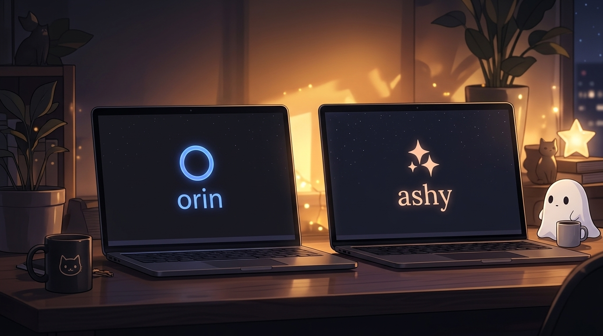

<div align="center">


# ✨ ASHY 1.0 ✨
### **Local-First Virtual Companion with Shared History, Persistent 4-Tier Affect, Realtime Omni Voice & Universal 2D Stage**
#### *Companheira Virtual Local-First com História Compartilhada, Afeto em 4 Camadas, Voz Omni em Tempo Real e Palco 2D Universal*

<br/>

<!-- LANGUAGE SWITCHER BUTTONS -->
[-10b981?style=for-the-badge&labelColor=064e3b)](#português-br)
[](#english)
[](./README.pt-BR.md)
[](./README.en.md)

<br/>

<!-- STATUS & TECH BADGES -->
[-f59e0b?style=flat-square&logo=rocket&logoColor=white)](./docs/ASHY_ROADMAP.md)
[](./docs/adr/0001-local-first-sqlite-cortex-and-dual-transport.md)
[-a855f7?style=flat-square&logo=ollama&logoColor=white)](./docs/PROVIDER_GUIDE.md)
[](./docs/adr/0002-six-memory-architecture-fsrs6-and-inside-joke-cooldown.md)
[_Click--Through-14b8a6?style=flat-square)](./docs/adr/0006-dual-mode-2d-stage-and-o1-cpu-click-through.md)
[](./docs/adr/0007-progressive-mcp-agency-3-tier-gatekeeper-and-security-hardening.md)
[](#quickstart--comandos-principais)
[](#)

<br/>

<!-- QUICK NAVIGATION PILL BUTTONS -->
[](#quickstart--comandos-principais)
[](./docs/USER_GUIDE.md)
[](./docs/PROVIDER_GUIDE.md)
[](./docs/ASHY_ARCHITECTURE_SPEC.md)
[](./docs/adr/)
[](./docs/ASHY_ROADMAP.md)

</div>

---

## 🖼️ Galeria Visual & Experiências da Ashy 1.0 / *Visual Showcase*

<div align="center">
<table>
  <tr>
    <td align="center" width="25%">
      <br/>
      <b>🌙 Cozy Night Studio</b><br/>
      <sub>Presença noturna em espaço de cor perceptual OKLCH/Oklab com iluminação ambiente sem auto-realimentação e <i>Retinal Light Squint</i>.</sub>
    </td>
    <td align="center" width="25%">
      <br/>
      <b>🎙️ Voz Omni & Lip-Sync</b><br/>
      <sub>Áudio 16kHz in &rarr; 24kHz <code>LiquidCodec</code> out (<code>LFM3-Omni-2B</code>), Turn-Taking CAS e Lip-Sync acústico <i>Winner + Runner-Up</i> (<code>A, E, I, O, U, S</code>).</sub>
    </td>
    <td align="center" width="25%">
      <br/>
      <b>🛡️ Seriousness Gate</b><br/>
      <sub>Detecção imediata de luto, crise ou urgência: suprime piadas internas e energia caótica para acolher você com calma.</sub>
    </td>
    <td align="center" width="25%">
      <br/>
      <b>🎭 Palco 2D & Overlay O(1)</b><br/>
      <sub>Tachie em camadas + Cubism 4 Live2D (<code>.model3.json</code>) e janela transparente <code>alwaysOnTop</code> com Click-Through em CPU $O(1)$.</sub>
    </td>
  </tr>
  <tr>
    <td align="center" width="25%">
      <br/>
      <b>✨ Nossa História</b><br/>
      <sub>Linha do tempo autobiográfica viva a partir do marco real <code>first_meeting</code> — zero memórias falsas ou semeadas.</sub>
    </td>
    <td align="center" width="25%">
      <br/>
      <b>😂 Piadas Internas</b><br/>
      <sub>Recuperação híbrida semântica + lexical com <code>CooldownLock</code> anti-saturação para callbacks espontâneos no momento certo.</sub>
    </td>
    <td align="center" width="25%">
      <br/>
      <b>🏆 Quarto da Ashy</b><br/>
      <sub>Troféus e lembranças visuais desbloqueados exclusivamente por marcos reais vividos em <code>autobiographical_milestones</code>.</sub>
    </td>
    <td align="center" width="25%">
      <br/>
      <b>💭 Dream &amp; Reflection</b><br/>
      <sub>Consolidação noturna <i>Predict &rarr; Calibrate</i> e evolução auditável dos 5 traços com <b>Reversão em 1 Clique</b>.</sub>
    </td>
  </tr>
</table>
</div>

---

<a id="português-br"></a>

# 🇧🇷 Português (BR) — Visão Geral da Ashy 1.0 (Marco M5 — Release 1.0)

> *"A Ashy não precisa lembrar de tudo. Precisa lembrar do que importa.*
> *Não precisa falar o tempo inteiro. Precisa saber quando faz sentido falar.*
> *Não precisa concordar com tudo. Precisa ter uma voz reconhecível.*
> *Não precisa fingir que é humana. Precisa ser uma boa companheira digital.*
> *E, acima de tudo, não deve evoluir simplesmente porque o tempo passou — deve evoluir porque alguma experiência significativa aconteceu."*

## 🌟 O que torna a Ashy única

**Ashy 1.0** é uma companheira virtual *local-first* para desktop (**Windows, macOS e Linux**) que **constrói, preserva e expressa uma história compartilhada** com o usuário — e **continua reconhecível mesmo quando o modelo principal de linguagem (LLM) é trocado**.

Em vez de prender sua identidade à janela de contexto efêmera de uma única API em nuvem, a Ashy separa **quem ela é** (**Ashy Cortex** em SQLite local `ashy.db` + pacote portátil **`.ashy-soul`**) de **qual modelo gera os tokens ou o áudio** (`LFM3-Omni-2B` local, Ollama, OpenRouter, Anthropic, OpenAI ou NVIDIA NIM):

| Diferencial | Como funciona na Ashy 1.0 |
| :--- | :--- |
| 🧠 **6 Memórias com Proveniência + FSRS-6** | Episódica, Semântica (`Predict -> Calibrate`), Autobiográfica (`Our Story`), Piadas Internas (`CooldownLock`), Prospectiva e Hábitos. Toda memória exige `source_episode_ids` reais (zero alucinações ou seeds). |
| 🔮 **Portabilidade da Alma (`.ashy-soul`) & Gate M2** | Compositor de prompt amigável a KV-Cache (`voice.md` + *Golden Dialogue Exemplars*). Troque do modelo A para o modelo B mantendo a voz, as referências e o humor, ou exporte/importe toda a alma com verificação `SHA-256`. |
| 🎙️ **Modo Omni Unificado (`LFM3-Omni-2B`) & Voz CAS** | Rode 1 único modelo local (`ollama run lfm3-omni:2b` ou `llama-server`) que recebe áudio `16kHz` direto + vídeo a `2 fps` (`dHash`) e responde com áudio `24kHz` (`LiquidCodec`) e `think: false`, ou use o modo modular (Whisper + LLM + Kokoro/ElevenLabs). |
| 🎭 **Palco Universal 2D & Click-Through $O(1)$** | Suporte nativo a **Live2D Cubism 4 (`.model3.json`)** e **Tachie em camadas**, lip-sync formante, mola a `120 Hz` e janela flutuante transparente (`alwaysOnTop`) com máscara de colisão `64x64` em CPU $O(1)$. |
| 🛡️ **Agência MCP em 3 Níveis & Privacidade Radical** | Descoberta progressiva com 3 meta-tools, **Action Gatekeeper** (`observe-only`, `read-safe`, `staged-confirm` com diff visual), criptografia em repouso `AES-256-GCM`, 6 atalhos globais (`Ctrl+Shift+M/E/D/H/Space/K`) e **Factory Reset em 1 Clique**. |

---

## 🧭 Fluxo Arquitetural Colorido (Mermaid)

```mermaid
flowchart LR
    subgraph User["👤 Usuário & Sensores"]
        Mic["🎙️ Mic 16kHz + RingBuffer 360ms"]
        Cam["👁️ Eyes / Vídeo 2fps (dHash 64-bit)"]
        Chat["⌨️ Texto & 6 Atalhos Globais"]
    end

    subgraph Host["🖥️ AshyHostKernel (Electron IPC + HTTP/SSE)"]
        Cortex["🧠 @ashy/cortex\nashy.db (SQLite + FTS5 + RRF)\nFSRS-6 + CooldownLock + AES-256-GCM"]
        Soul["✨ Soul Composer (KV-Cache)\nvoice.md + SeriousnessGate"]
        Orch["⚡ TurnOrchestrator\nTail-Safe <&#124;ACT&#124;> Parser"]
        Gate["🛡️ @ashy/agency\n3-Tier Gatekeeper + AuditLog"]
    end

    subgraph AI["🤖 Motores de IA (Intercambiáveis)"]
        Omni["🟣 Modo Omni Unificado\nLFM3-Omni-2B / GPT-4o Audio / Qwen 2.5 Omni"]
        Mod["🔵 Modo Modular\nOllama / OpenRouter / Anthropic + Whisper + Kokoro / ElevenLabs"]
    end

    subgraph Stage["🎭 @ashy/stage & UI"]
        Avatar["💃 Live2D Cubism 4 (.model3.json) & Tachie\nLip-Sync Formante + O(1) Click-Through"]
    end

    Mic & Cam & Chat --> Orch
    Orch <--> Cortex
    Cortex --> Soul
    Soul --> Orch
    Orch <--> Omni
    Orch <--> Mod
    Orch <--> Gate
    Orch --> Avatar

    style User fill:#1e1b4b,stroke:#818cf8,stroke-width:2px,color:#ffffff
    style Host fill:#064e3b,stroke:#10b981,stroke-width:2px,color:#ffffff
    style AI fill:#3b0764,stroke:#c084fc,stroke-width:2px,color:#ffffff
    style Stage fill:#4c0519,stroke:#f43f5e,stroke-width:2px,color:#ffffff
```



---

## 📦 Arquitetura do Monorepo

O repositório utiliza `pnpm` workspaces com **8 pacotes modulares** e **1 aplicação desktop**:

| Pacote / App | Caminho | Descrição Detalhada |
| :--- | :--- | :--- |
| 🟣 **`@ashy/shared`** | `packages/shared` | Contratos canônicos (Valibot), os 13 estados emocionais, modelos das 6 memórias, vetores afetivos em 4 camadas, protocolo `.ashy-soul` e segmentador de grafemas UTF-8 (`clustr`). |
| 🔵 **`@ashy/bus`** | `packages/bus` | Container de Injeção de Dependências funcional com ordenação topológica (`injeca`-style) + Barramento IPC/Worker/SSE tipado com orçamento de saltos (`hopsRemaining = 32`), deduplicação LRU e `lifetimeController` (`eventa`-style). |
| 🟢 **`@ashy/llm`** | `packages/llm` | Mini-SDK de LLM orientado a protocolo (`streamText` / `generateText` / `embed`), suporte multimodal Omni (`input_audio`, `image_url`, `video_frame`, `turn:audio-delta`), controle `reasoningEffort` (`'none'` default), parser incremental de `<|ACT|>`, `<|DELAY|>`, `<|CALLBACK|>` com retenção de cauda, categorizador `<think>` e ancoragem por sentinela `\uE000`. |
| 🟠 **`@ashy/cortex`** | `packages/cortex` | Coração cognitivo sobre SQLite local (`ashy.db` com `FTS5` BM25 + busca vetorial + **RRF** + curva de esquecimento **FSRS-6** com piso de *Flashbulb Memory*), criptografia em repouso `AES-256-GCM`, motor de **Piadas Internas** com `CooldownLock`, motor afetivo em 4 escalas com `SeriousnessGate`, consolidação ociosa **Dream & Reflection (`Predict -> Calibrate`)** reversível em 1 clique e **Soul Portability** (`.ashy-soul`). |
| 🩷 **`@ashy/voice`** | `packages/voice` | Pipeline de áudio em tempo real com Ring Buffer (`360ms` `HistoryLease`), Silero VAD ONNX, Turn-Taking humano (`VoiceEndJudge` aos `1200ms` com *Compare-And-Swap* + `3000ms` grace period + `SpeculativeRephrase` aos `600ms`), `MarkdownSegmenter`, *TTFA Boost Chunker* (`4..12` palavras nos 2 primeiros chunks), fila paralela 4x reordenada, `GaplessAudioPlayer`, **Barge-In em 2 fases** com `PlaybackReceipt` e áudio direto `directOmniAudio`. |
| 🩵 **`@ashy/stage`** | `packages/stage` | Palco 2D Dual-Mode (Tachie em camadas + Live2D Cubism 4 `.model3.json`), driver acústico de Lip-Sync *Winner + Runner-Up* (`A, E, I, O, U, S`), Auto-Blink multiplicativo (`BLINK_THRESHOLD = 0.15`), Saccades empíricas, mola semi-implícita a `120 Hz`, iluminação ambiente em **Oklab**, *Retinal Light Squint* e **Click-Through Desktop em CPU $O(1)$**. |
| 🔴 **`@ashy/agency`** | `packages/agency` | Controles físicos de privacidade (*Mic*, *Eyes*, *DND*, *Kill Switch*), filtro perceptual dHash 64-bit, *Progressive MCP Discovery* (3 meta-tools: `search_mcp_tools`, `get_mcp_tool_details`, `call_mcp_tool`) e **Action Gatekeeper** (`Observe != Prepare != Execute`) com `action_audit_log`. |
| 🟡 **`@ashy/evals`** | `packages/evals` | Bateria automatizada do **Experimento Central de Validação (Marco M2)**: simulação de convivência multi-dia com troca de modelo A &rarr; B, verificando recall, callbacks de piadas internas, zero memórias alucinadas e respeito ao `SeriousnessGate`. |
| 🖥️ **`apps/desktop`** | `apps/desktop` (`@ashy/desktop`) | Aplicação **React 19 + Electron + Tailwind/OKLCH** com `AshyHostKernel`, `ProviderVault` (`safeStorage`), **FirstMeetingWizard**, **Stage Overlay** flutuante transparente, **System Tray**, **Auto-Updater** e **Companion Hub** (*Estúdio*, *Memórias*, *Nossa História*, *Quarto da Ashy*, *Ajustes*). |

---

## 🚀 Instalação em 1 Comando / *One-Command Install*

Instale ou atualize a **Ashy** diretamente sem precisar clonar o repositório:

**Windows (PowerShell):**
```powershell
irm https://github.com/carlos-edu2367/ashy/releases/latest/download/install.ps1 | iex
```

**Linux (Bash):**
```bash
curl -fsSL https://github.com/carlos-edu2367/ashy/releases/latest/download/install.sh | bash
```

---

## ⚡ Quickstart & Comandos Principais

### Pré-requisitos
- **Node.js** `>= 22.6.0` (inclui `node:sqlite` nativo)
- **pnpm** `>= 10.x`
- *(Opcional para IA 100% Local)* **Ollama** (`ollama run lfm3-omni:2b`) ou **`llama-server`** (`LiquidAI/LFM3-Omni-2B-GGUF`)

### Comandos Prontos para Copiar

```bash
# 1. Instalar dependências do monorepo
pnpm install

# 2. Iniciar o ambiente de desenvolvimento (Host Kernel + UI em http://localhost:5173)
pnpm dev

# 3. Compilar o bundle de produção (Web + Electron Main/Preload)
pnpm build

# 4. Empacotar o aplicativo desktop descomprimido (electron-builder --dir)
pnpm --filter @ashy/desktop pack:dir

# 5. Rodar todos os testes unitários e de integração (Vitest)
pnpm test

# 6. Verificar tipagem estática em todo o monorepo (TypeScript)
pnpm typecheck

# 7. Rodar a bateria do Experimento Central de Validação — Marco M2 (Soul Portability)
pnpm eval:m2

# 8. Rodar a suíte completa End-to-End em navegador real (Playwright — 6 fluxos)
pnpm test:e2e
```

<details>
<summary>⌨️ <b>Clique para ver os 6 Atalhos Globais de Teclado (Desktop & Privacidade)</b></summary>
<br/>

| Atalho Global | Função | Comportamento |
| :--- | :--- | :--- |
| `Ctrl+Shift+M` | **Alternar Microfone (`Mic`)** | Liga ou silencia imediatamente a captura de microfone. |
| `Ctrl+Shift+E` | **Alternar Visão (`Eyes`)** | Liga ou desliga a captura autorizada de tela/janela. |
| `Ctrl+Shift+D` | **Alternar Não Perturbe (`DND`)** | Pausa ou libera iniciativas proativas da Ashy. |
| `Ctrl+Shift+H` | **Ocultar / Mostrar Avatar (`Hide Stage`)** | Esconde ou exibe o palco flutuante transparente (`Stage Overlay`). |
| `Ctrl+Shift+Space` | **Push-to-Talk / Turno de Voz** | Inicia ou sela imediatamente um turno de fala por voz. |
| `Ctrl+Shift+K` | **Escudo de Privacidade (`Kill Switch`)** | Corta em 1 clique `Mic = OFF`, `Eyes = OFF`, ativa `DND = ON`, para áudio/streams e cancela ações pendentes no Gatekeeper. |

</details>

---

## 📚 Documentação Completa e ADRs

### Guias de Uso e Configuração
- 📘 **[Guia do Usuário (`docs/USER_GUIDE.md`)](./docs/USER_GUIDE.md)** — Onboarding (`Zero-to-First-Conversation`), Estúdio (`Cozy Night Studio`), Voz e `SeriousnessGate`, Governança de Memórias FSRS-6, Nossa História, Piadas Internas (`CooldownLock`), Quarto da Ashy, *Dream & Reflection* (reversão em 1 clique), Palco 2D Live2D/Tachie, Overlay $O(1)$ Click-Through, Bandeja do Sistema, 6 Atalhos Globais, Portabilidade `.ashy-soul`, Criptografia `AES-256-GCM` e Factory Reset em 1 Clique.
- 🤖 **[Guia de Provedores e IA Local (`docs/PROVIDER_GUIDE.md`)](./docs/PROVIDER_GUIDE.md)** — Configuração passo a passo do `LFM3-Omni-2B` no Ollama (`http://127.0.0.1:11434`) e `llama-server` (`http://127.0.0.1:8080/v1`), modos `native-omni` / `hybrid-omni-in` / `modular`, provedores Cloud (`gpt-4o-audio-preview`, `Qwen 2.5 Omni 7B`, `Gemini 2.5 Flash`, OpenRouter, Anthropic, OpenAI, NVIDIA NIM) e motores STT/TTS (`faster-whisper-server`, `whisper.cpp`, Groq Whisper, OpenAI Audio, Kokoro-FastAPI, Piper HTTP, ElevenLabs e Web Speech API).

### Documentos de Engenharia e Arquitetura
- 🏛️ **[Especificação de Arquitetura (`docs/ASHY_ARCHITECTURE_SPEC.md`)](./docs/ASHY_ARCHITECTURE_SPEC.md)**
- 🗺️ **[Roadmap por Fases (`docs/ASHY_ROADMAP.md`)](./docs/ASHY_ROADMAP.md)** *(Fase 9 — Marco M5 Release 1.0 ✅ Concluída)*
- 🧭 **[Contexto e Visão do Produto (`docs/ASHY_PROJECT_CONTEXT.md`)](./docs/ASHY_PROJECT_CONTEXT.md)**
- 🧪 **[Plano de Implementação TDD (`docs/superpowers/plans/2026-10-28-ashy-v1-foundation.md`)](./docs/superpowers/plans/2026-10-28-ashy-v1-foundation.md)**
- 🔬 **[Estudo de Caso Forense: Ecossistema `moeru-ai` (`docs/MOERU_AI_CASE_STUDY.md`)](./docs/MOERU_AI_CASE_STUDY.md)**
- 🧬 **[Blueprint de Receitas Absorvidas e Corrigidas (`docs/MOERU_AI_ABSORPTION_RECIPES.md`)](./docs/MOERU_AI_ABSORPTION_RECIPES.md)**

### 📜 Architecture Decision Records (`docs/adr/`)
- 📂 **[Diretório de ADRs (`docs/adr/`)](./docs/adr/)**
  1. **[ADR-0001](./docs/adr/0001-local-first-sqlite-cortex-and-dual-transport.md):** Córtex Local-First em SQLite (`node:sqlite`), Criptografia `AES-256-GCM` Opcional e Transporte Dual (Electron IPC + HTTP/SSE)
  2. **[ADR-0002](./docs/adr/0002-six-memory-architecture-fsrs6-and-inside-joke-cooldown.md):** Arquitetura de 6 Memórias com Proveniência Obrigatória, Curva de Esquecimento FSRS-6 e Motor de Piadas Internas com `CooldownLock`
  3. **[ADR-0003](./docs/adr/0003-soul-portability-kv-cache-prompt-and-m2-eval-gate.md):** Portabilidade da Alma (`.ashy-soul`), Prompt Amigável a KV-Cache, Parser Tail-Safe e Gate de Avaliação M2
  4. **[ADR-0004](./docs/adr/0004-four-tier-affect-engine-and-seriousness-gate.md):** Motor Afetivo em 4 Escalas Temporais, `SeriousnessGate` Híbrido e Evolução Auditável/Reversível (*Dream & Reflection*)
  5. **[ADR-0005](./docs/adr/0005-realtime-voice-cas-turn-taking-and-unified-omni-lfm3.md):** Voz em Tempo Real com Turn-Taking CAS, Barge-In com `PlaybackReceipt` e Arquitetura Multimodal Omni Unificada (`LFM3-Omni-2B`)
  6. **[ADR-0006](./docs/adr/0006-dual-mode-2d-stage-and-o1-cpu-click-through.md):** Palco 2D Dual-Mode (Tachie + Cubism 4 Live2D), Lip-Sync Acústico, Iluminação Oklab e Click-Through Desktop em CPU $O(1)$
  7. **[ADR-0007](./docs/adr/0007-progressive-mcp-agency-3-tier-gatekeeper-and-security-hardening.md):** Agência Progressiva MCP (3 Meta-Tools), Gatekeeper em 3 Níveis, Visão Deduplicada por `dHash` e Endurecimento de Segurança

---
---

<a id="english"></a>

# 🇺🇸 English — Ashy 1.0 Overview (Milestone M5 — Release 1.0)

<div align="center">

[-10b981?style=for-the-badge)](#português-br)
[](./README.en.md)

</div>

> *"Ashy doesn't need to remember everything. She needs to remember what matters.*
> *She doesn't need to talk all the time. She needs to know when it makes sense to speak.*
> *She doesn't need to agree with everything. She needs to have a recognizable voice.*
> *She doesn't need to pretend to be human. She needs to be a great digital companion.*
> *And above all, she must not evolve simply because time passed — she must evolve because a meaningful shared experience happened."*

## 🌟 What Makes Ashy 1.0 Unique

**Ashy 1.0** is a *local-first* desktop digital companion (**Windows, macOS, and Linux**) engineered to **build, preserve, and express a shared history** with you — while **remaining unmistakably recognizable even when the underlying LLM is swapped**.

Instead of tying her identity to a single cloud vendor's ephemeral context window, Ashy decouples **who she is** (**Ashy Cortex** backed by local SQLite `ashy.db` + portable **`.ashy-soul`** archives) from **which model generates tokens or audio** (`LFM3-Omni-2B` local, Ollama, OpenRouter, Anthropic, OpenAI, or NVIDIA NIM):

| Core Pillar | How Ashy 1.0 Delivers It |
| :--- | :--- |
| 🧠 **6-Layer Memory with Provenance + FSRS-6** | Episodic, Semantic (`Predict -> Calibrate`), Autobiographical (`Our Story`), Inside-Joke Motifs (`CooldownLock`), Prospective Intents, and User Habits. Every memory requires real `source_episode_ids` (zero hallucinated or seeded memories). |
| 🔮 **Soul Portability (`.ashy-soul`) & M2 Gate** | KV-Cache-friendly prompt composer (`voice.md` + *Golden Dialogue Exemplars*). Swap from Model A to Model B mid-journey while keeping her voice, callbacks, and affect — or export/import her entire soul with `SHA-256` verification. |
| 🎙️ **Unified Omni Mode (`LFM3-Omni-2B`) & CAS Voice** | Run a single local multimodal model (`ollama run lfm3-omni:2b` or `llama-server`) taking direct `16kHz` mic audio + `2 fps` `dHash`-deduplicated video frames and streaming `24kHz` `LiquidCodec` audio with `think: false` — or mix modular STT/LLM/TTS providers. |
| 🎭 **Universal 2D Stage & $O(1)$ Click-Through** | Dual-mode **Live2D Cubism 4 (`.model3.json`)** and **Layered Tachie**, formant lip-sync (`A, E, I, O, U, S`), `120 Hz` spring physics, and a transparent `alwaysOnTop` floating overlay with $O(1)$ CPU `64x64` bitmask hit-testing. |
| 🛡️ **3-Tier MCP Agency & Radical Privacy** | Progressive MCP discovery via 3 meta-tools, **Action Gatekeeper** (`observe-only`, `read-safe`, `staged-confirm` with visual diffs), optional `AES-256-GCM` encryption at rest, 6 global OS shortcuts (`Ctrl+Shift+M/E/D/H/Space/K`), and **1-Click Factory Reset**. |

## 📦 Monorepo Package Architecture

- **`@ashy/shared`** (`packages/shared`): Canonical Valibot schemas, 13 emotional states, 6-memory data contracts, 4-tier affect vectors, `.ashy-soul` archive schemas, and UTF-8 grapheme segmentation (`clustr`).
- **`@ashy/bus`** (`packages/bus`): Functional Dependency Injection container with topological sorting (`injeca`-style) + typed IPC/Worker/SSE event bus with hop budgeting (`hopsRemaining = 32`), LRU deduplication, and `lifetimeController`.
- **`@ashy/llm`** (`packages/llm`): Protocol-oriented LLM mini-SDK (`streamText`, `generateText`, `embed`), unified Omni adapters (`input_audio`, `image_url`, `video_frame`, `turn:audio-delta`), `reasoningEffort` control (`'none'` default), tail-safe incremental `<|ACT|>`, `<|DELAY|>`, `<|CALLBACK|>` parser, `<think>` categorizer, and `\uE000` sentinel anchoring.
- **`@ashy/cortex`** (`packages/cortex`): Local SQLite cognitive core (`node:sqlite` / `ashy.db`), `AES-256-GCM` encryption at rest, hybrid `FTS5` BM25 + vector + **RRF** ranker, **FSRS-6** forgetting curve with *Flashbulb Memory* retention floor, **Inside-Joke Engine** with `CooldownLock`, 4-tier affect engine with `SeriousnessGate`, **Dream & Reflection (`Predict -> Calibrate`)** with 1-click trait revert, and **Soul Portability** (`.ashy-soul`).
- **`@ashy/voice`** (`packages/voice`): Realtime audio pipeline with `360ms` `HistoryLease` Ring Buffer, Silero VAD ONNX, Compare-And-Swap (CAS) Turn-Taking (`VoiceEndJudge` at `1200ms` + `3000ms` grace period + `SpeculativeRephrase` at `600ms`), `MarkdownSegmenter`, *TTFA Boost Chunker*, 4x parallel ordered TTS queue, 2-phase **Barge-In** with exact `PlaybackReceipt`, and `directOmniAudio`.
- **`@ashy/stage`** (`packages/stage`): Dual-Mode 2D Stage (Layered Tachie + Cubism 4 Live2D `.model3.json`), *Winner + Runner-Up* formant lip-sync, multiplicative auto-blink (`BLINK_THRESHOLD = 0.15`), empirical saccades, `120 Hz` semi-implicit springs, **Oklab** ambient lighting with *Retinal Light Squint*, and **$O(1)$ CPU Desktop Click-Through**.
- **`@ashy/agency`** (`packages/agency`): Hardware-style privacy switches (*Mic*, *Eyes*, *DND*, *Kill Switch*), 64-bit perceptual `dHash` frame filter, *Progressive MCP Discovery* (3 meta-tools), stdio/HTTP MCP client, and **Action Gatekeeper** (`Observe != Prepare != Execute`) with `action_audit_log`.
- **`@ashy/evals`** (`packages/evals`): Automated **Milestone M2 Validation Harness** testing multi-day shared history, mid-journey model swaps (Model A &rarr; Model B), recall precision, inside-joke cooldowns, zero hallucinated memories, and `SeriousnessGate` compliance.
- **`apps/desktop`** (`@ashy/desktop`): **Electron + React 19 + Vite + Zustand + Tailwind/OKLCH** desktop application featuring `AshyHostKernel`, `ProviderVault` (`safeStorage`), `FirstMeetingWizard`, transparent **Floating Stage Overlay**, **System Tray**, **Auto-Updater**, and the 5-tab **Companion Hub**.

## 🚀 One-Command Install & Quickstart Commands (English)

**Windows (PowerShell):**
```powershell
irm https://github.com/carlos-edu2367/ashy/releases/latest/download/install.ps1 | iex
```

**Linux (Bash):**
```bash
curl -fsSL https://github.com/carlos-edu2367/ashy/releases/latest/download/install.sh | bash
```

**Developer Workspace Commands:**

```bash
pnpm install                          # Install all workspace dependencies
pnpm dev                              # Launch Host Kernel + React Studio UI (http://localhost:5173)
pnpm build                            # Build production web & Electron main/preload bundles
pnpm --filter @ashy/desktop pack:dir  # Package unpacked desktop app via electron-builder
pnpm --filter @ashy/desktop dist:win  # Build AshySetup.exe & AshyPortable.exe on Windows
pnpm test                             # Run full unit & integration test suite (Vitest)
pnpm typecheck                        # Run strict TypeScript typechecking across all packages
pnpm eval:m2                          # Run Milestone M2 Soul Portability evaluation suite
pnpm test:e2e                         # Run the 6 real-browser Playwright E2E flows
```

### 🔗 Essential Links
- 📘 [End-User Guide (`docs/USER_GUIDE.md`)](./docs/USER_GUIDE.md)
- 🤖 [Provider & Local AI Guide (`docs/PROVIDER_GUIDE.md`)](./docs/PROVIDER_GUIDE.md)
- 🏛️ [Architecture Specification (`docs/ASHY_ARCHITECTURE_SPEC.md`)](./docs/ASHY_ARCHITECTURE_SPEC.md)
- 🗺️ [Phased Roadmap (`docs/ASHY_ROADMAP.md`)](./docs/ASHY_ROADMAP.md)
- 📜 [Architecture Decision Records (`docs/adr/0001..0007`)](./docs/adr/)
