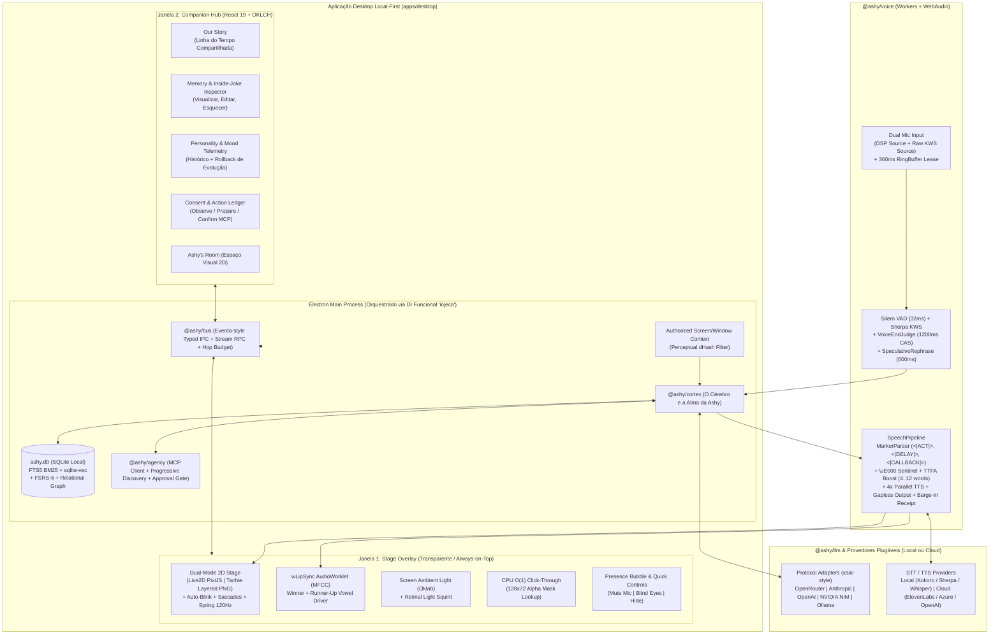
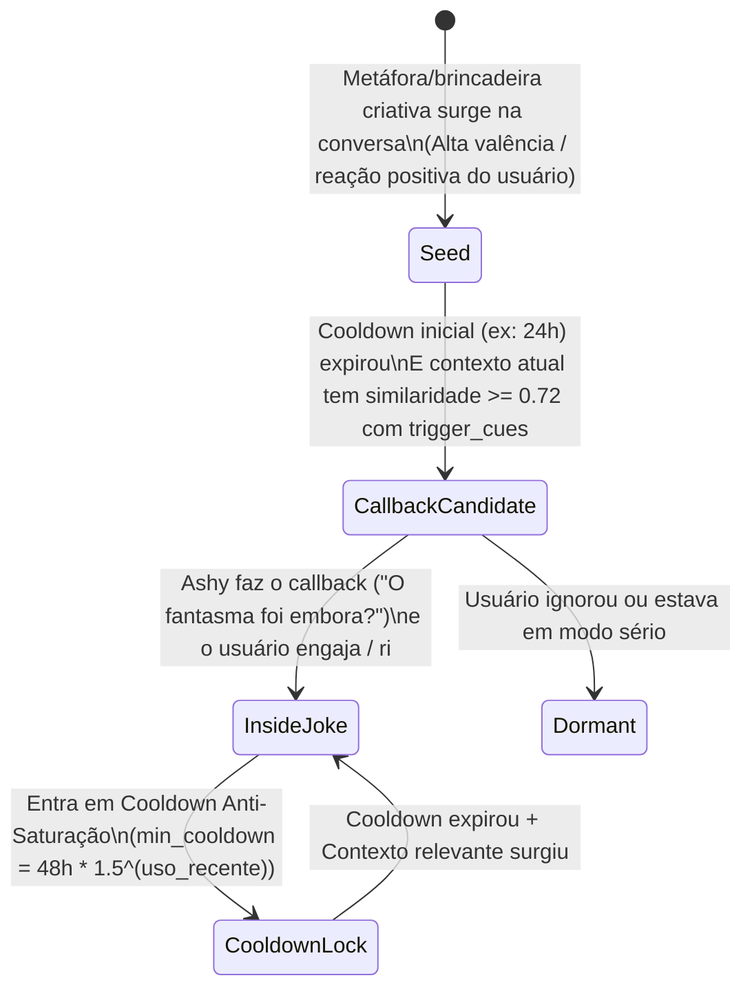

# ASHY — Especificação de Arquitetura e Design de Sistema (`v1.0-spec`)

> [!IMPORTANT]
> **Propósito deste Documento:** Traduzir a visão conceitual de [`ASHY_PROJECT_CONTEXT.md`](file:///c:/Users/User/Downloads/ASHY_PROJECT_CONTEXT.md) em uma arquitetura de engenharia completa para o repositório [`carlos-edu2367/ashy`](https://github.com/carlos-edu2367/ashy), absorvendo as melhores primitivas auditadas no ecossistema `moeru-ai` (e corrigindo seus gargalos de produção).

---

## 1. Decisões de Fundação (Alinhadas)

| Dimensão | Decisão Arquitetural | Justificativa Técnica |
| :--- | :--- | :--- |
| **Runtime & Persistência** | **Monorepo TypeScript + Electron + SQLite Local (`better-sqlite3` + `sqlite-vec` + `FTS5`)** | 100% *Local-First* em um único arquivo `ashy.db` (zero Docker, zero Postgres externo). Une busca léxica BM25 (`FTS5`), busca vetorial (`sqlite-vec`) e grafo relacional em queries de `< 2ms` no processo Main do Electron. |
| **Front-end & UI** | **React 19 + TypeScript + Vite + Zustand + Tailwind CSS (OKLCH)** | UI reativa moderna dividida em 2 janelas: **Stage Overlay** (avatar transparente no canto da tela) e **Companion Hub** (*Our Story*, *Memory Inspector*, *Ashy's Room*, *Permissions & MCP*). |
| **Corpo Digital (V1)** | **Dual-Mode 2D (`Live2D Cubism 4` + `Tachie Layered PNG`) com contrato aberto p/ 3D VRM** | Permite testar expressões, piscadas e lip-sync *Winner+Runner-Up* desde o Dia 1 com camadas PNG, e carregar qualquer modelo `.moc3`/`.model3.json` Live2D sem mudar uma linha do Cortex. |
| **Temperamento Base ($\mathbf{p}_0$)** | **Energética, Provocadora, Espirituosa e Caótica (Estilo *Neuro-sama*) + *Seriousness Gate*** | Rejeita 100% o tom passivo de "assistente". Tem opiniões próprias, humor afiado, *banter* rápido e iniciativa, mas possui uma **válvula de contexto** que reduz o caos/sarcasmo imediatamente quando detecta assuntos sérios ou urgentes. |
| **Escopo do MVP (V1)** | **Vertical Slice do Diferencial Central** | `Ashy Cortex` (6 memórias + Piadas Internas + FSRS-6 + *Dream & Reflection*) + *Our Story* + Voz em Tempo Real com *Barge-in* + Avatar 2D Desktop com Click-Through $O(1)$ + MCP com aprovação explícita. |

---

## 2. Arquitetura Macro do Sistema e Estrutura do Monorepo



### Estrutura de Diretórios do Repositório (`carlos-edu2367/ashy`)

```text
ashy/
├── apps/
│   └── desktop/                  # App Electron (Main + Preload + Stage Renderer + Hub Renderer)
├── packages/
│   ├── bus/                      # Barramento IPC/Worker/WS tipado (inspirado em @moeru/eventa) + DI funcional (injeca)
│   ├── llm/                      # Mini-SDK de LLM orientado a protocolo (<6KB, inspirado em @xsai/*)
│   ├── cortex/                   # Ashy Cortex: 6 Memórias, Piadas Internas, FSRS-6, Emoções 4-Níveis, Dream Worker
│   ├── voice/                    # Pipeline de Áudio: RingBuffer, VAD, KWS, EndJudge CAS, TTFA Chunker, Barge-In
│   ├── stage/                    # Componentes React + PixiJS: Live2D, Tachie 2D, wLipSync, Spring 120Hz, Oklab Light
│   ├── agency/                   # Integração MCP (Progressive Discovery) + Gatekeeper (Observe / Prepare / Confirm)
│   └── shared/                   # Schemas (Valibot), tipos canônicos de Emoções, Contratos e Utilitários (clustr)
├── assets/
│   ├── default-avatar/           # Avatar Tachie em camadas + modelo Live2D open-source inicial da Ashy
│   └── audio-fixtures/           # Arquivos .wav para testes determinísticos de voz (fakemic)
└── docs/
    ├── adr/                      # Architecture Decision Records
    └── ASHY_ARCHITECTURE_SPEC.md # Especificação viva do projeto
```

---

## 3. `Ashy Cortex`: Como Construímos Continuidade, Vínculo e Emoções Persistentes

O **Ashy Cortex** (`packages/cortex`) resolve a principal limitação que encontramos na auditoria do `moeru-ai/airi`: no AIRI, a memória cognitiva (`plast-mem`) estava desconectada da UI e as emoções não duravam de um turno para o outro. Na **Ashy**, memória, afeto e identidade formam **um único circuito fechado**.

### 3.1. Arquitetura das 6 Memórias no `ashy.db` (SQLite + `sqlite-vec` + `FTS5`)

Todas as memórias residem localmente no `ashy.db` e podem ser inspecionadas, editadas ou apagadas pelo usuário na aba **Memory Inspector** e **Our Story**:

| Tipo de Memória | Tabela SQLite | Como é Criada e Atualizada | Como é Recuperada |
| :--- | :--- | :--- | :--- |
| **1. Episódica** *(O que vivemos)* | `episodic_memories` + `episodic_fts` + `episodic_vec` | Segmentação em 3 estágios (fronteira *soft* $\ge 30\text{m}$, *hard* $> 3\text{h}$) resumindo acontecimentos, problemas resolvidos e momentos marcantes com flag `is_flashbulb`. | Busca híbrida **BM25 (`FTS5`) + Cosine (`sqlite-vec`)** fundida por **RRF** e multiplicada pela curva de esquecimento **FSRS-6**. |
| **2. Semântica** *(Quem é o usuário)* | `semantic_facts` | Consolidação **Predict $\rightarrow$ Calibrate** (só grava quando há *erro de predição* / novidade). Suporta `new`, `reinforce`, `update` (`invalid_at`) e `invalidate`. | Índice compacto no prompt + busca por entidade/projeto ativo. |
| **3. Relacional** *(Piadas internas e referências)* | `relational_motifs` | Detector de *Shared Motifs* identifica metáforas engraçadas, apelidos aceitos e momentos de alta valência/risada mútua. | **Injeção seletiva governada por Relevância Semântica + Cooldown Anti-Saturação** (ver Seção 3.2). |
| **4. Autobiográfica** *(A história da própria Ashy)* | `autobiographical_milestones` | Registra marcos da relação (*"Dia em que nos conhecemos"*, *"Primeiro bug cabeludo que matamos às 3h da manhã"*, mudanças de traços). | Alimenta a tela **Our Story** e ancora a identidade da Ashy em longo prazo. |
| **5. De Hábitos** *(Como o usuário funciona)* | `user_habits` | Observação de padrões recorrentes (horários de foco, preferência por respostas diretas quando está debugando vs. papo solto à noite). | Modula automaticamente a **Iniciativa Contextual** e o tamanho das respostas da Ashy. |
| **6. Prospectiva** *(Planos e retornos futuros)* | `prospective_intents` | Extraída quando o usuário menciona algo futuro (*"Amanhã tenho deploy"*, *"Me lembra de testar a API sexta"*) com `trigger_at` ou `trigger_context`. | Avaliada pelo loop de atenção no início da sessão ou no horário agendado para puxar assunto espontaneamente. |

---

### 3.2. O Motor de Piadas Internas (`Inside-Joke Lifecycle & Anti-Saturation Gate`)

Para realizar exatamente o exemplo do *"fantasma no backend / padre no npm"* descrito no contexto do projeto **sem que a Ashy fique repetindo a piada mecanicamente em toda frase**, implementamos uma máquina de estados com **Cooldown Dinâmico**:



- **Por que isso evita a repetição artificial?**
  - Enquanto uma piada está em `CooldownLock`, ela **nem sequer é injetada no contexto do turno do LLM**! O LLM literalmente só recebe a referência compartilhada no bloco `[Available Shared References (Use ONLY if naturally fitting)]` quando:
    1. O tempo desde o último uso é maior que `cooldown_hours`; **E**
    2. O assunto atual tem conexão semântica com os `trigger_cues` da piada; **E**
    3. O *Seriousness Gate* indica que o momento atual permite brincadeira.

---

### 3.3. Sistema Afetivo e de Personalidade em 4 Escalas Temporais

Diferente do AIRI (onde a emoção dura apenas uma frase), o `Ashy Cortex` modela o estado interno em **4 camadas acopladas**, mas **100% transparentes e auditáveis**:

1. **Camada 1 — Emoção Momentânea ($\mathbf{e}_{\text{moment}}$, escala de segundos):**
   - Emitida inline pelo LLM via `<|ACT {"emotion": "smug", "intensity": 0.85, "motion": "tease"}|>` e sincronizada na trilha de áudio pelo caractere sentinela `\uE000`.
   - Vocabulário expandido para a personalidade da Ashy: `happy`, `excited`, `smug` (convencida/irônica), `tease` (provocadora), `chaotic` (caótica/travessa), `curious`, `think`, `surprised`, `awkward`, `concerned` (preocupada/cuidadosa), `sad`, `angry`, `neutral`.
2. **Camada 2 — Humor da Sessão ($\mathbf{m}_{\text{session}} \in [-1, 1]^3$, escala de minutos/horas):**
   - Vetor tridimensional **[Valência $V$, Energia/Ativação $A$, Brincadeira/Seriedade $P$]** que decai exponencialmente de volta ao ponto de repouso da Ashy ($\mathbf{m}_0 = [+0.35, +0.65, +0.60]$, refletindo sua natureza energética e provocadora):
     $$\mathbf{m}(t) = \mathbf{m}_0 + \big(\mathbf{m}(t_{\text{prev}}) - \mathbf{m}_0\big) \cdot 2^{-\Delta t / \tau_{1/2}} + \Delta\mathbf{m}_{\text{turno}}$$
3. **Camada 3 — *Seriousness & Context Gate* (Válvula de Segurança Empática):**
   - Antes de montar o prompt do turno, um classificador ultraleve avalia o input do usuário. Se detectar **frustração real, desabafo emocional, cansaço extremo ou urgência crítica de trabalho**, a componente de Brincadeira/Provocação $P(t)$ sofre um *clamp* imediato para $\le 0.15$.
   - Isso muda a instrução de tom no turno: a Ashy larga o sarcasmo/caos na hora e assume sua faceta observadora, parceira e cuidadosa, sem perder sua voz própria.
4. **Camada 4 — Evolução de Personalidade Auditável e Reversível ($\mathbf{p}_{\text{traits}}$, escala de semanas):**
   - Traços contínuos (`wit_sarcasm`, `chaos_energy`, `warmth_affection`, `intellectual_curiosity`, `proactivity`) **nunca mudam por simples passagem de tempo**.
   - Eles só sofrem pequenos deltas ($\pm 0.02$ a $\pm 0.05$) durante o ciclo de **Dream & Reflection** quando um episódio significativo justifica a mudança — gerando um registro em `personality_evolution_log` com `{ id, trait, old_value, new_value, reason_episode_id, explanation }`.
   - Na tela **Personality & Mood** do Hub, o usuário vê exatamente *por que* a Ashy ficou mais ácida ou mais carinhosa e pode clicar em **"Revert Change"** a qualquer momento.

---

### 3.4. Como Garantimos que Trocar de LLM Não Apague a Ashy (*Soul Portability*)

Para vencer o **Experimento Central de Validação** (Seção 14 de `ASHY_PROJECT_CONTEXT.md`), a identidade da Ashy não depende do "jeito padrão" de nenhum LLM:
1. **Banco de *Golden Dialogue Exemplars* (`style_exemplars`):**
   - O `ashy.db` guarda ~6 turnos curtos canônicos (e turnos reais passados favoritados/bem-sucedidos com o usuário) que demonstram exatamente o ritmo, as tiradas rápidas, as tags `<|ACT|>` e o vocabulário da Ashy.
   - Esses exemplos são injetados como *few-shot turns* fixos no prefixo cacheável para calibrar qualquer modelo (seja Claude, GPT, Gemini, DeepSeek ou Llama local).
2. **Filtro Anti-Assistente (*Anti-Slop Guard*):**
   - O prompt proíbe explicitamente clichês de assistente (*"Como posso ajudar hoje?"*, *"Ótima pergunta!"*, listas de tópicos em conversa casual) e instrui a Ashy a responder com fala humana direta.

---

## 4. Pipeline de Voz em Tempo Real e Avatar 2D Dual-Mode

### 4.1. Conversação por Voz de Baixa Latência (`@ashy/voice`)
Absorvemos integralmente a arquitetura de áudio de ponta do `moeru-ai`, já livre dos bugs identificados no nosso Red-Team:
- **Entrada Dupla (`AudioWorklet` com Zero-Copy Transferable):**
  - `source` (AEC/NS/AGC ligados) $\rightarrow$ Silero VAD (`32ms` window) + STT streaming.
  - `rawSource` (sem DSP) $\rightarrow$ Wake Word (`"Ashy"` / `"Hey Ashy"`) com reset do decoder a cada `500ms` de silêncio.
  - **Ring Buffer com `HistoryLease` de `360ms`** cravado no exato milissegundo do *speech-onset* (antes do fade-out de `100ms` do *barge-in*).
- **Paciência Humana (`VoiceEndJudge` + CAS):**
  - Aos `1200ms` de pausa, consulta um modelo rápido para saber se a frase terminou (`complete: true/false`), validando na volta via *Compare-And-Swap* se nenhuma nova sílaba entrou no STT. Se incompleta, estende a espera em `+3000ms`.
  - Aos `600ms` de pausa, já dispara o `SpeculativeRephrase` em background para ter texto limpo em `0ms` ao fechar o turno.
- **Saída com *TTFA Boost* e *Barge-In Receipt*:**
  - Os 2 primeiros chunks de fala cortam na primeira vírgula/pausa após `4 palavras` (máx. `12 palavras`), fazendo a Ashy começar a falar em **~300ms**.
  - Até `4` chunks são sintetizados em paralelo e agendados de forma *gapless* no `AudioContext.currentTime`.
  - Se o usuário interromper a Ashy no meio da frase: o áudio faz fade-out linear em `100ms`, o hardware reporta o `PlaybackReceipt` (`throughMs` = exatamente até qual palavra o usuário ouviu), e o turno seguinte recebe `[Interrupted after 2.4s — user only heard: "Eu acho que esse código..."]` para que a Ashy possa reagir à interrupção com naturalidade (*"Ei! Eu nem terminei de falar!"* ou *"Tá, tá, mudando de assunto..."*)!

### 4.2. Corpo Digital 2D Dual-Mode (`@ashy/stage`)
1. **Modo `TachieLayeredRenderer` (PNG Tuber Avançado — Pronto no Dia 1):**
   - Composto por camadas independentes no PixiJS: ` base_body `, ` eyes (open / half / closed) `, ` brows (normal / smug / angry / sad / surprised) `, ` mouth (closed / A / E / I / O / U) ` e ` accessories/fx `.
   - Guiado exatamente pelos mesmos motores matemáticos do Live2D: Auto-Blink multiplicativo (`75ms` fechar / `150-300ms` abrir), Lip-Sync *Winner + Runner-Up* (`wlipsync` MFCC), respiração senoidal assimétrica (`42%` inspira, `46%` expira, `12%` pausa) e mola semi-implícita a `120 Hz` que dá um leve *bounce* físico quando ela começa a falar ou ri.
2. **Modo `Live2DRenderer` (Cubism 4 `.model3.json`):**
   - Suporte completo a modelos Live2D com inspeção automática do `.zip`/`.model3.json` para injetar as expressões disponíveis no prompt da Ashy, sequestro de `ParamEyeBallX/Y` em idle para sacadas oculares naturais, Iluminação Ambiente em **Oklab** sem auto-realimentação e *Light Squint* biológico.
3. **Click-Through Desktop em CPU $O(1)$:**
   - Na janela transparente do Electron (`Stage Overlay`), o teste de mouse usa um bitmap de silhueta `128x72` em memória RAM (atualizado a `4 Hz`), decidindo em `< 0.001ms` se o cursor está sobre o corpo da Ashy ou sobre área transparente (`setIgnoreMouseEvents(true, { forward: true })`), **sem jamais chamar `gl.readPixels` no `mousemove`**.

---

## 5. Uso do Computador, Privacidade e Ferramentas MCP (`@ashy/agency`)

Para respeitar o princípio *"observar é diferente de agir; preparar uma ação é diferente de confirmá-la"*:

1. **Controles Físicos Imediatos na Janela do Avatar:**
   - 3 botões sempre acessíveis no hover da Ashy (e via atalhos globais):
     - **Mic Toggle:** Mudo / Escuta contínua / Push-to-Talk.
     - **Eyes Toggle (Observação de Tela):** Desligado (padrão) / Apenas janela selecionada / Tela ativa.
     - **Do Not Disturb (Silêncio Proativo):** Impede qualquer iniciativa espontânea sem o usuário falar primeiro.
2. **Progressive MCP Discovery:**
   - A Ashy pode se conectar a qualquer servidor MCP local (arquivos, Git, navegador, terminal), mas o prompt principal só carrega as 3 meta-ferramentas (`search_mcp_tools`, `get_mcp_tool_details`, `call_mcp_tool`), mantendo o prompt enxuto e rápido.
3. **Gatekeeper de Ações em 3 Níveis (`Observe` / `Prepare` / `Execute`):**
   - Toda ferramenta MCP é classificada por política de risco:
     - `read-safe`: executa após autorização do escopo (ex.: ler arquivo da pasta do projeto autorizado).
     - `write-staged` / `sensitive`: a chamada da tool **não executa a ação imediatamente**; ela cria um `PendingActionCard` na UI (e no balão da Ashy) mostrando exatamente o que será feito (ex.: comando, caminho do arquivo, diff) com botões **Aprovar (1x)**, **Aprovar na Sessão** ou **Recusar**. Tudo fica gravado no `action_audit_log` do `ashy.db`.

---

## 6. Experiências de Continuidade no Companion Hub

1. **Our Story (Linha do Tempo Viva):**
   - Visualização cronológica de marcos autobiográficos, piadas internas nascidas (`Seed` $\rightarrow$ `Inside Joke`), projetos acompanhados e momentos *Flashbulb*, com busca e edição direta.
2. **Dream & Reflection (Consolidação Ociosa):**
   - Roda quando a sessão encerra ou após inatividade prolongada (ou sob comando manual no Hub). Executa o pipeline **Predict $\rightarrow$ Calibrate** (extraindo apenas o que surpreendeu ou mudou em relação ao que a Ashy já sabia), atualiza a estabilidade **FSRS-6** das memórias usadas na conversa (`again`, `hard`, `good`, `easy`) e propõe pequenos ajustes justificados de personalidade, **sem jamais inventar vivências falsas**.
3. **Ashy's Room (Fundação V1 $\rightarrow$ Expansão V2):**
   - Na V1, o fundo do Hub/Stage reflete o horário local (manhã, tarde, noite, madrugada) e exibe pequenos itens/troféus desbloqueados por marcos reais da tabela `autobiographical_milestones` (ex.: um post-it ou objeto na mesa representando o primeiro projeto ou piada interna de vocês).

---

## 7. Revisão e Aprovação da Especificação

Esta especificação cobre toda a fundação arquitetural da **Ashy**.
- Você aprova esta especificação (`ASHY_ARCHITECTURE_SPEC.md`) para avançarmos para a etapa de **Plano de Implementação (`writing-plans`)**, ou gostaria de ajustar algum detalhe de design antes?
