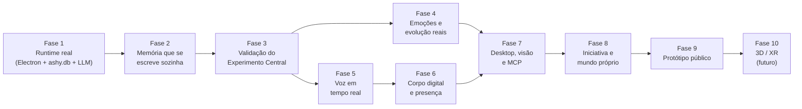

# ASHY — Roadmap por Fases

> **Propósito:** definir o caminho, em fases verificáveis, entre o estado atual do repositório e o objetivo final descrito em [`ASHY_PROJECT_CONTEXT.md`](./ASHY_PROJECT_CONTEXT.md): uma companheira digital que **constrói, preserva e expressa uma história compartilhada** e que **continua reconhecível quando o modelo de linguagem é trocado**.
>
> Este documento complementa a [Especificação de Arquitetura](./ASHY_ARCHITECTURE_SPEC.md) e o [Plano TDD v1](./superpowers/plans/2026-10-28-ashy-v1-foundation.md). Aqueles documentos descrevem *como* cada motor funciona; este define *em que ordem* eles viram um produto real e *como saber* que cada fase terminou.

**Data da análise base:** 2026-10-28 · **Commit base:** `1eba1df`

---

## 1. Ponto de partida (estado verificado)

A base de engenharia é sólida: ~20k linhas TypeScript em 7 pacotes + 1 app, `pnpm test` (99 testes), `pnpm typecheck` e `pnpm build` passando. Porém, **a aplicação é uma demonstração roteirizada**: os motores existem isolados, mas o circuito *conversar → lembrar → reencontrar* não está fechado.

| Área | O que existe de verdade | O que é simulado ou falta |
| :--- | :--- | :--- |
| `@ashy/llm` | Adapters OpenAI-compatível e Anthropic com streaming SSE; parser de marcadores; anti-slop. | **Nunca é chamado pelo app.** |
| `@ashy/cortex` | SQLite (`node:sqlite`) + FTS5, ranker FSRS + RRF, motor de piadas com cooldown, afeto em 4 camadas, *soul composer*. | Sem geração de embeddings; nenhuma extração automática de memórias a partir da conversa; `user_habits` e `prospective_intents` não entram no prompt. |
| `apps/desktop` (store) | UI React com 5 seções e design system. | Respostas da Ashy são **3 frases fixas** (`useAshyStore.ts:982-1035`); o prompt compilado é descartado; Cortex em RAM (`forceMemoryFallback: true`, `useAshyStore.ts:339`); memórias fictícias semeadas no boot. |
| `@ashy/voice` | Ring buffer, turn-policy CAS, TTFA chunker, fila paralela, recibo de barge-in (lógica). | Sem microfone, VAD, STT ou TTS reais — `synthesizeFn` apenas estima duração (`useAshyStore.ts:784`). |
| `@ashy/stage` | Drivers matemáticos (blink, saccades, mola, lip-sync, hit-test). | Avatar = 2 JPGs com transform CSS (`AshyStageCanvas.tsx:567`); sem Tachie em camadas nem Live2D. |
| `@ashy/agency` | Gatekeeper Observe/Prepare/Execute, privacidade, dHash. | Sem cliente MCP real; sem captura de tela. |
| Electron | — | Não é dependência; `electron/main.ts` só retorna um objeto de configuração. |
| Testes E2E | Testes de UI em jsdom. | Sem Playwright. |

**Achado crítico para o diferencial:** com as frases exatas do documento de contexto, `computeMotifRelevance` retorna relevância **0** para o Dia 18 (*"Fui mexer numa biblioteca antiga e deu erro."*) e **0.125** para o Dia 5 (*"Lembra daquele bug? Consegui resolver."*), abaixo do limiar de 0.15 usado pelo app. A relevância é puramente lexical; a piada interna só "funciona" quando o usuário repete as palavras-gatilho — o oposto do que o projeto propõe.

---

## 2. Princípios que governam o roadmap

1. **Fechar o circuito antes de polir as pontas.** Nenhuma fase de voz, avatar ou ferramentas começa antes de a Ashy conversar com um LLM real e lembrar entre sessões.
2. **Seguir a ordem de prioridades do §14 do contexto:** identidade e memória → emoções e evolução → voz e avatar → desktop e ferramentas → mundo próprio.
3. **Medir o diferencial, não só os motores.** O Experimento Central de Validação ganha uma bateria de avaliação automatizada própria (Fase 3) que passa a ser gate para as fases seguintes.
4. **Nenhuma memória sem origem.** Toda memória gravada deve apontar para o(s) episódio(s) real(is) que a originou; zero memórias semeadas ou inventadas.
5. **Reaproveitar o que já existe.** Os pacotes atuais são a base; cada fase pluga I/O real nos motores já testados, em vez de reescrevê-los.
6. **Cada fase termina com critérios de saída verificáveis** (teste automatizado, avaliação ou demonstração reproduzível).

---

## 3. Visão geral das fases

| Fase | Nome | Pilar do contexto | Marco |
| :--- | :--- | :--- | :--- |
| 1 | Runtime real | §9 Local-first | **M1 — A Ashy conversa de verdade** |
| 2 | Memória que se escreve sozinha | §4 Memórias | |
| 3 | Validação do Experimento Central | §14 Experimento | **M2 — Diferencial provado em texto** |
| 4 | Emoções e evolução reais | §5, §6 | |
| 5 | Voz em tempo real | §7 | |
| 6 | Corpo digital e presença | §8 | **M3 — Companheira com voz e corpo** |
| 7 | Desktop, visão e MCP | §10 | |
| 8 | Iniciativa contextual e mundo próprio | §11 | **M4 — Presença completa** |
| 9 | Protótipo público | §15 | **M5 — Release 1.0** |
| 10 | 3D e XR | §8 (futuro) | |

---

## Fase 1 — Runtime real (Electron + `ashy.db` + LLM)

**Objetivo:** substituir a demo roteirizada por um ciclo de conversa real e persistente, ainda só em texto.

### Entregas
1. **Processo Main do Electron real** (`apps/desktop/src/main/`):
   - Adicionar `electron` como dependência; criar `BrowserWindow` do Hub e preload com `contextBridge`.
   - Orquestrar serviços via `@ashy/bus` (`createContainer`) no Main: Cortex, provedores LLM, Gatekeeper.
   - IPC tipado renderer ↔ main usando o `event-bus` existente (RPC de streaming para tokens).
2. **Persistência:** Cortex rodando no Main sobre arquivo `ashy.db` em `app.getPath('userData')`; remover `forceMemoryFallback` do caminho de produção; versionar migrations do schema.
3. **Ciclo de turno real:** reescrever `sendUserMessage` para:
   `compileTurnPrompt` → `streamText` (adapter ativo) → `createTailSafeMarkerParser`/categorizer → UI em streaming → sinais `<|ACT|>` aplicados ao afeto (`recordEmotionPulse`) → `<|CALLBACK id|>` registrado em `recordJokeCallback`.
4. **Configuração de provedores:** tela de Modelos com provedor, modelo, base URL e chave de API (OpenRouter, Anthropic, OpenAI, NVIDIA NIM, Ollama). Chaves guardadas no Main com `safeStorage`, nunca no renderer.
5. **Começar do zero:** remover as memórias, marcos e piadas semeados do boot de produção (mantê-los apenas como *fixtures* de teste). A primeira conversa cria o marco `first_meeting`.
6. **Limpezas:** remover `timeLabel: '21:15'` e `screenContext` fixos; histórico de chat persistido por sessão.

### Critérios de saída
- Conversar com um modelo real, fechar o app, reabrir: histórico, humor e traços persistem.
- Trocar de provedor na UI sem reiniciar e sem perder estado.
- Nenhuma string de resposta da Ashy hardcoded no código de produção.
- Teste de integração no Main com `createScriptedMockModel` cobrindo o ciclo completo do turno.

---

## Fase 2 — Memória que se escreve sozinha

**Objetivo:** a Ashy passa a criar, consolidar, recuperar e esquecer memórias a partir das conversas reais — o coração do projeto (§4).

### Entregas
1. **Segmentação de episódios:** fronteiras *soft* (≥ 30 min de pausa ou mudança de assunto) e *hard* (> 3 h), gerando `EpisodicMemory` com resumo produzido por LLM.
2. **Extração estruturada pós-episódio** (LLM com saída validada por Valibot):
   - fatos semânticos candidatos → `runPredictCalibrateConsolidation` (já existente);
   - candidatos a motivos relacionais (metáforas, apelidos aceitos, momentos de riso mútuo);
   - intenções prospectivas (`trigger_at` / `trigger_context`);
   - observações de hábitos;
   - marcação de *flashbulb* por surpresa/valência.
   - Regra: **todo item extraído carrega `source_episode_ids`**; itens sem evidência são descartados.
3. **Embeddings:** interface `EmbeddingProvider` em `@ashy/llm` com opção local (ex.: Ollama/modelo ONNX) e remota; gerar embeddings para episódios, fatos e `trigger_cues`; avaliar `sqlite-vec` versus a solução atual (JSON + cosseno em JS) conforme o volume.
4. **Relevância semântica das piadas internas:** combinar a relevância lexical atual com similaridade de embedding entre o contexto e os `trigger_cues`/origem do motivo. **Teste de regressão obrigatório com as frases exatas dos Dias 1, 5 e 18 do contexto.**
5. **Loop FSRS real:** após cada turno, avaliar quais memórias recuperadas foram usadas na resposta (`good`/`easy`) ou ignoradas (`again`/`hard`) e chamar `reviewMemory`.
6. **Prompt completo:** incluir intenções prospectivas e hábitos relevantes no prefixo dinâmico do `soul-composer`.
7. **Controle do usuário:** Memory Inspector e Our Story operando sobre dados reais do `ashy.db` — visualizar, corrigir, apagar (com remoção de embeddings e FTS) e escolher o que exige confirmação antes de ser guardado (decisão aberta do §15).

### Critérios de saída
- O cenário "fantasma no backend" roda ponta a ponta com as frases do documento de contexto, sem palavras-gatilho artificiais: a piada nasce no Dia 1, é retomada no Dia 5, fica bloqueada por cooldown logo depois e volta no Dia 18.
- Fatos contraditórios são invalidados (`invalid_at`) e não aparecem no prompt.
- Apagar uma memória a remove de todas as buscas.
- Nenhuma memória no banco sem episódio de origem.

---

## Fase 3 — Validação do Experimento Central (**Marco M2**)

**Objetivo:** transformar o Experimento Central (§14) em uma bateria de avaliação reproduzível que mede o diferencial do projeto — e que passa a ser gate de regressão para todas as fases seguintes.

### Entregas
1. **Pacote `evals/`** (ou `packages/evals`) com:
   - **Roteiros de convivência:** semanas simuladas de conversa (com relógio controlado), incluindo nascimento de piadas, projetos, fatos que mudam, momentos sérios e intenções futuras.
   - **Usuário simulado** (LLM) para variar o fraseado e evitar que o teste dependa de palavras exatas.
   - **Troca de modelo:** os mesmos roteiros rodados com o modelo A até o dia N e com o modelo B depois.
2. **Métricas** (determinísticas quando possível, *LLM-as-judge* com rubrica fixa quando necessário):
   - *Recall* de memória relevante e precisão (memórias irrelevantes injetadas);
   - taxa de callback de piada no momento certo × repetição mecânica;
   - **memórias alucinadas** (afirmações sobre o passado sem episódio de origem) — meta: zero;
   - consistência de estilo/identidade antes × depois da troca de modelo;
   - respeito ao *Seriousness Gate* (nenhuma piada em momento delicado);
   - presença de clichês de assistente (anti-slop).
3. **Relatório** por execução (markdown/JSON) e job manual/agendado em CI com limites mínimos.

### Critérios de saída
- Relatório mostrando que, após a troca do modelo A → B, recall, callbacks e identidade se mantêm dentro de uma margem definida, com zero memórias alucinadas.
- O teste atual de *soul portability* (que só verifica o conteúdo do prompt) é complementado por esta avaliação comportamental.

> **Este é o ponto em que o projeto demonstra seu diferencial central em texto.** As fases seguintes dão expressão e presença a uma personalidade que já foi provada.

---

## Fase 4 — Emoções e evolução reais

**Objetivo:** acontecimentos reais influenciam o comportamento de forma gradual, contextual, auditável e reversível (§5, §6, §11 *Personality Evolution*).

### Entregas
1. **Afeto dirigido pela conversa:** humor da sessão atualizado pelos sinais `<|ACT|>` reais e pela reação do usuário; persistência e decaimento já existentes conectados ao ciclo real.
2. **Seriousness Gate híbrido:** manter as regras regex como piso rápido e adicionar classificação leve por LLM (ou modelo local pequeno) para casos não cobertos; medir falsos negativos na bateria da Fase 3.
3. **Dream & Reflection real:** agendador no Main que roda ao fim da sessão ou após inatividade; consolida episódios, detecta conexões entre eles, revisa FSRS e **propõe** deltas de traço justificados por episódios específicos.
4. **Evolução auditável:** propostas registradas em `personality_evolution_log` com explicação legível; tela *Personality & Dream Center* com histórico e **Revert** sobre dados reais; limites de deriva para preservar a identidade-base.
5. **Salvaguardas de vínculo (§6, §12):** regras no prompt e checagens na avaliação contra indução de culpa por ausência, cobrança de atenção ou fingir necessidades humanas; honestidade sobre afetos simulados.

### Critérios de saída
- Traços nunca mudam sem episódio de origem; toda mudança é reversível pela UI.
- A bateria da Fase 3 inclui cenários de tom sério e de manipulação de vínculo, todos passando.

---

## Fase 5 — Voz em tempo real

**Objetivo:** conversa por voz fluida, com baixa latência e interrupção natural (§7), plugando I/O real em `@ashy/voice`.

### Entregas
1. **Captura:** `getUserMedia` + `AudioWorklet` alimentando o ring buffer existente (fonte com AEC/NS/AGC e fonte crua).
2. **VAD:** Silero VAD (ONNX, local) ligado ao `createSpeechActivityTracker`/`createVoiceTurnController`.
3. **STT:** interface `SttProvider` com opção local (ex.: Whisper/Sherpa) e em nuvem; streaming quando disponível.
4. **TTS:** interface `TtsProvider` com opção local (ex.: Kokoro) e em nuvem (ex.: ElevenLabs, OpenAI, Azure) implementando `synthesizeFn` de verdade; reprodução *gapless* via `AudioContext`.
5. **Turn-taking real:** `VoiceEndJudge` e `SpeculativeRephrase` usando um modelo rápido configurável.
6. **Barge-in real:** fade-out, `PlaybackReceipt` calculado a partir do relógio de áudio e nota `[Interrupted after Xs — user only heard: "..."]` injetada no próximo turno.
7. **Wake word** (opcional nesta fase) e modos Mic: mudo / contínuo / push-to-talk.
8. **Fixtures de áudio** (`assets/audio-fixtures/*.wav`) para testes determinísticos.

### Critérios de saída
- Latência até o primeiro áudio (TTFA) medida e registrada por provedor, com metas definidas a partir das primeiras medições.
- Interromper a Ashy no meio da fala faz o próximo turno reagir à interrupção.
- Pausas de pensamento do usuário não cortam a fala dele (cenário do CAS reproduzido com áudio real).

---

## Fase 6 — Corpo digital e presença (**Marco M3**)

**Objetivo:** dar expressão visual à personalidade, com o avatar sincronizado com a fala e presente no desktop (§8).

### Entregas
1. **Identidade visual original da Ashy** (decisão aberta do §15): arte final em camadas Tachie — corpo, olhos (aberto/meio/fechado), sobrancelhas por emoção, bocas A/E/I/O/U, acessórios/efeitos — em `assets/default-avatar/`.
2. **Renderer Tachie real** (Canvas/PixiJS) dirigido pelos drivers existentes: auto-blink, saccades, respiração, mola 120 Hz, emoções das 13 categorias.
3. **Lip-sync acústico:** análise do áudio de TTS (ex.: wLipSync/MFCC em AudioWorklet) alimentando o driver *Winner + Runner-Up*.
4. **Janela Stage Overlay real:** `BrowserWindow` transparente, sem moldura, always-on-top, com click-through via `setIgnoreMouseEvents(…, { forward: true })` e a máscara de silhueta gerada a partir do avatar renderizado.
5. **Controles rápidos e atalhos globais:** Mic, Eyes, DND e Ocultar, sempre acessíveis.
6. **Live2D (opcional nesta fase):** importador `.model3.json` usando o `live2d-inspector` existente.

### Critérios de saída
- Ashy fala com lip-sync e expressões coerentes com os marcadores `<|ACT|>` recebidos.
- Cliques em áreas transparentes passam para as janelas de baixo; cliques no avatar e nos controles funcionam.
- Ocultar/silenciar a Ashy leva um clique ou um atalho.

---

## Fase 7 — Desktop, visão e ferramentas MCP

**Objetivo:** a Ashy acompanha e ajuda em atividades autorizadas, com execução previsível e controlável (§10).

### Entregas
1. **Cliente MCP real** com `@modelcontextprotocol/sdk` (transportes stdio e HTTP) conectado ao `ProgressiveMcpRegistry` existente (3 meta-tools no prompt).
2. **Gatekeeper ligado à UI:** `PendingActionCard` no Hub e no balão da Ashy com diff/comando/caminho, **Aprovar 1x / Aprovar na sessão / Recusar**; `action_audit_log` persistido no `ashy.db`.
3. **Classificação de risco por ferramenta** configurável pelo usuário (`observe-only`, `read-safe`, `staged-confirm`), com escopos de pasta autorizados.
4. **Visão autorizada:** modo Eyes (desligado por padrão / janela selecionada / tela) via `desktopCapturer`, filtro dHash para descartar quadros repetidos e provedor de visão plugável.
5. **Consent Center:** lista do que foi acessado ou modificado, revogação de permissões.

### Critérios de saída
- Uma ferramenta de escrita (ex.: `write_file`, `run_command`) nunca executa sem aprovação explícita — coberto por teste E2E.
- Com Eyes desligado, nenhum quadro de tela é capturado.
- Todo acesso e ação aparecem no audit log.

---

## Fase 8 — Iniciativa contextual e mundo próprio (**Marco M4**)

**Objetivo:** a Ashy toma iniciativa com motivo concreto e ganha um espaço próprio que reflete a história compartilhada (§11).

### Entregas
1. **Loop de atenção:** avalia `prospective_intents`, conquistas a acompanhar e temas recorrentes; gera turnos proativos com silêncio seletivo (o *soul composer* já suporta *"Speak about this notice only if it fits now, or stay quiet."*).
2. **Limites de iniciativa:** frequência máxima, horários de silêncio, DND e modulação por `user_habits` — tudo configurável (decisão aberta do §15).
3. **Our Story** como linha do tempo viva sobre marcos reais, com busca e edição.
4. **Ashy's Room:** ambiente que reflete horário e itens desbloqueados por marcos reais de `autobiographical_milestones`.
5. **Diário de reflexão** (opcional): registros do Dream & Reflection legíveis pelo usuário, sem vivências inventadas.

### Critérios de saída
- Toda iniciativa espontânea referencia um item real (intenção, marco ou tema) e respeita DND e horários de silêncio.
- A bateria da Fase 3 passa a medir iniciativas inoportunas ou sem motivo.

---

## Fase 9 — Protótipo público (**Marco M5 — Release 1.0**)

**Objetivo:** tornar a Ashy instalável, segura e compreensível para outras pessoas.

### Entregas
1. **Empacotamento** (ex.: electron-builder) para Windows, macOS e Linux; atualização automática.
2. **Onboarding:** escolha de provedores (local/nuvem), permissões explicadas, primeira conversa.
3. **Portabilidade da alma:** exportar/importar `ashy.db` (memórias, traços, exemplos de estilo) e apagar tudo com um clique.
4. **Privacidade e segurança:** criptografia em repouso do banco (opcional), revisão de segurança do IPC e do MCP, nenhuma telemetria sem consentimento.
5. **Suíte E2E Playwright** cobrindo os 6 fluxos do Plano TDD (Tarefa 7.2) sobre o app Electron real.
6. **Documentação:** guia de usuário, guia de provedores, ADRs (`docs/adr/`) das decisões tomadas nas fases anteriores.

### Critérios de saída
- Instalação limpa em máquina nova até a primeira conversa sem passos manuais além da configuração de provedor.
- E2E e bateria do Experimento Central verdes no commit de release.

---

## Fase 10 — 3D e XR (futuro)

Expansão desejada, não requisito do protótipo (§8): renderer VRM respeitando o mesmo contrato do `@ashy/stage` (emoções, lip-sync, olhar), e exploração de presença em XR. Só começa após a Release 1.0.

---

## 4. Trabalho transversal (todas as fases)

- **Gate de qualidade:** `pnpm test`, `pnpm typecheck` e `pnpm build` verdes em todo PR; adicionar CI (GitHub Actions) já na Fase 1.
- **Bateria do Experimento Central** (a partir da Fase 3) rodando em cada fase como regressão do diferencial.
- **Memória técnica:** decisões arquiteturais registradas como ADR em `docs/adr/`.
- **Guardrails do §12** ("O que a Ashy não deve ser") traduzidos em cenários de avaliação.

## 5. Decisões abertas (§15) e quando resolvê-las

| Decisão | Fase em que precisa estar fechada |
| :--- | :--- |
| Temperamento inicial exato (a spec propõe energética/provocadora + Seriousness Gate) | Fase 1 (afeta os *Golden Dialogue Exemplars*); calibrar com dados na Fase 3 |
| Quais memórias são guardadas automaticamente × exigem escolha do usuário | Fase 2 |
| Até onde a personalidade pode evoluir sem perder a identidade | Fase 4 |
| Identidade visual, voz e linguagem corporal | Fases 5 e 6 |
| Quando ela pode iniciar uma conversa por conta própria | Fase 8 |
| Funcionalidades indispensáveis para o primeiro protótipo público | Antes da Fase 9 |

## 6. O que evitar

- Investir mais em matemática de avatar, otimizações de áudio ou polimento de UI antes dos Marcos M1 e M2 — essas partes já estão à frente do núcleo.
- Semear memórias fictícias em builds de produção.
- Considerar uma fase concluída apenas porque os testes unitários dos motores passam: o critério é o comportamento ponta a ponta definido em cada fase.
