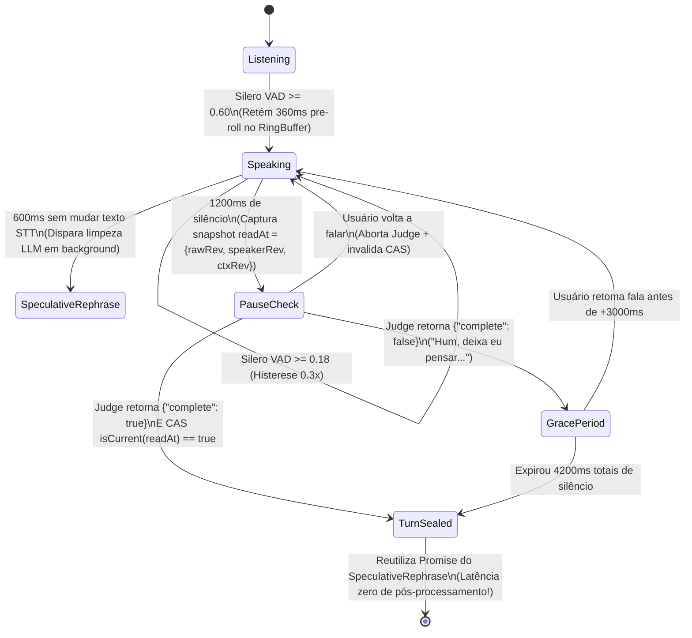

# Blueprint Prático de Absorção: 8 Receitas de Engenharia da `moeru-ai` (Corrigidas e Unificadas)

Este documento consolida os **8 melhores padrões de código e matemática** extraídos dos 20 repositórios da `moeru-ai`, **já aprimorados com as correções da nossa auditoria Red-Team** (ex.: estado emocional homeostático persistente, hit-testing em CPU $O(1)$ sem `gl.readPixels` e transferência zero-copy em Workers).

---

## Receita 1: Parser de Streaming com Retenção de Cauda + Sentinela `\uE000` + Emoção Homeostática Persistente

### O que absorvemos da `moeru-ai`
Baseado em [`llm-marker-parser.ts`](file:///C:/Users/User/.gemini/antigravity/brain/e800800b-4b21-4251-951e-c03e384333cd/scratch/moeru-ai/airi/packages/core-agent/src/runtime/llm-marker-parser.ts#L77-L243), [`response-categoriser.ts`](file:///C:/Users/User/.gemini/antigravity/brain/e800800b-4b21-4251-951e-c03e384333cd/scratch/moeru-ai/airi/packages/core-agent/src/runtime/response-categoriser.ts#L214-L469) e [`speech-pipeline.ts`](file:///C:/Users/User/.gemini/antigravity/brain/e800800b-4b21-4251-951e-c03e384333cd/scratch/moeru-ai/airi/packages/pipelines-audio/src/speech-pipeline.ts#L366-L423), somado à nossa correção Red-Team: um **Vetor Afetivo Homeostático Persistente** que não esquece a emoção no turno seguinte.

### Equação do Estado Afetivo Homeostático (Correção Red-Team)
Em vez de tratar `<|ACT {"emotion":{"name":"angry","intensity":0.9}}|>` apenas como um comando efêmero de animação, mantemos um estado contínuo $\mathbf{e}(t) = [V(t), A(t), S(t)]^T$ (*Valence, Arousal, Social Affinity*) que decai exponencialmente para a linha de base da personalidade $\mathbf{e}_0$ com meia-vida $\tau_{1/2}$:

$$\mathbf{e}(t) = \mathbf{e}_0 + \big(\mathbf{e}(t_{\text{last}}) - \mathbf{e}_0\big) \cdot \exp\left(-\frac{\ln 2}{\tau_{1/2}} (t - t_{\text{last}})\right) + \gamma \cdot \Delta\mathbf{e}_{\text{ACT}}$$

### Implementação de Referência (Parser Incremental Sem Vazamento de Tags)
```ts
const OPEN_TAG = '<|'
const CLOSE_TAG = '|>'
export const CONTROL_SENTINEL = '\uE000'

export interface MarkerParserCallbacks {
  onLiteral: (text: string) => void
  onSpecial: (rawTagContent: string) => void
}

export function createTailSafeMarkerParser(callbacks: MarkerParserCallbacks) {
  let buffer = ''
  let inTag = false
  const tailHold = OPEN_TAG.length - 1 // Retém 1 char ('<') se estiver na borda do chunk

  return {
    consume(chunk: string) {
      buffer += chunk
      while (buffer.length > 0) {
        if (!inTag) {
          const openIdx = buffer.indexOf(OPEN_TAG)
          if (openIdx === -1) {
            const safeEnd = Math.max(0, buffer.length - tailHold)
            if (safeEnd === 0) break
            callbacks.onLiteral(buffer.slice(0, safeEnd))
            buffer = buffer.slice(safeEnd)
            break
          }
          if (openIdx > 0) {
            callbacks.onLiteral(buffer.slice(0, openIdx))
          }
          buffer = buffer.slice(openIdx + OPEN_TAG.length)
          inTag = true
        } else {
          const closeIdx = buffer.indexOf(CLOSE_TAG)
          if (closeIdx === -1) break // Aguarda o restante da tag no próximo chunk
          const payload = buffer.slice(0, closeIdx).trim()
          buffer = buffer.slice(closeIdx + CLOSE_TAG.length)
          inTag = false
          callbacks.onSpecial(payload)
        }
      }
    },
    flush() {
      if (!inTag && buffer.length > 0) {
        callbacks.onLiteral(buffer)
      }
      buffer = ''
      inTag = false
    },
  }
}
```

---

## Receita 2: Chunker TTS com *TTFA Boost* + Reordenação Concorrente + Agendamento Gapless

### O que absorvemos da `moeru-ai`
Baseado em [`tts-chunker.ts`](file:///C:/Users/User/.gemini/antigravity/brain/e800800b-4b21-4251-951e-c03e384333cd/scratch/moeru-ai/airi/packages/pipelines-audio/src/processors/tts-chunker.ts#L28-L211), [`speech-pipeline.ts`](file:///C:/Users/User/.gemini/antigravity/brain/e800800b-4b21-4251-951e-c03e384333cd/scratch/moeru-ai/airi/packages/pipelines-audio/src/speech-pipeline.ts#L181-L265) e [`audio-output.ts`](file:///C:/Users/User/.gemini/antigravity/brain/e800800b-4b21-4251-951e-c03e384333cd/scratch/moeru-ai/airi/packages/audio/src/browser/audio-output.ts#L40-L153).

### Regra de Corte Adaptativa (TTFA Boost)
- **Nos primeiros `boost = 2` chunks da resposta:**
  - Corta em qualquer **pontuação suave** (`,`, `，`, `、`, `—`, `:`, `;`) assim que atingir **`minimumWords = 4` palavras**.
  - Ou força o corte em **`maximumWords = 12` palavras** na próxima fronteira de espaço.
  - **Resultado:** O 1º chunk de áudio tem apenas 4 a 8 palavras e começa a tocar nos alto-falantes em **~250–400ms** após o primeiro token do LLM!
- **A partir do 3º chunk (`chunkCount >= 2`):**
  - Como o usuário já está ouvindo os chunks 1 e 2, o chunker desativa o corte em vírgulas e só corta em **pontuação forte de fim de sentença** (`.!?…⋯。！？\n`), dando máxima naturalidade prosódica ao modelo TTS.

### Agendamento Gapless + Barge-In com `PlaybackReceipt`
```ts
export class GaplessAudioOutput {
  private nextStart = 0
  private activeItems = new Set<{
    source: AudioBufferSourceNode
    gain: GainNode
    startTime: number
    durationMs: number
  }>()

  constructor(
    private readonly context: AudioContext,
    private readonly analysisNode: GainNode, // Pré-volume para LipSync!
  ) {}

  schedule(buffer: AudioBuffer): Promise<{ throughMs: number }> {
    const source = this.context.createBufferSource()
    const gain = this.context.createGain()
    source.buffer = buffer
    source.connect(gain)
    gain.connect(this.analysisNode)

    const startTime = Math.max(this.context.currentTime, this.nextStart)
    this.nextStart = startTime + buffer.duration
    const durationMs = buffer.duration * 1000
    const item = { source, gain, startTime, durationMs }
    this.activeItems.add(item)

    return new Promise((resolve) => {
      source.onended = () => {
        this.activeItems.delete(item)
        const elapsedSec = Math.max(0, this.context.currentTime - startTime)
        const throughMs = Math.min(durationMs, Math.round(elapsedSec * 1000))
        resolve({ throughMs })
      }
      source.start(startTime)
    })
  }

  stopWithFade(fadeMs = 100): void {
    const now = this.context.currentTime
    const end = now + fadeMs / 1000
    this.nextStart = 0
    for (const item of this.activeItems) {
      item.gain.gain.cancelScheduledValues(now)
      item.gain.gain.setValueAtTime(item.gain.gain.value, now)
      item.gain.gain.linearRampToValueAtTime(0, end)
      try {
        item.source.stop(end)
      } catch {}
    }
  }
}
```

---

## Receita 3: Turn-Taking Humano (`VoiceEndJudge` + Concorrência Otimista CAS + Reescrita Especulativa)

### O que absorvemos da `moeru-ai`
Baseado em [`voice-end-judge-plugin.ts`](file:///C:/Users/User/.gemini/antigravity/brain/e800800b-4b21-4251-951e-c03e384333cd/scratch/moeru-ai/airi/packages/stage-ui/src/libs/voice/voice-end-judge-plugin.ts#L49-L90), [`voice-rephrase-plugin.ts`](file:///C:/Users/User/.gemini/antigravity/brain/e800800b-4b21-4251-951e-c03e384333cd/scratch/moeru-ai/airi/packages/stage-ui/src/libs/voice/voice-rephrase-plugin.ts#L40-L96) e [`rules.ts`](file:///C:/Users/User/.gemini/antigravity/brain/e800800b-4b21-4251-951e-c03e384333cd/scratch/moeru-ai/airi/packages/core-agent/src/voice/policy/rules.ts#L102-L288).



---

## Receita 4: Memória Cognitiva Híbrida (FSRS-6 Forgetting Curve + RRF + Predictive Coding)

### O que absorvemos do `plast-mem`
Baseado em [`episodic.rs`](file:///C:/Users/User/.gemini/antigravity/brain/e800800b-4b21-4251-951e-c03e384333cd/scratch/moeru-ai/plast-mem/crates/core/src/memory/episodic.rs#L79-L171), [`memory_review.rs`](file:///C:/Users/User/.gemini/antigravity/brain/e800800b-4b21-4251-951e-c03e384333cd/scratch/moeru-ai/plast-mem/crates/worker/src/jobs/memory_review.rs#L55-L219) e [`predict_calibrate.rs`](file:///C:/Users/User/.gemini/antigravity/brain/e800800b-4b21-4251-951e-c03e384333cd/scratch/moeru-ai/plast-mem/crates/worker/src/jobs/predict_calibrate.rs#L87-L253), com a nossa ativação real de **Flashbulb Memories** (`is_flashbulb`).

### Fórmula de Ranking com Esquecimento Biológico e Piso Emocional
Para cada episódio candidato $m$ retornado pela busca textual (BM25 rank $r_{\text{bm25}}$) e vetorial (Cosine rank $r_{\text{vec}}$):

$$\text{RRF}(m) = \frac{1}{30 + r_{\text{bm25}}(m)} + \frac{1}{30 + r_{\text{vec}}(m)}$$

A probabilidade de lembrança (*retrievability*) segundo a curva de esquecimento **FSRS-6** após $\Delta t$ dias desde a última revisão (`last_reviewed_at`), com estabilidade $S_m$ e decaimento $w_{20} = 0.1542$:

$$R_{\text{FSRS6}}(S_m, \Delta t) = \left(1 + f_{\text{factor}} \cdot \frac{\Delta t}{S_m}\right)^{-w_{20}}$$

Aplicando o piso de **Flashbulb Memory** (momentos de alto impacto emocional onde $\text{surprise}_m \ge 0.8$ nunca caem abaixo de $70\%$ de nitidez):

$$R_{\text{eff}}(m) = \begin{cases} \max\big(0.70, R_{\text{FSRS6}}(S_m, \Delta t)\big) & \text{se } m.\text{is\_flashbulb} = \text{true} \\ R_{\text{FSRS6}}(S_m, \Delta t) & \text{caso contrário} \end{cases}$$

$$\text{Score}_{\text{final}}(m) = \text{RRF}(m) \times R_{\text{eff}}(m)$$

---

## Receita 5: Lip-Sync "Winner + Runner-Up" + Cessão Dinâmica de Visemas

### O que absorvemos da `moeru-ai`
Baseado em [`vowel-driver.ts`](file:///C:/Users/User/.gemini/antigravity/brain/e800800b-4b21-4251-951e-c03e384333cd/scratch/moeru-ai/airi/packages/model-driver-lipsync/src/shared/wlipsync/vowel-driver.ts#L59-L126) e [`vrm/expression.ts`](file:///C:/Users/User/.gemini/antigravity/brain/e800800b-4b21-4251-951e-c03e384333cd/scratch/moeru-ai/airi/packages/stage-ui-three/src/composables/vrm/expression.ts#L250-L303).

```ts
export type VowelKey = 'A' | 'E' | 'I' | 'O' | 'U'
const VOWELS: VowelKey[] = ['A', 'E', 'I', 'O', 'U']

export function createWinnerRunnerUpVowelDriver() {
  const current: Record<VowelKey, number> = { A: 0, E: 0, I: 0, O: 0, U: 0 }
  let silentMs = 0

  return {
    update(rawWeights: Record<VowelKey, number>, rawVolume: number, dtSeconds: number): Record<VowelKey, number> {
      const amp = Math.min(rawVolume * 0.9, 1) ** 0.7
      const ranked = VOWELS
        .map(v => ({ key: v, weight: (rawWeights[v] ?? 0) * amp }))
        .sort((a, b) => b.weight - a.weight)

      const winner = ranked[0]!
      const runnerUp = ranked[1]!
      const isSilent = amp < 0.04 || winner.weight < 0.05
      silentMs = isSilent ? silentMs + dtSeconds * 1000 : 0

      const targets: Record<VowelKey, number> = { A: 0, E: 0, I: 0, O: 0, U: 0 }
      if (silentMs < 160 && !isSilent) {
        targets[winner.key] = Math.min(0.7, winner.weight)
        targets[runnerUp.key] = Math.min(0.35, runnerUp.weight * 0.6)
      }

      for (const v of VOWELS) {
        const from = current[v]
        const to = targets[v] * 0.7 // outputScale
        const speed = to > from ? 50 : 30 // Ataque rápido (50), fechamento suave (30)
        const alpha = 1 - Math.exp(-speed * Math.max(0, dtSeconds))
        current[v] = from + (to - from) * alpha
      }
      return { ...current }
    },
  }
}
```

---

## Receita 6: Iluminação Ambiente Sem Auto-Realimentação + *Light Squint* Biológico

### O que absorvemos da `moeru-ai`
Baseado em [`sampling.ts`](file:///C:/Users/User/.gemini/antigravity/brain/e800800b-4b21-4251-951e-c03e384333cd/scratch/moeru-ai/airi/packages/stage-shared/src/screen-ambient-light/sampling.ts#L169-L721), [`screen-ambient-light.ts`](file:///C:/Users/User/.gemini/antigravity/brain/e800800b-4b21-4251-951e-c03e384333cd/scratch/moeru-ai/airi/packages/stage-ui-live2d/src/filters/screen-ambient-light.ts#L192-L216) e [`motion-manager.ts`](file:///C:/Users/User/.gemini/antigravity/brain/e800800b-4b21-4251-951e-c03e384333cd/scratch/moeru-ai/airi/packages/stage-ui-live2d/src/composables/live2d/motion-manager.ts#L513-L686).

1. **Convolução Normalizada Excluindo a Silhueta do Avatar:**
   Para cada pixel $(x, y)$ capturado da tela (`128x72`), se $\alpha_{\text{avatar}}(x, y) > 4$, atribuímos peso $w(x, y) = 0$. Caso contrário, convertemos sRGB para luz linear $(R_{\text{lin}}, G_{\text{lin}}, B_{\text{lin}})$ e definimos o peso ponderado por saturação:
   $$w(x, y) = 0.35 + 0.65 \cdot \text{sat}(x, y)$$
   Aplicamos 3 passadas de box blur 1D horizontal e vertical ($O(1)$ por pixel com janela deslizante) sobre a tupla de 4 canais $\big(R_{\text{lin}} w, G_{\text{lin}} w, B_{\text{lin}} w, w\big)$ e dividimos os 3 primeiros canais pelo 4º canal borrado $\tilde{w}$. Isso preenche o espaço ocupado pelo avatar com a luz exata da janela que está atrás dele, sem jamais realimentar as cores do próprio avatar!
2. **Seguidor Duplo de Adaptação Retiniana (`Light Squint`):**
   ```ts
   export function createRetinalLightSquint() {
     let fastLuma = 0.2
     let slowLuma = 0.2

     return {
       update(behindLuminance: number, dtSec: number, strength = 0.65): number {
         const alphaFast = 1 - Math.exp(-dtSec / 0.15) // 150ms (reflexo rápido)
         const tauSlow = behindLuminance > slowLuma ? 4.0 : 90.0 // 4s claro / 90s escuro
         const alphaSlow = 1 - Math.exp(-dtSec / tauSlow)

         fastLuma += (behindLuminance - fastLuma) * alphaFast
         slowLuma += (behindLuminance - slowLuma) * alphaSlow

         const contrastShock = Math.max(0, fastLuma - slowLuma)
         return Math.min(1, (contrastShock ** 0.6) * strength)
       },
     }
   }
   ```

---

## Receita 7: Click-Through Desktop em CPU $O(1)$ (Eliminando o Gargalo de `gl.readPixels` da `moeru-ai`)

### Por que esta correção é essencial
Na `moeru-ai`, mover o mouse sobre a janela transparente do Electron chama `gl.readPixels` síncrono (2D) ou renderiza a cena Three.js inteira uma 2ª vez para um `WebGLRenderTarget` offscreen + `readRenderTargetPixels` (3D).
Abaixo está a nossa arquitetura substituta de **custo zero na GPU** durante o `mousemove`:

1. **Para Avatares 2D (Live2D / Spine / Tachie) — Consulta $O(1)$ na Máscara `128x72` já existente:**
   - O `useStagePaintedMask` já atualiza um `Uint8ClampedArray` de `128x72` a cada `250ms` (ou apenas quando o avatar se move).
   - No `mousemove(clientX, clientY)`, basta mapear $(x, y)$ para $(u, v) \in [0..127] \times [0..71]$ e ler um único byte em memória RAM:
     ```ts
     export function isAvatarHit2D(
       maskAlpha: Uint8Array,
       maskW: number,
       maskH: number,
       clientX: number,
       clientY: number,
       windowW: number,
       windowH: number,
     ): boolean {
       const ix = Math.floor((clientX / windowW) * maskW)
       const iy = Math.floor((clientY / windowH) * maskH)
       if (ix < 0 || ix >= maskW || iy < 0 || iy >= maskH) return false
       return maskAlpha[iy * maskW + ix]! > 10
     }
     ```
2. **Para Avatares 3D (VRM / MMD) — Raycast em CPU contra `Box3` / Cápsulas dos Ossos Humanoides ($< 0.02\text{ms}$):**
   - Em vez de renderizar os triângulos da malha na GPU para ler 1 pixel, mantemos ~14 `THREE.Box3` (ou esferas/cápsulas) atreladas aos ossos principais do `vrm.humanoid` (`head`, `chest`, `spine`, `hips`, `upperArm`, `lowerArm`, `upperLeg`, `lowerLeg`).
   - No `mousemove`, lançamos um `THREE.Raycaster` puramente matemático na CPU contra essas 14 caixas (`raycaster.ray.intersectsBox(boneBox)`), executando em **menos de 20 microssegundos** sem tocar no WebGL!

---

## Receita 8: Contexto e Memória 100% KV-Cache-Friendly

### O que absorvemos da `moeru-ai`
Baseado em [`datetime-prefix.ts`](file:///C:/Users/User/.gemini/antigravity/brain/e800800b-4b21-4251-951e-c03e384333cd/scratch/moeru-ai/airi/packages/core-agent/src/messages/datetime-prefix.ts#L25-L34), [`context-prompt.ts`](file:///C:/Users/User/.gemini/antigravity/brain/e800800b-4b21-4251-951e-c03e384333cd/scratch/moeru-ai/airi/packages/core-agent/src/messages/context-prompt.ts#L18-L50) e [`stores/memory.ts`](file:///C:/Users/User/.gemini/antigravity/brain/e800800b-4b21-4251-951e-c03e384333cd/scratch/moeru-ai/airi/packages/stage-ui/src/stores/memory.ts#L86-L105).

### As 4 Regras de Ouro de Montagem de Prompt para Tempo Real
1. **System Prompt 100% Imutável na Sessão:**
   - Contém apenas: Persona (`ReLU` / Card), Controles físicos do modelo ativo (`formatLive2DActPrompt`) e o Índice Compacto de Memórias (`- slug: resumo de 1 linha`).
   - **Proibido** colocar timestamps, status de jogos ou coordenadas de tela no System Prompt (garante **100% de KV-Cache Hit** no prefixo em todos os turnos!).
2. **Timestamp Apenas nas Mensagens do `user`:**
   - Prefixe cada mensagem do usuário com `[2026-10-28 15:10] `.
   - **Jamais** prefixe mensagens do `assistant` com timestamp (evita que o LLM passe a gerar timestamps na própria fala).
3. **Contexto Multimodal como Lista Markdown Plana (Nunca XML):**
   - Antes da fala do usuário, injete as atualizações do `ContextRegistry` (`ReplaceSelf` / `AppendSelf`) como lista Markdown simples:
     ```markdown
     [Context]
     - vision: User is debugging a WebSocket handler in VS Code
     - minecraft: Health 18/20, Hunger 20/20, Inventory has 12 oak_log. Bot is online; use builtIn_emitSparkCommand to control it.
     - affect: Current mood is mildly curious (valence: +0.35, arousal: 0.40)

     [2026-10-28 15:10] Oi! Viu o que eu acabei de quebrar no código?
     ```
4. **Proatividade com Silêncio Seletivo:**
   - Quando um evento assíncrono (`spark:notify` ou timer de visão) disparar sem o usuário ter falado, envie um turno oculto com a instrução `[Speak about this notice only if it fits now, or stay quiet.]`. Se o modelo retornar resposta vazia ou apenas `<think>`, descarte o turno sem gravá-lo no histórico da conversa.
