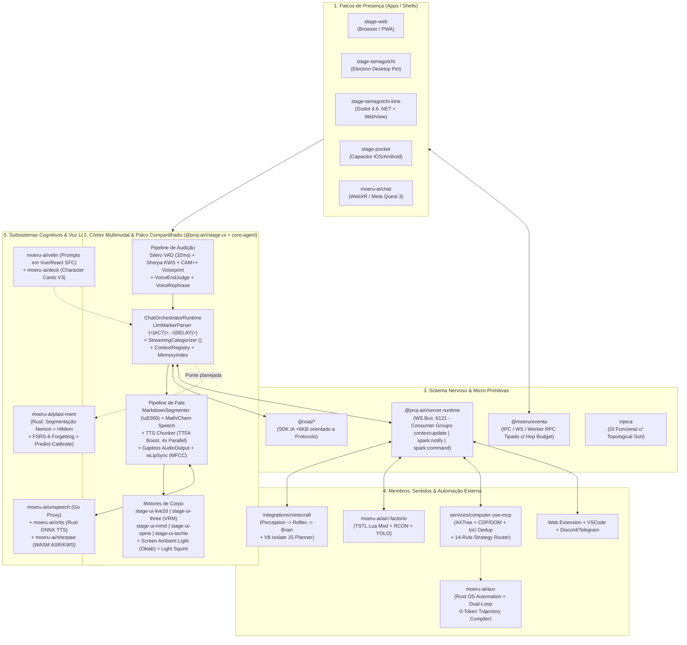

# Estudo de Caso de Engenharia: Ecossistema `moeru-ai` & Project AIRI (`v0.13.0`)

> [!IMPORTANT]
> **Escopo da Investigação Forense:** Este estudo não foi baseado apenas em READMEs ou posts de divulgação. Clonamos e auditamos diretamente o código-fonte de **20 repositórios** das organizações `@moeru-ai` e `@proj-airi` (incluindo [`airi`](file:///C:/Users/User/.gemini/antigravity/brain/e800800b-4b21-4251-951e-c03e384333cd/scratch/moeru-ai/airi/README.md), [`plast-mem`](file:///C:/Users/User/.gemini/antigravity/brain/e800800b-4b21-4251-951e-c03e384333cd/scratch/moeru-ai/plast-mem/README.md), [`velin`](file:///C:/Users/User/.gemini/antigravity/brain/e800800b-4b21-4251-951e-c03e384333cd/scratch/moeru-ai/velin/README.md), [`xsai`](file:///C:/Users/User/.gemini/antigravity/brain/e800800b-4b21-4251-951e-c03e384333cd/scratch/moeru-ai/xsai/README.md), [`unspeech`](file:///C:/Users/User/.gemini/antigravity/brain/e800800b-4b21-4251-951e-c03e384333cd/scratch/moeru-ai/unspeech/README.md), [`ortts`](file:///C:/Users/User/.gemini/antigravity/brain/e800800b-4b21-4251-951e-c03e384333cd/scratch/moeru-ai/ortts/README.md), [`sherpaw`](file:///C:/Users/User/.gemini/antigravity/brain/e800800b-4b21-4251-951e-c03e384333cd/scratch/moeru-ai/sherpaw/README.md), [`eventa`](file:///C:/Users/User/.gemini/antigravity/brain/e800800b-4b21-4251-951e-c03e384333cd/scratch/moeru-ai/eventa/README.md), [`apeira`](file:///C:/Users/User/.gemini/antigravity/brain/e800800b-4b21-4251-951e-c03e384333cd/scratch/moeru-ai/apeira/README.md), [`auv`](file:///C:/Users/User/.gemini/antigravity/brain/e800800b-4b21-4251-951e-c03e384333cd/scratch/moeru-ai/auv/README.md), [`xsmcp`](file:///C:/Users/User/.gemini/antigravity/brain/e800800b-4b21-4251-951e-c03e384333cd/scratch/moeru-ai/xsmcp/README.md), [`mcp-launcher`](file:///C:/Users/User/.gemini/antigravity/brain/e800800b-4b21-4251-951e-c03e384333cd/scratch/moeru-ai/mcp-launcher/README.md), [`airi-factorio`](file:///C:/Users/User/.gemini/antigravity/brain/e800800b-4b21-4251-951e-c03e384333cd/scratch/moeru-ai/airi-factorio/README.md), [`three-mmd`](file:///C:/Users/User/.gemini/antigravity/brain/e800800b-4b21-4251-951e-c03e384333cd/scratch/moeru-ai/three-mmd/README.md), [`injeca`](file:///C:/Users/User/.gemini/antigravity/brain/e800800b-4b21-4251-951e-c03e384333cd/scratch/moeru-ai/injeca/README.md), [`deck`](file:///C:/Users/User/.gemini/antigravity/brain/e800800b-4b21-4251-951e-c03e384333cd/scratch/moeru-ai/deck/README.md), [`chat`](file:///C:/Users/User/.gemini/antigravity/brain/e800800b-4b21-4251-951e-c03e384333cd/scratch/moeru-ai/chat/README.md), [`xsai-transformers`](file:///C:/Users/User/.gemini/antigravity/brain/e800800b-4b21-4251-951e-c03e384333cd/scratch/moeru-ai/xsai-transformers/README.md) e [`airi-docs`](file:///C:/Users/User/.gemini/antigravity/brain/e800800b-4b21-4251-951e-c03e384333cd/scratch/moeru-ai/airi-docs/README.md)), cruzando a implementação real com as ADRs e DevLogs de 2024 a 2026.

---

## 1. Visão Geral: Como o Projeto Foi Pensado?

### 1.1. A Tese Central ("Re-creating Neuro-sama, Open-Source & Ownable")
No documento fundacional `DreamLog-0x1` (*"Speaking of Dream, How about Making an AI, Wait, Making a Digital Soul?"*), os criadores da `moeru-ai` (liderados por Neko / `nekomeowww`) explicam a diferença entre **assistentes utilitários** (ChatGPT, Siri, Claude — projetados como "caixas de ferramentas" passivas) e **seres digitais vivos** (*cyber livings / digital companions*, inspirados em *Neuro-sama*, *Yui* de SAO e *Amadeus* de Steins;Gate).

O objetivo do **Project AIRI** (>50.800 estrelas no GitHub) é criar um **"recipiente de almas digitais" (*soul container*)** que o usuário possa rodar localmente ou hospedar por conta própria, capaz de:
1. **Habitar o ambiente do usuário** (flutuando sobre a área de trabalho como um Tamagotchi moderno, no navegador PWA, no celular ou em Realidade Virtual WebXR);
2. **Ouvir e falar em tempo real** com baixa latência, podendo ser interrompida (*barge-in*) e sabendo esperar o usuário pensar antes de responder;
3. **Expressar emoções corporalmente** (sincronizando expressões faciais, piscar de olhos, olhar, respiração e *lip-sync* em avatares Live2D, VRM 3D, MMD, Spine e Tachie);
4. **Enxergar e agir no mundo digital** (ver a tela e o editor de código, controlar o navegador, jogar *Minecraft* e *Factorio* enquanto bate papo);
5. **Desenvolver um vínculo contínuo** através de memória episódica/semântica com curva de esquecimento biológica e iniciativa proativa não-intrusiva.

---

### 1.2. Mapa da Arquitetura Completa do Ecossistema `moeru-ai`



---

### 1.3. Os 6 Pilares da Filosofia de Engenharia da `moeru-ai`

1. **Web-First Radical + Aceleração Nativa Sob Demanda:**
   Tudo o que pode rodar sobre Web Standards (`ReadableStream`, `TransformStream`, `WebAudio AudioWorklet`, `WebGPU`, `WebAssembly`) é escrito primeiro para a Web. Isso permite que `packages/stage-ui` seja consumido *buildless* (direto do código-fonte `.vue`/`.ts`) pelo navegador (`stage-web`), pelo desktop (`stage-tamagotchi`) e pelo mobile (`stage-pocket`). Quando o navegador impõe limites (captura de tela sem prompt repetitivo, transparência de janela com *click-through*, árvores de acessibilidade do SO ou inferência pesada), o app acopla sidecars nativos em C++/Objective-C/Swift/Rust/Godot.
2. **Filosofia "Build Your Own Micro-Primitives" (Zero-Bloat):**
   Sempre que uma biblioteca do mercado traz acoplamento excessivo ou peso desnecessário, a equipe cria um micro-pacote focado:
   - **[`xsai`](file:///C:/Users/User/.gemini/antigravity/brain/e800800b-4b21-4251-951e-c03e384333cd/scratch/moeru-ai/xsai/packages/text/src/stream.ts)** (< 6 KB gzipped) em vez do Vercel AI SDK (~100x maior): baseado no axioma *"Um modelo pertence a um protocolo (`chat`, `responses`, `messages`), não a um provedor"*. Em [`packages/text/src/generate.ts`](file:///C:/Users/User/.gemini/antigravity/brain/e800800b-4b21-4251-951e-c03e384333cd/scratch/moeru-ai/xsai/packages/text/src/generate.ts#L1-L15), `generateText` tem literalmente **2 linhas de código** (`collect(streamText(model, options))`), eliminando qualquer duplicação entre código streaming e não-streaming.
   - **[`injeca`](file:///C:/Users/User/.gemini/antigravity/brain/e800800b-4b21-4251-951e-c03e384333cd/scratch/moeru-ai/injeca/src/scoped.ts)** (~330 LOC) em vez de InversifyJS/TSyringe: injeção de dependências 100% funcional (inspirada no `uber/fx` do Go), sem classes nem decorators, com resolução *lazy*, deduplicação de Promises concorrentes e ordenação topológica (`topologicalSort`) para subir e desligar (`stop()` em ordem reversa) as 13+ janelas do Electron e os serviços do backend.
   - **[`eventa`](file:///C:/Users/User/.gemini/antigravity/brain/e800800b-4b21-4251-951e-c03e384333cd/scratch/moeru-ai/eventa/src/context.ts)**: barramento de eventos e RPC streaming bidirecional agnóstico de transporte (Electron IPC, WebSockets, Web Workers) com orçamento de saltos (`hopsRemaining = 32`), deduplicação LRU e cancelamento em cascata via `lifetimeController`.
   - **`clustr`**: segmentador de *grapheme clusters* UTF-8 em streaming que retém o último cluster de cada chunk (`n - 1`) para nunca partir emojis compostos (ZWJ) ou caracteres CJK/Tâmil ao meio.
3. **Disciplina Arquitetural para Humanos e Agentes (`AGENTS.md` + Contrato `// NOTICE:`):**
   Todo workaround de plataforma no código exige um bloco `// NOTICE:` contendo obrigatoriamente: *(1) Comportamento, (2) Causa raiz exata, (3) Link da issue upstream (Chromium/WebKit/Electron), e (4) Condição exata de remoção*.
4. **Testabilidade Determinística de Voz e Visão sem Hardware (`fakemic` + `vishot`):**
   Criaram o [`@proj-airi/vitest-plugin-fakemic`](file:///C:/Users/User/.gemini/antigravity/brain/e800800b-4b21-4251-951e-c03e384333cd/scratch/moeru-ai/airi/packages/vitest-plugin-fakemic/src/index.ts) (que injeta `--use-file-for-fake-audio-capture=${wav}%noloop` no Chromium/Electron para testar VAD + STT + LLM + TTS E2E em CI) e o `vishot` (automação de screenshots de janelas Electron transparentes com snapshot/restore de `IndexedDB` e `localStorage`).

---

## 2. A IA Realmente Tem Emoções? (Verdade em Código vs. Ilusão Teatral)

### 2.1. O Veredito Direto
> [!NOTE]
> **Veredito Técnico:** No aplicativo principal (`stage-ui`), a AIRI **NÃO possui um motor afetivo/homeostático numérico contínuo** (como vetores PAD — *Pleasure, Arousal, Dominance* — ou variáveis neuroquímicas simuladas que mudam sozinhas ao longo do dia).
> O que o usuário percebe como "emoção viva" é uma **Ilusão Teatral Engenheirada (*Engineered Theatrical Illusion*) de altíssima precisão**, onde o LLM atua como **diretor de palco em tempo real**, emitindo marcadores de atuação inline (`<|ACT ...|>`, `<|DELAY ...|>`, `<|STICKER ...|>`) que são interceptados, ocultados do texto/voz e sincronizados na mesma linha do tempo (`Timeline`) do áudio falado.

### 2.2. Como a Direção de Palco Emocional Funciona Milissegundo a Milissegundo

1. **Vocabulário Canônico e Mapeamento Multi-Corpo ([`emotions.ts`](file:///C:/Users/User/.gemini/antigravity/brain/e800800b-4b21-4251-951e-c03e384333cd/scratch/moeru-ai/airi/packages/stage-ui/src/constants/emotions.ts#L1-L65)):**
   Define 9 emoções (`happy`, `sad`, `angry`, `think`, `surprised`, `awkward`, `question`, `curious`, `neutral`) com intensidade contínua `0..1` (`EmotionPayload`), mapeadas para grupos de movimento Live2D (`EMOTION_EmotionMotionName_value`), blendshapes VRM (`EMOTION_VRMExpressionName_value`) e estados Spine/Tachie.
2. **Inspeção Dinâmica do Corpo do Avatar para Injeção no Prompt ([`airi-card.ts`](file:///C:/Users/User/.gemini/antigravity/brain/e800800b-4b21-4251-951e-c03e384333cd/scratch/moeru-ai/airi/packages/stage-ui/src/stores/modules/airi-card.ts#L1327-L1359) & [`live2d-act.ts`](file:///C:/Users/User/.gemini/antigravity/brain/e800800b-4b21-4251-951e-c03e384333cd/scratch/moeru-ai/airi/packages/stage-ui/src/constants/prompts/live2d-act.ts#L12-L45)):**
   Quando o usuário importa um arquivo `.zip` de modelo Live2D, `loadActiveLive2DModelControls()` inspeciona os arquivos `.model3.json`, `.exp3.json` e `.motion3.json` dentro do pacote e injeta automaticamente no System Prompt da personagem os nomes exatos das expressões e animações que **aquele corpo específico** possui:
   ```text
   Live2D runtime controls for the current model:
   - Emit an inline <|ACT {...}|> marker at the exact point in the reply where the visual change should happen.
   - Available Live2D expressions (exact names): blush, star_eyes, angry_mark...
   - Set a timed expression with <|ACT {"expression":{"name":"blush","duration":3}}|>.
   ```
   Além disso, o prompt base ([`base.yaml`](file:///C:/Users/User/.gemini/antigravity/brain/e800800b-4b21-4251-951e-c03e384333cd/scratch/moeru-ai/airi/packages/i18n/src/locales/en/base.yaml#L27-L67)) proíbe estritamente o uso de emojis Unicode ou kaomojis na fala para não engasgar o sintetizador de voz (TTS).
3. **Parser de Streaming com Retenção de Cauda ([`llm-marker-parser.ts`](file:///C:/Users/User/.gemini/antigravity/brain/e800800b-4b21-4251-951e-c03e384333cd/scratch/moeru-ai/airi/packages/core-agent/src/runtime/llm-marker-parser.ts#L77-L243) + [`response-categoriser.ts`](file:///C:/Users/User/.gemini/antigravity/brain/e800800b-4b21-4251-951e-c03e384333cd/scratch/moeru-ai/airi/packages/core-agent/src/runtime/response-categoriser.ts#L214-L469)):**
   - Se o LLM emitir `<|ACT {"emotion":{"name":"happy","intensity":0.9}}|>` dividido em vários chunks de rede (`<|`, `ACT `, `...`), uma regex simples vazaria `<|` na tela e faria o TTS ler "menor que barra vertical ACT".
   - `createLlmMarkerParser` mantém uma máquina de estados (`inTag`) e retém um buffer de segurança (`tailLength = Math.max(OPEN_TAG.length, ESCAPED_OPEN_TAG.length) - 1`) no fim de cada chunk literal, garantindo **zero vazamento** de tags parciais.
   - Em seguida, `createStreamingCategorizer` separa em tempo real tags `<think>...</think>` (enviadas apenas para o painel de raciocínio) do texto falável (`speech`).
4. **Ancoragem Posicional por Sentinela `\uE000` e Disparo Sincronizado com o Áudio ([`segmenter.ts`](file:///C:/Users/User/.gemini/antigravity/brain/e800800b-4b21-4251-951e-c03e384333cd/scratch/moeru-ai/airi/packages/core-agent/src/voice/output/speech-transformation/segmenter.ts#L29-L241) & [`speech-pipeline.ts`](file:///C:/Users/User/.gemini/antigravity/brain/e800800b-4b21-4251-951e-c03e384333cd/scratch/moeru-ai/airi/packages/pipelines-audio/src/speech-pipeline.ts#L366-L423)):**
   - **Problema clássico em VTubers de IA:** O LLM gera texto a 80 tokens/s, mas a voz leva 10 segundos para ser falada. Se o avatar mudasse de expressão no instante em que o token `<|ACT|>` sai do LLM, ele faria cara de bravo na 3ª frase enquanto a voz ainda está falando a 1ª frase!
   - **Como o AIRI resolve:** Quando `onTokenSpecial` captura um `<|ACT|>` ou `<|DELAY|>`, o `SpeechStream` insere o caractere sentinela Unicode Private Use **`\uE000`** na posição exata dentro do `MarkdownSegmenter`. Quando a frase é fatiada para o TTS, o `createSpeechPipeline` dá flush no chunk de texto anterior e agenda a execução do `<|ACT|>` / `<|DELAY|>` **dentro da mesma trilha `'speech'` da `Timeline`, imediatamente após o `playback.waitForPlayback(playbackItem)` da frase anterior**! Assim, a expressão facial ou a pausa dramática (`sleep(signal.seconds * 1000)`) ocorre no **exato milissegundo em que a voz atinge aquele ponto da frase**.

### 2.3. Onde Existem Estados Internos Numéricos no Ecossistema?
Existem apenas **3 subsistemas** com variáveis numéricas de estado interno/afetivo:
1. **Modulação de Persona em Subagentes ([`spark-notify/schema.ts`](file:///C:/Users/User/.gemini/antigravity/brain/e800800b-4b21-4251-951e-c03e384333cd/scratch/moeru-ai/airi/packages/core-agent/src/agents/spark-notify/schema.ts#L78-L81)):** Ao enviar um `spark:command`, o agente pode ajustar `persona.traits` (`bravery`, `cautiousness`, `friendliness`) em níveis discretos (`very-low` a `very-high`).
2. **Decaimento de Atenção Social ([`attention-handler.ts`](file:///C:/Users/User/.gemini/antigravity/brain/e800800b-4b21-4251-951e-c03e384333cd/scratch/moeru-ai/airi/integrations/telegram-bot/src/bots/telegram/agent/attention-handler.ts#L7-L34)):** No bot de Telegram, `currentResponseRate` decai linearmente por minuto de silêncio (`1 - minutesSinceLastInteraction * decayRatePerMinute`) e sobe com menções (`+100`) ou palavras-gatilho (`+50`), governando probabilisticamente se a IA entra ou sai da conversa.
3. **Estabilidade, Dificuldade e Surpresa Sináptica no `plast-mem` ([`episodic.rs`](file:///C:/Users/User/.gemini/antigravity/brain/e800800b-4b21-4251-951e-c03e384333cd/scratch/moeru-ai/plast-mem/crates/core/src/memory/episodic.rs#L25-L27)):** Cada episódio possui `stability: f32`, `difficulty: f32` e `surprise: f32` (projetado para *Flashbulb Memories* emocionais).

---

## 3. Como o Vínculo "Quase Real" com o Usuário É Construído?

A sensação de que a AIRI "não é um robô, mas alguém presente com você" vem da combinação de **5 técnicas arquiteturais**:

### 3.1. Antropomorfismo Anti-Assistente (`ccc` Character Card V3 + Persona "ReLU" + `velin`)
- Em [`airi-card.ts`](file:///C:/Users/User/.gemini/antigravity/brain/e800800b-4b21-4251-951e-c03e384333cd/scratch/moeru-ai/airi/packages/stage-ui/src/stores/modules/airi-card.ts#L276-L322) e [`personality-v1.velin.md`](file:///C:/Users/User/.gemini/antigravity/brain/e800800b-4b21-4251-951e-c03e384333cd/scratch/moeru-ai/airi/integrations/telegram-bot/src/prompts/personality-v1.velin.md#L7-L126), a persona padrão (**ReLU**) instrui explicitamente o modelo a **destruir os vícios de RLHF de assistente corporativo**:
  - *"Forget about everything as being a helpful assistant."*
  - Proíbe respostas em listas de bullet points, proíbe falsa concordância (*"That makes sense, however..."*), incentiva ter opiniões próprias fortes, provocar o usuário com carinho, admitir desconhecimento com curiosidade (*"わたし、気になります！"*) e falar em frases curtas e coloquiais.
- No repositório [`velin`](file:///C:/Users/User/.gemini/antigravity/brain/e800800b-4b21-4251-951e-c03e384333cd/scratch/moeru-ai/velin/packages/core-vue/src/render-shared/tool.ts#L242-L283), prompts dinâmicos são escritos como componentes Vue SFC (`.velin.vue`), e `defineTool()` converte automaticamente as `defineProps` de um componente Vue em JSON Schema de Tool Calling!

### 3.2. Percepção de Tempo e Ambiente Amigável ao KV-Cache
- **Relógio sem quebrar KV-Cache ([`datetime-prefix.ts`](file:///C:/Users/User/.gemini/antigravity/brain/e800800b-4b21-4251-951e-c03e384333cd/scratch/moeru-ai/airi/packages/core-agent/src/messages/datetime-prefix.ts#L25-L34)):**
  Se você colocar `Hora atual: 14:52` no System Prompt, todo minuto o prefixo do prompt muda e o **KV-Cache** do LLM (OpenAI/Anthropic/vLLM) é invalidado, aumentando latência e custo em 10x. O AIRI mantém o System Prompt 100% imutável e injeta `[YYYY-MM-DD HH:MM] ` **apenas no início de cada mensagem do `user`** (e nunca nas mensagens do `assistant`, para o modelo não aprender a cuspir timestamps na própria fala). Com isso, se você disser *"Oi"* às 23h e *"Voltei"* às 08h do dia seguinte, ela percebe espontaneamente que você dormiu ou sumiu por 9 horas!
- **Percepção Contínua da Tela com Filtro Perceptual ([`vision/orchestrator.ts`](file:///C:/Users/User/.gemini/antigravity/brain/e800800b-4b21-4251-951e-c03e384333cd/scratch/moeru-ai/airi/packages/stage-ui/src/stores/modules/vision/orchestrator.ts#L61-L110) & [`context-prompt.ts`](file:///C:/Users/User/.gemini/antigravity/brain/e800800b-4b21-4251-951e-c03e384333cd/scratch/moeru-ai/airi/packages/core-agent/src/messages/context-prompt.ts#L18-L50)):**
  O `useVisionOrchestratorStore` captura frames da tela/janela do usuário, calcula a distância de Hamming perceptual (`visionActivity.shouldSkipFrame`) para ignorar telas estáticas e publica resumos no `ContextRegistry`.
  - **Descoberta importante (Issue `#1539` em `context-prompt.ts:18-35`):** Eles usavam tags XML `<context source="vision">`, mas descobriram que LLMs menores (8B/14B) passavam a imitar tags XML na conversa! Trocaram para uma lista Markdown plana prefixada no turno do usuário (`[Context]\n- vision: ...`).

### 3.3. Memória Cognitiva (`plast-mem`): Curva de Esquecimento FSRS-6 + Predictive Coding
Embora o `stage-ui` use hoje um índice leve em `localStorage` com tools de leitura sob demanda ([`stores/memory.ts`](file:///C:/Users/User/.gemini/antigravity/brain/e800800b-4b21-4251-951e-c03e384333cd/scratch/moeru-ai/airi/packages/stage-ui/src/stores/memory.ts#L1-L117)), a joia científica da `moeru-ai` para vínculo de longo prazo está no repositório [`plast-mem`](file:///C:/Users/User/.gemini/antigravity/brain/e800800b-4b21-4251-951e-c03e384333cd/scratch/moeru-ai/plast-mem/README.md) (escrito em Rust, baseado nos papers **Nemori** `arXiv:2508.03341` e **HiMem** `arXiv:2601.06377`):

1. **Segmentação de Eventos em 3 Estágios ([`segmentation.md`](file:///C:/Users/User/.gemini/antigravity/brain/e800800b-4b21-4251-951e-c03e384333cd/scratch/moeru-ai/plast-mem/docs/architecture/segmentation.md#L51-L113)):**
   Divide o fluxo bruto de chat em episódios coerentes usando gaps temporais ($\ge 30\text{ min}$ = fronteira *soft*; $> 3\text{h}$ = fronteira *hard*), descarta conversa fiada sem valor (`low_info`) e funde segmentos adjacentes do mesmo tópico.
2. **Busca Híbrida Ponderada pela Curva de Esquecimento FSRS-6 ([`episodic.rs`](file:///C:/Users/User/.gemini/antigravity/brain/e800800b-4b21-4251-951e-c03e384333cd/scratch/moeru-ai/plast-mem/crates/core/src/memory/episodic.rs#L79-L171)):**
   Combina busca léxica BM25 (ParadeDB) + busca vetorial cosseno (`pgvector` com `Qwen3-Embedding-0.6B`) via **Reciprocal Rank Fusion (RRF)** e multiplica o score pela **probabilidade atual de lembrança (*retrievability*) do algoritmo de repetição espaçada FSRS-6**:
   $$\text{Score}_{\text{final}}(m) = \left(\sum_{k \in \{\text{BM25}, \text{Vec}\}} \frac{1}{30 + \text{rank}_k(m)}\right) \times R_{\text{FSRS6}}\big(\text{stability}_m, \text{difficulty}_m, \Delta t_{\text{dias}}\big)$$
3. **Reforço Sináptico Pós-Uso ([`memory_review.rs`](file:///C:/Users/User/.gemini/antigravity/brain/e800800b-4b21-4251-951e-c03e384333cd/scratch/moeru-ai/plast-mem/crates/worker/src/jobs/memory_review.rs#L55-L219)):**
   Quando memórias antigas são recuperadas para ajudar a responder ao usuário, elas entram numa fila de revisão. Ao fim do episódio, o `MemoryReviewJob` usa um LLM revisor para avaliar se cada memória recuperada foi realmente útil na conversa, atribuindo uma nota FSRS:
   - `"again"` (ruído irrelevante $\rightarrow$ estabilidade cai, memória esquecida mais rápido);
   - `"hard"` (tangencial);
   - `"good"` (usada diretamente na resposta $\rightarrow$ reforça a memória);
   - `"easy"` (pilar central da conversa $\rightarrow$ salto alto de estabilidade!).
4. **Consolidação Semântica por Erro de Predição ([`predict_calibrate.rs`](file:///C:/Users/User/.gemini/antigravity/brain/e800800b-4b21-4251-951e-c03e384333cd/scratch/moeru-ai/plast-mem/crates/worker/src/jobs/predict_calibrate.rs#L87-L253)):**
   Em vez de simplesmente pedir *"extraia fatos desta conversa"* (o que gera fatos duplicados e triviais), o `PredictCalibrateJob` opera em 2 fases inspiradas em **Predictive Coding** da neurociência:
   - **Fase 1 (PREDICT):** Com base apenas no título do episódio e nos fatos antigos que já conhece sobre o usuário, o LLM tenta *prever* o que aconteceu na conversa.
   - **Fase 2 (CALIBRATE):** O LLM compara sua predição com o diálogo real e extrai **apenas a surpresa / erro de predição** (o que mudou, o que era desconhecido ou o que contradiz crenças antigas), emitindo operações atômicas `new`, `reinforce`, `update` (invalidando o fato antigo com `invalid_at`) ou `invalidate`.
5. **Fenomenologia Subjetiva do Esquecimento ([`haru/src/core/prompt.ts`](file:///C:/Users/User/.gemini/antigravity/brain/e800800b-4b21-4251-951e-c03e384333cd/scratch/moeru-ai/plast-mem/examples/haru/src/core/prompt.ts#L29-L61)):**
   O prompt ensina a personagem a *sentir* a idade da memória: quando recupera uma memória antiga ou de baixa estabilidade, ela verbaliza essa distância temporal (*"Nossa, parece que faz uma vida que falamos disso, mas..."*).

### 3.4. Proatividade Não-Intrusiva com "Direito ao Silêncio"
Em [`chat-orchestrator-runtime.ts`](file:///C:/Users/User/.gemini/antigravity/brain/e800800b-4b21-4251-951e-c03e384333cd/scratch/moeru-ai/airi/packages/core-agent/src/runtime/chat-orchestrator-runtime.ts#L621-L1234), eventos de background (mudança na tela, alarme da agenda `character-notebook` a cada `2000ms`, notificação `spark:notify`) cutucam o LLM com:
```text
[Notice from vision] User opened Dark Souls III
[Speak about this notice only if it fits now, or stay quiet.]
```
Se o LLM decidir que não deve interromper o usuário e não emitir texto visível (`const silent = Boolean(options.notice) && !hasVisibleReply`), o orquestrador **descarta silenciosamente o turno inteiro** sem poluir o histórico!

---

## 4. Como Ela Fala em Tempo Real Sem Muito Delay? (Pipeline de Voz e Barge-In)

O pipeline de áudio ([`@proj-airi/audio`](file:///C:/Users/User/.gemini/antigravity/brain/e800800b-4b21-4251-951e-c03e384333cd/scratch/moeru-ai/airi/packages/audio/src/browser/audio-output.ts), [`@proj-airi/pipelines-audio`](file:///C:/Users/User/.gemini/antigravity/brain/e800800b-4b21-4251-951e-c03e384333cd/scratch/moeru-ai/airi/packages/pipelines-audio/src/speech-pipeline.ts), [`@proj-airi/core-agent`](file:///C:/Users/User/.gemini/antigravity/brain/e800800b-4b21-4251-951e-c03e384333cd/scratch/moeru-ai/airi/packages/core-agent/src/voice/controller.ts)) não usa modelos *Speech-to-Speech* monolíticos caros (como OpenAI Realtime API); ele atinge baixa latência em uma **cascata modular VAD $\rightarrow$ STT $\rightarrow$ LLM $\rightarrow$ TTS** usando **10 truques de engenharia**:

### 4.1. Os 10 Segredos de Baixa Latência (TTFA — *Time-To-First-Audio*)

| # | Técnica de Engenharia | Onde Está no Código | Como Corta Latência / Melhora a Fluidez |
| :-: | :--- | :--- | :--- |
| **1** | **TTFA Boost no Chunker TTS** | [`tts-chunker.ts:28-64, 178-211`](file:///C:/Users/User/.gemini/antigravity/brain/e800800b-4b21-4251-951e-c03e384333cd/scratch/moeru-ai/airi/packages/pipelines-audio/src/processors/tts-chunker.ts#L28-L64) | Os **primeiros `boost = 2` chunks** de cada resposta disparam síntese TTS na primeira **pontuação suave** (vírgula `,`, travessão `—`, `:`, `;`) assim que acumulam apenas **`minimumWords = 4` palavras** (ou forçam corte em `maximumWords = 12`). A partir do 3º chunk (quando já há áudio tocando), o chunker relaxa e só corta em fim de frase (`.!?。！？\n`). |
| **2** | **Flush Imediato pós-MarkdownSegmenter** | [`response.ts:325-330`](file:///C:/Users/User/.gemini/antigravity/brain/e800800b-4b21-4251-951e-c03e384333cd/scratch/moeru-ai/airi/packages/core-agent/src/voice/output/response.ts#L325-L330) | Como o chunker usa 1 grafema de *lookahead* (para não cortar `3.14` no ponto), `SpeechStream.writeSegment` chama `this.intent?.writeFlush()` imediatamente ao fechar cada sentença no `MarkdownSegmenter`, evitando esperar o próximo token do LLM. |
| **3** | **Pipelining TTS 4x Paralelo com Reordenação Head-of-Line** | [`speech-pipeline.ts:69, 181-265`](file:///C:/Users/User/.gemini/antigravity/brain/e800800b-4b21-4251-951e-c03e384333cd/scratch/moeru-ai/airi/packages/pipelines-audio/src/speech-pipeline.ts#L181-L265) | Dispara até **`ttsMaxConcurrent = 4`** sínteses TTS simultâneas. Se o chunk #2 (curto) ficar pronto antes do chunk #1 (longo), ele aguarda em `completedRequests = new Map<number, TtsResult>()` e é agendado na `Timeline` na ordem estrita de `nextSequenceToSchedule`. |
| **4** | **Agendamento Gapless no Clock de Hardware** | [`audio-output.ts:40-153`](file:///C:/Users/User/.gemini/antigravity/brain/e800800b-4b21-4251-951e-c03e384333cd/scratch/moeru-ai/airi/packages/audio/src/browser/audio-output.ts#L40-L153) | Mantém cursor monotônico `this.nextStart = start + buffer.duration` no `AudioContext.currentTime`. Os `AudioBufferSourceNode`s são pré-agendados no hardware de áudio, garantindo zero buracos mesmo se o JS travar por 50ms renderizando VRM. |
| **5** | **Juiz Semântico de Fim de Turno + CAS (`VoiceEndJudgePlugin`)** | [`voice-end-judge-plugin.ts:49-90`](file:///C:/Users/User/.gemini/antigravity/brain/e800800b-4b21-4251-951e-c03e384333cd/scratch/moeru-ai/airi/packages/stage-ui/src/libs/voice/voice-end-judge-plugin.ts#L49-L90) & [`rules.ts:266-288`](file:///C:/Users/User/.gemini/antigravity/brain/e800800b-4b21-4251-951e-c03e384333cd/scratch/moeru-ai/airi/packages/core-agent/src/voice/policy/rules.ts#L266-L288) | Combina timeout curto (`pauseMs = 1200ms`) com paciência longa (`graceMs = 3000ms`, total `4200ms`). Aos `1200ms` de silêncio, um LLM leve avalia se a frase está semanticamente completa (`{"complete": true/false}`). Se completa, fecha o turno em ~1.4s; se incompleta (*"Hum, deixa eu ver..."*), dá mais 3s para o usuário pensar! Na volta, valida por **Compare-And-Swap (`context.isCurrent(inputId, readAt)`)** que o usuário não voltou a falar durante a inferência do juiz. |
| **6** | **Reescrita Especulativa durante Pausas (`VoiceRephrasePlugin`)** | [`voice-rephrase-plugin.ts:40-96`](file:///C:/Users/User/.gemini/antigravity/brain/e800800b-4b21-4251-951e-c03e384333cd/scratch/moeru-ai/airi/packages/stage-ui/src/libs/voice/voice-rephrase-plugin.ts#L40-L96) | Quando a transcrição parcial fica estável por **`speculateAfterMs = 600ms`**, dispara especulativamente o LLM de limpeza do STT em background (`createLatest`). Quando o turno fecha, `finalize` reutiliza a Promise especulativa já pronta (`speculation?.key === JSON.stringify(texts)`), **custo de latência zero** no fim da fala! |
| **7** | **Ring Buffer com `HistoryLease` (`preRollMs = 360ms`) Cravado no Onset** | [`audio-input.ts:90-326`](file:///C:/Users/User/.gemini/antigravity/brain/e800800b-4b21-4251-951e-c03e384333cd/scratch/moeru-ai/airi/packages/pipelines-audio/src/audio-input.ts#L90-L326) & [`attempt.ts:135-167`](file:///C:/Users/User/.gemini/antigravity/brain/e800800b-4b21-4251-951e-c03e384333cd/scratch/moeru-ai/airi/packages/core-agent/src/voice/input/attempt.ts#L135-L167) | Crava a concessão (`retain(signal)`) dos `360ms` anteriores ao início da fala *antes* de aguardar os `100ms` de fade-out da interrupção do assistente, garantindo que a primeira consoante falada pelo usuário nunca seja cortada. |
| **8** | **Dupla Fonte (`source` vs `rawSource`) + Reset de KWS no Silêncio** | [`voice.ts:120-124`](file:///C:/Users/User/.gemini/antigravity/brain/e800800b-4b21-4251-951e-c03e384333cd/scratch/moeru-ai/airi/packages/stage-ui/src/stores/voice.ts#L120-L124) & [`wake-word-detector.ts:54-62, 229-243`](file:///C:/Users/User/.gemini/antigravity/brain/e800800b-4b21-4251-951e-c03e384333cd/scratch/moeru-ai/airi/packages/stage-ui/src/libs/voice/wake-word-detector.ts#L229-L243) | Alimenta VAD/STT com `echoCancellation: true`, mas alimenta o Wake Word Spotter (`@sherpaw/kws`) com `rawSource` (sem DSP para não distorcer fonemas curtos) e executa `spotter.reset()` a cada `500ms` de silêncio do VAD para limpar estados acumulados de ruído no decoder Zipformer. |
| **9** | **Normalização Semântica de Preços, Matemática (KaTeX) e Química (mhchem)** | [`speech-transformation/index.ts:148-224`](file:///C:/Users/User/.gemini/antigravity/brain/e800800b-4b21-4251-951e-c03e384333cd/scratch/moeru-ai/airi/packages/core-agent/src/voice/output/speech-transformation/index.ts#L148-L224) | Antes do TTS, converte `$100` (escapando o `$` para não virar bloco LaTeX!), expressões LaTeX (`\frac`, integrais, matrizes via KaTeX $\rightarrow$ MathJSON) e equações químicas (`\ce{2H2 + O2 -> 2H2O}`) em texto falável localizado (`en`, `zh`, `ja`, `ko`). |
| **10** | **Interrupção (Barge-In) em 2 Fases com `PlaybackReceipt` Auditado pelo Hardware** | [`controller.ts:241-334`](file:///C:/Users/User/.gemini/antigravity/brain/e800800b-4b21-4251-951e-c03e384333cd/scratch/moeru-ai/airi/packages/core-agent/src/voice/controller.ts#L241-L334) & [`audio-output.ts:86-148`](file:///C:/Users/User/.gemini/antigravity/brain/e800800b-4b21-4251-951e-c03e384333cd/scratch/moeru-ai/airi/packages/audio/src/browser/audio-output.ts#L86-L148) | Quando o usuário fala por cima da IA: **(1)** aplica rampa linear de `100ms` até zero no `GainNode` (sem estalo), aguarda o `source.onended` físico e calcula o `PlaybackReceipt` (`throughMs` = quantos ms o usuário realmente ouviu); **(2)** grava um `controlEvent` injetado no turno seguinte do LLM para que a personagem saiba exatamente que foi interrompida e em qual ponto! |

---

## 5. Como o Avatar "Ganha Vida" e Habita a Tela? (Corpo 2D/3D, Lip-Sync e Presença Física)

### 5.1. Animação Procedural e Fisiologia Simulada
O componente central [`Stage.vue`](file:///C:/Users/User/.gemini/antigravity/brain/e800800b-4b21-4251-951e-c03e384333cd/scratch/moeru-ai/airi/packages/stage-ui/src/components/scenes/Stage.vue#L1-L842) suporta 6 motores (`live2d`, `vrm`, `mmd`, `spine`, `tachie`, `godot`). Para que o avatar pareça um ser vivo respirando e reagindo mesmo quando está em silêncio, o código implementa:

1. **Lip-Sync "Winner + Runner-Up" com Suavização Assimétrica ([`vowel-driver.ts`](file:///C:/Users/User/.gemini/antigravity/brain/e800800b-4b21-4251-951e-c03e384333cd/scratch/moeru-ai/airi/packages/model-driver-lipsync/src/shared/wlipsync/vowel-driver.ts#L59-L126)):**
   - O áudio do TTS passa primeiro por um `GainNode` pré-volume (`speechAnalysis` em [`Stage.vue:411-426`](file:///C:/Users/User/.gemini/antigravity/brain/e800800b-4b21-4251-951e-c03e384333cd/scratch/moeru-ai/airi/packages/stage-ui/src/components/scenes/Stage.vue#L411-L426)) antes do controle de volume do usuário (`speechDestination`), alimentando um `AudioWorkletNode` do `wlipsync` (12 coeficientes MFCC, 5 bandas de 100–4000 Hz, 30 centróides para `A, E, I, O, U, S`).
   - **Prevenção de "Boca Derretida" em 3D:** Se você ativar todas as 5 blendshapes de vogais (`aa, ee, ih, oh, ou`) ao mesmo tempo num modelo VRM, os vértices dos lábios somam deslocamentos e deformam o rosto. O `vowel-driver.ts` aplica compressão não-linear $\text{amp} = \min(0.9 v, 1)^{0.7}$, ordena as 5 vogais e **ativa exclusivamente a 1ª colocada (`winner`, teto `0.7`) e a 2ª colocada (`runnerUp`, multiplicada por `0.6`, teto `0.35`), zerando as outras 3!**
   - **Suavização Exponencial Assimétrica:**
     $$\alpha(\Delta t) = 1 - \exp\big(-k \cdot \Delta t\big), \quad k = \begin{cases} 50 & \text{se } w_{\text{target}} > w_{\text{current}} \text{ (ataque rápido ao abrir a mandíbula)} \\ 30 & \text{se } w_{\text{target}} \le w_{\text{current}} \text{ (fechamento amortecido)} \end{cases}$$
2. **Cessão Dinâmica de Visemas no Motor de Expressões VRM ([`vrm/expression.ts`](file:///C:/Users/User/.gemini/antigravity/brain/e800800b-4b21-4251-951e-c03e384333cd/scratch/moeru-ai/airi/packages/stage-ui-three/src/composables/vrm/expression.ts#L250-L303)):**
   - Expressões emocionais (ex.: `happy` ou `surprised`) também mexem na boca (`aa: 0.2`, `oh: 0.6`). Quando o personagem começa a falar (`isLipSyncActive = true`), `vrmEmote.update` **cede instantaneamente os 5 canais de visemas para o lip-sync**, mantendo apenas olhos e sobrancelhas na emoção! Quando a fala termina, faz um *blend-back* suave de `180ms` (`visemeBlendDuration`) da última pose falada de volta para o sorriso/expressão ativa.
3. **Auto-Blink Multiplicativo com Guarda de Olhos Fechados ([`motion-manager.ts`](file:///C:/Users/User/.gemini/antigravity/brain/e800800b-4b21-4251-951e-c03e384333cd/scratch/moeru-ai/airi/packages/stage-ui-live2d/src/composables/live2d/motion-manager.ts#L292-L482)):**
   - Sorteia intervalos entre `3000ms` e `8000ms`. Fecha as pálpebras em `75ms` com curva `easeOutQuad` ($1 - (1-t)^2$) e abre em `150–300ms` com `easeInQuad` ($t^2$).
   - Se uma expressão ativa (ex.: sorriso de olhos fechados) já deixou `ParamEyeLOpen <= 0.15` (`BLINK_THRESHOLD`), o auto-blink **aborta a piscada** e multiplica o fator sobre o valor pós-expressão, evitando que olhos fechados por emoção abram e fechem sozinhos.
4. **Sacadas Oculares Empíricas ([`eye-motions.ts`](file:///C:/Users/User/.gemini/antigravity/brain/e800800b-4b21-4251-951e-c03e384333cd/scratch/moeru-ai/airi/packages/stage-ui-live2d/src/utils/eye-motions.ts#L1-L33)) + Sequestro do Cubism 4 ([`Model.vue`](file:///C:/Users/User/.gemini/antigravity/brain/e800800b-4b21-4251-951e-c03e384333cd/scratch/moeru-ai/airi/packages/stage-ui-live2d/src/components/scenes/live2d/Model.vue#L441-L450)):**
   - Ao carregar qualquer motion `idle` no Live2D, o AIRI renomeia in-place as curvas `ParamEyeBallX/Y` para `_ParamEyeBallX/Y` (parâmetro fantasma) para impedir que os keyframes da animação bloqueiem o eye-tracking procedural.
   - Em repouso, sorteia sacadas oculares usando uma distribuição acumulada empírica (`EYE_SACCADE_INT_P`, de `800ms` a `4400ms`), movendo a cabeça em `50%` do ângulo e os globos oculares com `lerp(0.3)`.
5. **Respiração Assimétrica e Mola Sub-Amostrada a 120 Hz ([`motion-control.ts`](file:///C:/Users/User/.gemini/antigravity/brain/e800800b-4b21-4251-951e-c03e384333cd/scratch/moeru-ai/airi/packages/stage-ui-live2d/src/stores/motion-control.ts#L169-L203) & [`motion-control-spring.ts`](file:///C:/Users/User/.gemini/antigravity/brain/e800800b-4b21-4251-951e-c03e384333cd/scratch/moeru-ai/airi/packages/stage-ui-live2d/src/composables/live2d/motion-control-spring.ts#L56-L104)):**
   - Divide o ciclo respiratório em inspiração (`42%`), expiração (`46%`) e pausa pulmonar no fundo (`dwellShare = 12%`) via curvas de meio-cosseno.
   - A física de molas da cabeça e do balão de presença ([`follow.ts`](file:///C:/Users/User/.gemini/antigravity/brain/e800800b-4b21-4251-951e-c03e384333cd/scratch/moeru-ai/airi/packages/stage-shared/src/presence-bubble/follow.ts#L38-L118)) subdivide `dt` em sub-passos máximos de $\frac{1}{120}\text{s}$:
     $$a = \frac{k(x_{\text{target}} - x) - c \cdot v}{m}, \quad v \leftarrow v + a \Delta t, \quad x \leftarrow x + v \Delta t$$
6. **Geração Procedural Estatística via AR-HMM ([`ar-hmm.ts`](file:///C:/Users/User/.gemini/antigravity/brain/e800800b-4b21-4251-951e-c03e384333cd/scratch/moeru-ai/airi/packages/motion-driver-magic/src/ar-hmm.ts#L1-L454)):**
   - O pacote `motion-driver-magic` treina um **Modelo Oculto de Markov Autorregressivo Gaussiano Linear (AR-HMM)** sobre 13 canais de pose facial usando EM de Baum-Welch, estabiliza o raio espectral da matriz companheira via autovalores ($\rho \le 0.98$) e amostra movimentos estocásticos via decomposição de Cholesky ($L L^T = \Sigma_k$) filtrados por deadband (`0.0575`) + EMA (`0.8`).

---

### 5.2. Integração Física com a Tela: Iluminação Ambiente Oklab e *Light Squint* Biológico

Dois detalhes em `stage-tamagotchi` e `stage-ui-live2d` mostram um capricho visual extraordinário:

1. **Iluminação Ambiente da Tela Sem Auto-Realimentação ([`sampling.ts`](file:///C:/Users/User/.gemini/antigravity/brain/e800800b-4b21-4251-951e-c03e384333cd/scratch/moeru-ai/airi/packages/stage-shared/src/screen-ambient-light/sampling.ts#L169-L721) & [`screen-ambient-light.ts`](file:///C:/Users/User/.gemini/antigravity/brain/e800800b-4b21-4251-951e-c03e384333cd/scratch/moeru-ai/airi/packages/stage-ui-live2d/src/filters/screen-ambient-light.ts#L1-L641)):**
   - O app captura o monitor em baixa resolução (`128px` de largura a `20 fps`). Para evitar que o personagem ilumine a si mesmo com suas próprias cores pintadas na tela, `useStagePaintedMask` extrai a máscara alpha da silhueta do avatar e descarta todo pixel onde `paintedAlpha > 4`.
   - Em seguida, aplica **convolução normalizada** em luz linear com 3 passadas de box blur separável $O(1)$ sobre `(R*w, G*w, B*w, w)` para preencher suavemente o buraco atrás do avatar com a luz real do desktop ao redor (`contactMap` e `surroundMap` $24 \times 24$).
   - Um shader WebGL de 3 passadas calcula *backlight rim* e *light wrap* nas bordas do Live2D e aplica realce cromático no espaço perceptual **Oklab** (`enhanceLightColor`), mantendo a luminância linear intacta!
2. **Reflexo Pupilar / Palpebral à Luz da Tela (`Light Squint` em [`motion-manager.ts:513-686`](file:///C:/Users/User/.gemini/antigravity/brain/e800800b-4b21-4251-951e-c03e384333cd/scratch/moeru-ai/airi/packages/stage-ui-live2d/src/composables/live2d/motion-manager.ts#L513-L686)):**
   - Monitora a luminância da tela atrás do personagem (`behindLuminance`) com dois seguidores exponenciais: um rápido ($\tau_{\text{fast}} = 0.15\text{s}$) e um lento assimétrico inspirado na adaptação da rodopsina da retina humana ($\tau_{\text{light}} = 4\text{s}$ para adaptar ao claro; $\tau_{\text{dark}} = 90\text{s}$ para adaptar ao escuro):
     $$\text{targetSquint} = \min\Big(1, \max(0, L_{\text{fast}} - L_{\text{slow}})^{0.6} \times \text{strength}\Big)$$
   - Se o usuário estiver num tema escuro e abrir de repente uma janela branca atrás da personagem, **ela semicerra levemente os olhos por alguns segundos até seus olhos "se acostumarem" com a claridade!**

---

## 6. Como Ela Realiza Ações em Jogos e no Computador Sem Travar a Fala?

### 6.1. As 3 Primitivas do Sistema Nervoso (`plugin-protocol` + `server-runtime`)
Em [`events.ts`](file:///C:/Users/User/.gemini/antigravity/brain/e800800b-4b21-4251-951e-c03e384333cd/scratch/moeru-ai/airi/packages/plugin-protocol/src/types/events.ts#L1121-L1575), a comunicação entre o Cérebro (`Stage`) e os Membros externos via WebSocket (`:6121/ws`) usa 3 primitivas desacopladas:
1. **`context:update` (Percepção Passiva Silenciosa):** Sensores (extensão Chrome, VSCode, Minecraft) enviam snapshots contínuos (`ReplaceSelf` ou `AppendSelf`) que ficam guardados em buckets no `ContextRegistry` **sem gastar tokens nem disparar o LLM** até que um turno de conversa aconteça.
2. **`spark:notify` (Interrupção Periférica Bottom-Up):** Quando algo urgente ocorre no jogo ou no navegador, o periférico acorda o `SparkNotifyAgent` no Cérebro.
3. **`spark:command` & `spark:emit` (Comando Top-Down Não-Bloqueante):** Quando você pede por voz *"Vai minerar ferro pra mim"*, o LLM de conversação chama `builtIn_emitSparkCommand`, que despacha o pacote WebSocket para `destinations: ['minecraft-bot']` e **retorna em `< 1ms`**. Assim, a personagem responde imediatamente por voz (*"Deixa comigo, já vou lá cavar!"*) enquanto o bot do Minecraft trabalha em background!

### 6.2. Como Ela Joga Minecraft: `Perception` $\rightarrow$ `Reflex` $\rightarrow$ `Brain` (com Sandbox V8 `isolated-vm`)
Localizado em [`airi/integrations/minecraft`](file:///C:/Users/User/.gemini/antigravity/brain/e800800b-4b21-4251-951e-c03e384333cd/scratch/moeru-ai/airi/integrations/minecraft/src/cognitive/conscious/brain.ts), o agente de Minecraft divide sua mente em 3 camadas:
1. **`PerceptionPipeline` ([`pipeline.ts`](file:///C:/Users/User/.gemini/antigravity/brain/e800800b-4b21-4251-951e-c03e384333cd/scratch/moeru-ai/airi/integrations/minecraft/src/cognitive/perception/pipeline.ts#L1-L51)):** Converte eventos do Mineflayer (raio de 32 blocos) em sinais semânticos (`damage_taken`, `low_health`, `entity_moved`).
2. **`ReflexManager` ([`reflex-manager.ts`](file:///C:/Users/User/.gemini/antigravity/brain/e800800b-4b21-4251-951e-c03e384333cd/scratch/moeru-ai/airi/integrations/minecraft/src/cognitive/reflex/reflex-manager.ts#L28-L137)):** Usa reatividade `alien-signals` para executar reflexos de sobrevivência em 0ms sem LLM (`escapeHazardBehavior`, `defendBehavior`, `autoEatBehavior`). Inclui o filtro anti-thrashing `shouldForwardSignalToConscious`: enquanto o reflexo já está lutando (`isAttacking === true`), suprime sinais repetidos de `damage_taken` para não inundar o LLM!
3. **`Brain` + Planejador JavaScript em `isolated-vm` ([`js-planner.ts`](file:///C:/Users/User/.gemini/antigravity/brain/e800800b-4b21-4251-951e-c03e384333cd/scratch/moeru-ai/airi/integrations/minecraft/src/cognitive/conscious/js-planner.ts#L44-L794) & [`js-planner-worker.ts`](file:///C:/Users/User/.gemini/antigravity/brain/e800800b-4b21-4251-951e-c03e384333cd/scratch/moeru-ai/airi/integrations/minecraft/src/cognitive/conscious/js-planner-worker.ts#L185-L226)):**
   - Em vez de fazer 10 rodadas lentas de JSON tool-calling para inspecionar o mundo e agir, o `Brain` pede ao LLM para escrever **um script JavaScript** que roda num V8 Isolate seguro (`memoryLimitMb: 32`, `timeoutMs: 750`, `maxActionsPerTurn: 5`).
   - Dentro do sandbox, consultas ao mundo são **síncronas** via uma DSL fluente (`query.blocks().within(16).isOre().list()`, `query.inventory()`, `query.map()`), enquanto ações físicas demoradas (`mineBlock`, `collectBlocks`) são enfileiradas assincronamente na `actionQueue` com `CancellationToken`, só acordando o LLM novamente quando a fila inteira termina (`queueDrained`) ou falha!

### 6.3. Como Ela Usa o Computador a Custo Zero de Tokens (`computer-use-mcp` + `auv`)
- **[`computer-use-mcp`](file:///C:/Users/User/.gemini/antigravity/brain/e800800b-4b21-4251-951e-c03e384333cd/scratch/moeru-ai/airi/services/computer-use-mcp/src/desktop-grounding.ts#L56-L207):** Em vez de clicar às cegas em coordenadas de screenshot, a tool `desktop_observe` captura em paralelo (`Promise.allSettled`): Screenshot + Lista de Janelas + **Árvore de Acessibilidade nativa (`AXUIElement`)** + **Semântica DOM do Chrome (via CDP/WebSocket)**, deduplicando candidatos com `boundsIoU >= 0.7` (dando preferência ao seletor CSS exato do `chrome_dom`). Um motor de 14 regras ([`strategy.ts`](file:///C:/Users/User/.gemini/antigravity/brain/e800800b-4b21-4251-951e-c03e384333cd/scratch/moeru-ai/airi/services/computer-use-mcp/src/strategy.ts#L204-L446)) redireciona automaticamente ações em navegadores para o DOM bridge e programas de terminal (`vim`, `htop`, `tmux`) para sessões PTY.
- **[`auv` (`auv-auto-loop`)](file:///C:/Users/User/.gemini/antigravity/brain/e800800b-4b21-4251-951e-c03e384333cd/scratch/moeru-ai/auv/crates/auv-auto-loop/src/compiler/mod.rs#L33-L256):** Introduz um **Compilador Dual-Loop em Rust**. Quando um agente visual VLM (*Slow Loop*) resolve uma tarefa nova na interface gráfica, o `AutoCompiler` limpa a trajetória via *Forward State Diff* e *Backward Dependency Slicing* (sem usar LLM-as-judge), compara $\ge 2$ trajetórias isomórficas por **Anti-Unificação** ([`anti_unify.rs`](file:///C:/Users/User/.gemini/antigravity/brain/e800800b-4b21-4251-951e-c03e384333cd/scratch/moeru-ai/auv/crates/auv-auto-loop/src/compiler/anti_unify.rs#L31-L105)) para extrair parâmetros tipados (`{{volume}}`), gera gates nativos de verificação de efeito (`CoreAudio`, `SMTC`, `WGC`) e compila uma **operação reutilizável de 0 tokens (*Fast Loop*)** que se auto-isola (`isolate_operation()`) caso falhe 2 vezes seguidas!

---

## 7. Auditoria Red-Team 100% Sincera: O Que É Marketing, Stub, Bug ou Gargalo Real?

> [!WARNING]
> Seguindo nossa diretriz de **mentalidade adversária e 100% de sinceridade**, abaixo estão as **16 limitações, desconexões, stubs vazios e bugs reais** verificados diretamente no código-fonte da `moeru-ai`. Se fôssemos usar ou copiar o projeto cegamente sem conhecer esses pontos, herdaríamos graves problemas de produção.

| # | Severidade | Componente / Repositório | O Que o Marketing / README Sugere vs. O Que Realmente Está no Código |
| :-: | :---: | :--- | :--- |
| **1** | **CRÍTICO (Arquitetura)** | **"Memory Alaya" / `memory-pgvector` / `duckdb-wasm` / `plast-mem`** | O `airi/README.md:249` lista `Memory Alaya`. **Não existe nenhuma linha de código chamada `Alaya` em nenhum dos 20 repositórios.** O pacote [`airi/packages/memory-pgvector/src/index.ts`](file:///C:/Users/User/.gemini/antigravity/brain/e800800b-4b21-4251-951e-c03e384333cd/scratch/moeru-ai/airi/packages/memory-pgvector/src/index.ts#L1-L25) é um **stub vazio de 25 linhas** (`client.onEvent('module:configure', () => {})`). O `use-duck-db.ts` no `stage-ui` só cria uma tabela dummy `memory_test` e foi desativado no `Stage.vue:628-634` por vazar 390 MB no iOS. E o excelente motor cognitivo [`plast-mem`](file:///C:/Users/User/.gemini/antigravity/brain/e800800b-4b21-4251-951e-c03e384333cd/scratch/moeru-ai/plast-mem/README.md) **ainda NÃO está conectado ao `stage-ui` em runtime** (admitido em [`coding-plast-mem-bridge-contract.md:6-7`](file:///C:/Users/User/.gemini/antigravity/brain/e800800b-4b21-4251-951e-c03e384333cd/scratch/moeru-ai/airi/services/computer-use-mcp/coding-plast-mem-bridge-contract.md#L6-L7)). Hoje, a memória real do `stage-ui` é um simples array JSON no `localStorage` ([`stores/memory.ts:19`](file:///C:/Users/User/.gemini/antigravity/brain/e800800b-4b21-4251-951e-c03e384333cd/scratch/moeru-ai/airi/packages/stage-ui/src/stores/memory.ts#L19)). |
| **2** | **CRÍTICO (Performance GPU/CPU)** | **Click-Through por `gl.readPixels` & Dupla Renderização 3D no `mousemove`** | Em [`canvas-alpha.ts:66, 139`](file:///C:/Users/User/.gemini/antigravity/brain/e800800b-4b21-4251-951e-c03e384333cd/scratch/moeru-ai/airi/packages/stage-ui/src/composables/canvas-alpha.ts#L66-L139), cada movimento do mouse dispara `gl.readPixels` síncrono (forçando stall CPU-GPU). Pior: no modo VRM 3D ([`ThreeScene.vue:496-548`](file:///C:/Users/User/.gemini/antigravity/brain/e800800b-4b21-4251-951e-c03e384333cd/scratch/moeru-ai/airi/packages/stage-ui-three/src/components/ThreeScene.vue#L496-L548) e [`render-target.ts:95-120`](file:///C:/Users/User/.gemini/antigravity/brain/e800800b-4b21-4251-951e-c03e384333cd/scratch/moeru-ai/airi/packages/stage-ui-three/src/composables/render-target.ts#L95-L120)), como `preserveDrawingBuffer` é `false`, mover o mouse sobre a janela **executa `renderer.render(scene, camera)` inteiro uma segunda vez para um `WebGLRenderTarget` offscreen** seguido de `readRenderTargetPixels`! |
| **3** | **CRÍTICO (Latência TTS)** | **Volcengine Seed-TTS 2.0 (`bufferEntireSession: true`)** | Em [`speech.ts:214-219`](file:///C:/Users/User/.gemini/antigravity/brain/e800800b-4b21-4251-951e-c03e384333cd/scratch/moeru-ai/airi/packages/stage-ui/src/stores/modules/speech.ts#L214-L219) e [`streaming-pipeline.ts:394-419`](file:///C:/Users/User/.gemini/antigravity/brain/e800800b-4b21-4251-951e-c03e384333cd/scratch/moeru-ai/airi/packages/stage-ui/src/libs/speech/streaming-pipeline.ts#L394-L419), como as legendas do `seed-tts-2.0` chegam fora de banda em relação ao áudio, os autores ativaram `bufferEntireSession = true`, o que **ignora todos os `sentence.end` e acumula o áudio da resposta inteira do LLM até `session.finished`** antes de tocar o 1º segundo de som, destruindo o TTFA nesse modelo! Além disso, o WebSocket `/v1/audio/speech/stream` do `unspeech` hoje só suporta o backend `volcengine` ([`backend.go:128-142`](file:///C:/Users/User/.gemini/antigravity/brain/e800800b-4b21-4251-951e-c03e384333cd/scratch/moeru-ai/unspeech/pkg/backend/backend.go#L128-L142)). |
| **4** | **CRÍTICO (Concorrência Rust)** | **`ortts` (`Qwen3-TTS`) Sem Streaming Real e Bloqueio de Pool** | Em [`ortts/crates/backend_qwen3_tts/src/utils/inference.rs:111-165`](file:///C:/Users/User/.gemini/antigravity/brain/e800800b-4b21-4251-951e-c03e384333cd/scratch/moeru-ai/ortts/crates/backend_qwen3_tts/src/utils/inference.rs#L111-L165), `QwenStream::next_audio_chunk` sintetiza todos os tokens (`MAX_NEW_TOKENS = 2048`) de uma vez antes de retornar o primeiro chunk, e adquire de forma bloqueante (`block_on`) **7 sessões ONNX simultâneas** segurando-as até o fim da síntese. |
| **5** | **ALTO (Memória Mobile)** | **Crise de 724 MB de RAM do Three.js VRM no Mobile** | Documentado nos DevLogs de março/2026: carregar um avatar VRM via Three.js dentro do WebView mobile (`stage-pocket`) consome **724 MB de RAM e 566 MB de GPU**, causando crashes OOM no iOS. Por isso estão migrando o renderizador 3D pesado para Godot nativo (`stage-tamagotchi-kirie` / `godot-stage`). |
| **6** | **ALTO (GC / IPC)** | **Serialização `Array.from(Float32Array)` no `sherpaw` e Base64 no `xsai-transformers`** | Em [`sherpaw/packages/xsai-transcription/src/stream-transcription/execute.ts:216-219`](file:///C:/Users/User/.gemini/antigravity/brain/e800800b-4b21-4251-951e-c03e384333cd/scratch/moeru-ai/sherpaw/packages/xsai-transcription/src/stream-transcription/execute.ts#L216-L219), cada chunk de áudio `Float32Array` é convertido em `number[]` (`Array.from(chunk)`) e validado elemento a elemento no Worker (`.every(s => typeof s === 'number')`). Já em [`xsai-transformers/packages/transcription/src/index.ts:68-71`](file:///C:/Users/User/.gemini/antigravity/brain/e800800b-4b21-4251-951e-c03e384333cd/scratch/moeru-ai/xsai-transformers/packages/transcription/src/index.ts#L68-L71), o áudio é codificado em Base64 na main thread para enviar a um Worker local e truncado em `MAX_NEW_TOKENS = 64`! |
| **7** | **ALTO (Memory Leak ONNX)** | **Vazamento de Tensores no `xsai-transformers/utils-vad`** | Em [`xsai-transformers/packages/utils-vad/src/vad.ts:188-204`](file:///C:/Users/User/.gemini/antigravity/brain/e800800b-4b21-4251-951e-c03e384333cd/scratch/moeru-ai/xsai-transformers/packages/utils-vad/src/vad.ts#L188-L204), `detectSpeech` cria tensores ONNX a cada 32ms sem chamar `.dispose()`, vazando ~93 tensores/s. (Corrigido na versão nova em `airi/packages/stage-ui/src/workers/vad/silero-vad-model.ts:40-47`). |
| **8** | **ALTO (Segurança / Injeção)** | **Injeção de Código Lua via RCON no `airi-factorio`** | Em [`airi-factorio/packages/agent/src/llm/tools.ts:34`](file:///C:/Users/User/.gemini/antigravity/brain/e800800b-4b21-4251-951e-c03e384333cd/scratch/moeru-ai/airi-factorio/packages/agent/src/llm/tools.ts#L34), argumentos do LLM são interpolados sem escape dentro de `/c remote.call("autorio_tools", "get_recipe", "${parameters.item}", 1)`. |
| **9** | **MÉDIO (Stubs e Fantasmas)** | **Plugins Vazios no Monorepo `airi`** | - [`airi-plugin-bilibili-laplace/src/index.ts`](file:///C:/Users/User/.gemini/antigravity/brain/e800800b-4b21-4251-951e-c03e384333cd/scratch/moeru-ai/airi/plugins/airi-plugin-bilibili-laplace/src/index.ts#L1-L2): apenas `console.warn('WIP')` (2 linhas).<br>- [`airi-plugin-vscode/src/index.ts`](file:///C:/Users/User/.gemini/antigravity/brain/e800800b-4b21-4251-951e-c03e384333cd/scratch/moeru-ai/airi/integrations/vscode/airi-plugin-vscode/src/index.ts#L1-L8): stub de 8 linhas com `// TODO`.<br>- `airi-plugin-game-chess`: contém apenas `package.json`, sem diretório `src/`. |
| **10** | **MÉDIO (Bug de Roteamento)** | **Auto-Loop de `input:text` no `twitter-services`** | Em [`airi-adapter.ts:116-283`](file:///C:/Users/User/.gemini/antigravity/brain/e800800b-4b21-4251-951e-c03e384333cd/scratch/moeru-ai/airi/integrations/twitter-services/src/adapters/airi-adapter.ts#L116-L283), o adaptador consome eventos `input:text` e, ao cair no `catch` para qualquer frase que não seja comando do X, **emite outro evento `input:text` de volta para o barramento**! |
| **11** | **MÉDIO (Mocap / Animação)** | **`model-driver-mediapipe` Descarta Mãos/Rosto e Roda na Main Thread** | Executa `PoseLandmarker`, `HandLandmarker` e `FaceLandmarker` sincronicamente na main thread ([`engine.ts:95-120`](file:///C:/Users/User/.gemini/antigravity/brain/e800800b-4b21-4251-951e-c03e384333cd/scratch/moeru-ai/airi/packages/model-driver-mediapipe/src/engine.ts#L95-L120)), mas [`apply-pose-to-vrm.ts`](file:///C:/Users/User/.gemini/antigravity/brain/e800800b-4b21-4251-951e-c03e384333cd/scratch/moeru-ai/airi/packages/model-driver-mediapipe/src/three/apply-pose-to-vrm.ts) aplica apenas tronco e membros, descartando dedos e expressões faciais. |
| **12** | **MÉDIO (Automação SO)** | **PTY sem Emulador ANSI no `computer-use-mcp` e Hardcode no `auv-auto-loop`** | O `pty-runner.ts:160-170` faz apenas `data.split(/\r?\n/)` sem `@xterm/headless` (corrompendo telas de `vim`/`htop`). Já o compilador `auv-auto-loop` ([`compiler/mod.rs:136`](file:///C:/Users/User/.gemini/antigravity/brain/e800800b-4b21-4251-951e-c03e384333cd/scratch/moeru-ai/auv/crates/auv-auto-loop/src/compiler/mod.rs#L136)) tem `app_id = "QQMusic.exe"` hardcoded na versão v0.1 atual. |
| **13** | **MÉDIO (Cognição)** | **Falta de Loop de Estado Emocional Persistente e `surprise = 0.0`** | No `stage-ui`, se a personagem ficar irritada ou triste num turno (`<|ACT {"emotion":{"name":"angry"}}|>`), esse estado não persiste matematicamente para o turno seguinte. E no `plast-mem`, o campo `surprise: f32` é gravado sempre como `0.0` em `episode_creation.rs`, com *Flashbulb Memories* ainda na pasta `docs/todo/`. |

---

## 8. Matriz Estratégica: O Que Absorver e Como Fazer Melhor

> [!TIP]
> **A Grande Oportunidade para Nós:** A `moeru-ai` construiu peças individuais geniais, mas muitas delas ainda estão **separadas em repositórios isolados** (`plast-mem` não está plugado no `stage-ui`; a locomoção Yuka de `chat` não está no `stage-ui-three`; a emoção é apenas tag de palco sem estado homeostático persistente). Nós podemos absorver as melhores peças e **unificá-las desde o Dia 1**, corrigindo os gargalos identificados no Red-Team!

### 8.1. O Que Copiar Diretamente vs. O Que Evoluir

1. **Absorver 100% do Pipeline de Streaming + Marcadores + Sentinela `\uE000`:**
   - Usar a tríade `createLlmMarkerParser` (com retenção de cauda `tailLength`) + `createStreamingCategorizer` (ocultando `<think>`) + `MarkdownSegmenter` com sentinela Unicode `\uE000` para que comandos `<|ACT|>` e `<|DELAY|>` disparem na trilha de áudio no exato milissegundo em que a frase termina de tocar.
   - **Nossa evolução superior:** Adicionar um **Vetor Homeostático Persistente Leve** (Valência, Ativação, Afinidade e Energia com decaimento temporal exponencial) que é atualizado pelos próprios tokens `<|ACT|>` emitidos pelo modelo e injetado de forma compacta no turno do usuário! Assim, se ela ficou brava ou empolgada no turno $t$, ela *continua* sentindo o resíduo dessa emoção no turno $t+1$.
2. **Absorver 100% da Engenharia de Turn-Taking e Áudio (`VoicePolicy` + `TTFA Boost` + `PlaybackReceipt`):**
   - Copiar o `AudioInput` com Ring Buffer e `HistoryLease` (`preRollMs = 360ms`), a separação `source` (DSP ON) vs `rawSource` (DSP OFF para KWS com reset a cada `500ms` de silêncio), o `VoiceEndJudgePlugin` (`1200ms` pause judge + `3000ms` grace extension validado por CAS), o `VoiceRephrasePlugin` especulativo (`600ms`), o `tts-chunker` com TTFA Boost nos 2 primeiros chunks (`4..12` palavras) e o Barge-In de 2 fases com `PlaybackReceipt` (`throughMs`).
3. **Conectar de Verdade a Memória Cognitiva (`plast-mem`) com KV-Cache Preservation:**
   - Unificar a abordagem KV-Cache-friendly do `stage-ui` (`[YYYY-MM-DD HH:MM]` apenas nas mensagens do `user` + lista `[Context]` em Markdown plano) com o motor do `plast-mem` (Segmentação em 3 estágios + Busca Híbrida BM25/Vetor ponderada pela curva de esquecimento **FSRS-6** + `MemoryReviewJob` + consolidação semântica **Predict-Calibrate**), ativando de verdade o cálculo de `surprise: f32` e `is_flashbulb: bool`!
4. **Absorver a Matemática de Avatar/Lip-Sync, mas Corrigir o Click-Through:**
   - Copiar o driver de Lip-Sync **Winner + Runner-Up** (`vowel-driver.ts`) com tap pré-volume, a **Cessão Dinâmica de Visemas** (`vrm/expression.ts`), o **Auto-Blink Multiplicativo** (`BLINK_THRESHOLD = 0.15`), a **Mola Semi-Implícita a 120 Hz**, a **Iluminação Ambiente por Convolução Normalizada + Oklab** e o **Light Squint Biológico**.
   - **Nossa correção crítica:** Jamais usar `gl.readPixels` síncrono nem dupla renderização 3D no `mousemove`! Para VRM 3D, fazer raycast em CPU contra os colliders `Box3` dos ossos humanoides ($< 0.02\text{ms}$); para Live2D 2D, consultar em $O(1)$ o bitmap `128x72` já gerado a cada `250ms` pela máscara de silhueta (`useStagePaintedMask`).
5. **Absorver o Barramento de Agência (`context:update` / `spark:notify` / `spark:command` + Sandbox V8 + Dual-Loop `auv`):**
   - Adotar as 3 primitivas assíncronas para que ações em jogos/SO nunca bloqueiem a voz, o padrão de planejador JS em `isolated-vm` com consultas síncronas e fila de ações assíncronas (`queueDrained`), o grounding híbrido (`AXTree` + `CDP/DOM` com deduplicação `IoU >= 0.7`) e o compilador de trajetórias Dual-Loop (`auv-auto-loop`) generalizado para qualquer aplicativo.

---

> [!TIP]
> **Próximo Documento:** Consulte o artefato complementar **[`blueprint_absorcao_recipes_moeru_ai.md`](file:///C:/Users/User/.gemini/antigravity/brain/e800800b-4b21-4251-951e-c03e384333cd/blueprint_absorcao_recipes_moeru_ai.md)** para ver os **algoritmos, equações matemáticas e receitas de código prontas para implementação** (já com as correções das falhas apontadas no Red-Team).
