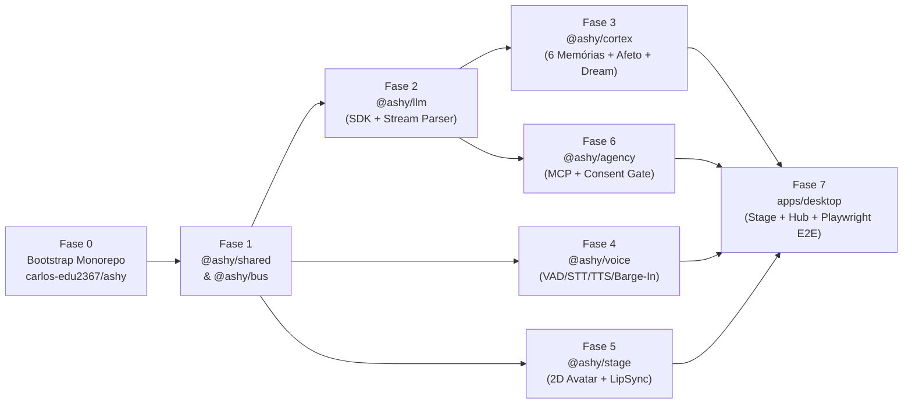

# Plano de Implementação TDD — Projeto ASHY (`v1.0`)

> [!IMPORTANT]
> **Metodologia Obrigatória (`superpowers` + TDD + Red-Team + Testes 100% Locais):**
> - Cada tarefa segue estritamente o ciclo **RED $\rightarrow$ GREEN $\rightarrow$ REFACTOR** (escrever o teste falhando primeiro, implementar o código mínimo para passar, refatorar e tentar quebrar com inputs adversários).
> - Todas as migrações e queries do `ashy.db` (SQLite local + `FTS5` + vetores) devem ser testadas 100% localmente antes de integrar na UI.
> - Toda a interface React 19 (`Stage Overlay` e `Companion Hub`) será validada visualmente com **Playwright** antes da entrega.

---

## Visão Geral das Fases e Grafo de Dependências

---

## Fase 0: Bootstrap do Repositório e Monorepo (`carlos-edu2367/ashy`)

**Objetivo:** Inicializar a estrutura local do repositório em `C:\Users\User\.gemini\antigravity\scratch\ashy`, conectada ao remote `https://github.com/carlos-edu2367/ashy.git`, com suporte a TypeScript estrito, `pnpm` workspaces, `turbo` e `vitest`.

### Arquivos a Criar
- `package.json` (scripts raiz: `dev`, `build`, `test`, `typecheck`, `lint`)
- `pnpm-workspace.yaml` (`apps/*`, `packages/*`)
- `tsconfig.base.json` (TypeScript 5.8+ `strict: true`, `noUncheckedIndexedAccess: true`)
- `vitest.config.ts`
- `docs/ASHY_PROJECT_CONTEXT.md` (cópia versionada do documento de visão do usuário)
- `docs/ASHY_ARCHITECTURE_SPEC.md` (cópia versionada da especificação aprovada)
- `docs/superpowers/plans/2026-10-28-ashy-v1-foundation.md` (cópia versionada deste plano)

### Verificação da Fase 0
- Rodar `pnpm install` e `pnpm test` garantindo que o runner do Vitest inicializa limpo.

---

## Fase 1: `@ashy/shared` & `@ashy/bus` (Contratos, DI Funcional e IPC Tipado)

**Objetivo:** Construir os alicerces de tipagem, utilitários de string/streaming (`clustr`), injeção de dependências funcional (`injeca`-style) e barramento de eventos tipado (`eventa`-style).

### Tarefa 1.1 — `@ashy/shared`: Schemas, Emoções Canônicas e Segmentador de Grafemas
- **Arquivos:**
  - `packages/shared/src/emotions.ts`: Enum e metadados das 13 emoções da Ashy (`happy`, `excited`, `smug`, `tease`, `chaotic`, `curious`, `think`, `surprised`, `awkward`, `concerned`, `sad`, `angry`, `neutral`).
  - `packages/shared/src/memory-types.ts`: Contratos das 6 memórias (`EpisodicMemory`, `SemanticFact`, `RelationalMotif`, `AutobiographicalMilestone`, `UserHabit`, `ProspectiveIntent`).
  - `packages/shared/src/affect-types.ts`: Tipos do vetor de humor $\mathbf{m}(t) = [V, A, P]$, traços de personalidade $\mathbf{p}_{\text{traits}}$ e log de evolução.
  - `packages/shared/src/grapheme-stream.ts`: Segmentador incremental UTF-8 (`Intl.Segmenter`) que retém o último *grapheme cluster* até o chunk seguinte para jamais quebrar emojis ZWJ ou acentos compostos.
- **TDD (`packages/shared/test/shared.test.ts`):**
  - **[RED]** Testar que emojis compostos (ex.: `👩‍💻`) partidos em chunks de bytes/strings separados não são corrompidos e que payloads inválidos de emoção/memória são rejeitados pela validação Valibot.
  - **[GREEN]** Implementar schemas e `createGraphemeStreamer()`.

### Tarefa 1.2 — `@ashy/bus`: DI Funcional (`createContainer`) e Barramento Tipado (`createEventContext`)
- **Arquivos:**
  - `packages/bus/src/di.ts`: Implementação funcional de `provide`, `invoke`, `resolve`, `start` (com `topologicalSort` e detecção de ciclos) e `stop` (execução de `onStop` em ordem topológica reversa).
  - `packages/bus/src/event-bus.ts`: Eventos tipados e RPC unário/streaming com `deliveryId`, orçamento de saltos `hopsRemaining = 32`, cache LRU de deduplicação e `lifetimeController` (abortando todas as Promises pendentes se o transporte fechar).
- **TDD (`packages/bus/test/bus.test.ts`):**
  - **[RED]** Testar: (1) detecção de dependência circular no DI; (2) ordem exata de `onStart` vs `onStop` reverso; (3) bloqueio de loop infinito de eventos ao esgotar `hopsRemaining = 32`; (4) rejeição imediata de RPC em voo quando `ctx.dispose()` é chamado.
  - **[GREEN]** Implementar `di.ts` e `event-bus.ts`.

---

## Fase 2: `@ashy/llm` (Mini-SDK Orientado a Protocolo e Parser de Marcadores em Streaming)

**Objetivo:** Permitir que a Ashy converse usando qualquer provedor (OpenRouter, Anthropic, OpenAI, NVIDIA NIM, Ollama) e extrair em tempo real marcadores `<|ACT {...}|>`, `<|DELAY s|>`, `<|CALLBACK id|>` e `<think>...</think>` sem vazar um único caractere para a tela ou TTS.

### Tarefa 2.1 — Parser Incremental com Retenção de Cauda e Sentinela `\uE000`
- **Arquivos:**
  - `packages/llm/src/marker-parser.ts`: `createTailSafeMarkerParser` que retém `OPEN_TAG.length - 1` caracteres no fim de cada chunk e suporta tanto `<|...|>` quanto a forma escapada `<{'|'}...{'|'}>`, com parser JSON tolerante a falhas para payloads `<|ACT|>`.
  - `packages/llm/src/categorizer.ts`: `createStreamingCategorizer` que separa blocos `<think>` / `<reasoning>` do fluxo de fala (`speech`) e substitui marcadores de atuação pela sentinela posicional `\uE000`.
  - `packages/llm/src/anti-slop.ts`: Detector e filtro de clichês de assistente corporativo.
- **TDD (`packages/llm/test/marker-parser.test.ts`):**
  - **[RED]** Enviar uma resposta caracter por caracter (`1 char per chunk`) contendo `<think>raciocínio</think>Oi!<|ACT {"emotion":"smug","intensity":0.9}|> <|` (tag truncada/malformada) e validar que zero tags vazam em `onSpeech` e que a sentinela `\uE000` marca a posição exata entre `"Oi!"` e o resto da frase.
  - **[GREEN]** Implementar o parser e o categorizador.

### Tarefa 2.2 — Protocol Adapters (`streamText`, `generateText` e Auto-Recovering Tools)
- **Arquivos:**
  - `packages/llm/src/stream-text.ts`: Loop multi-step sobre `ReadableStream` com `highWaterMark: 0`, onde `generateText = collect(streamText())`. Se o LLM chamar uma tool inexistente ou passar argumentos inválidos, captura o erro e devolve `isError: true` para o próprio LLM corrigir no próximo step.
  - `packages/llm/src/adapters/`: Adaptadores `openai-compatible.ts` (OpenRouter, OpenAI, NVIDIA NIM, Ollama, vLLM) e `anthropic-messages.ts`, além de `mock-model.ts` determinístico para testes.
- **TDD (`packages/llm/test/stream-text.test.ts`):**
  - **[RED]** Testar multi-step tool calling onde o 1º step falha na validação de argumentos da tool, o runtime devolve `isError: true` sem derrubar o stream, e o 2º step corrige os argumentos e conclui a fala.
  - **[GREEN]** Implementar `stream-text.ts` e adaptadores.

---

## Fase 3: `@ashy/cortex` (SQLite Local, 6 Memórias, Piadas Internas, FSRS-6, 4 Camadas Afetivas e *Soul Portability*)

**Objetivo:** Construir o coração da Ashy sobre SQLite local (`ashy.db`), garantindo continuidade real entre sessões, nascimento e evolução de piadas internas sem repetição mecânica, esquecimento humano FSRS-6 com *Flashbulb Memories*, humor persistente com *Seriousness Gate* e portabilidade de identidade entre modelos.

### Tarefa 3.1 — Banco de Dados Local `ashy.db` e Repositório das 6 Memórias + Busca Híbrida
- **Arquivos:**
  - `packages/cortex/src/db/schema.ts`: Migrations SQLite criando:
    - `episodic_memories` + `episodic_fts` (FTS5 BM25) + embeddings vetoriais + colunas FSRS (`stability`, `difficulty`, `last_reviewed_at`, `surprise`, `is_flashbulb`).
    - `semantic_facts` (com `category`, `confidence`, `source_episode_ids`, `valid_from`, `invalid_at`).
    - `relational_motifs` (piadas internas, apelidos, referências compartilhadas: `motif`, `trigger_cues`, `stage`, `times_used`, `last_used_at`, `cooldown_hours`).
    - `autobiographical_milestones` (marcos para a linha do tempo *Our Story*).
    - `user_habits` e `prospective_intents`.
    - `affective_state`, `personality_traits`, `personality_evolution_log` e `style_exemplars`.
  - `packages/cortex/src/memory/fsrs-ranker.ts`: Cálculo da curva de esquecimento **FSRS-6** combinada com **Reciprocal Rank Fusion (RRF)** entre BM25 e similaridade cosseno, respeitando o piso de $0.70$ para memórias `is_flashbulb = 1`.
  - `packages/cortex/src/memory/memory-review.ts`: Atualização pós-turno dos parâmetros FSRS (`again`, `hard`, `good`, `easy`) conforme a memória recuperada tenha sido efetivamente útil.
- **TDD (`packages/cortex/test/memory-db.test.ts`):**
  - **[RED]** Testar no SQLite local: (1) inserção e busca híbrida (BM25 + Vetor + FSRS-6); (2) uma memória normal de 60 dias atrás sem revisão perde ranking para uma recente, mas uma memória `is_flashbulb = true` de 60 dias atrás mantém `retrievability >= 0.70`; (3) nota `easy` aumenta a estabilidade $S_m$, enquanto `again` reduz.
  - **[GREEN]** Implementar schema, queries e `fsrs-ranker.ts`.

### Tarefa 3.2 — Motor de Piadas Internas (`InsideJokeEngine`) com Cooldown Anti-Saturação
- **Arquivos:**
  - `packages/cortex/src/relational/inside-joke-engine.ts`:
    - Transições `seed -> callback_candidate -> inside_joke -> legendary`.
    - Regra de elegibilidade: só retorna a piada para o prompt do turno se `hoursSinceLastUse >= cooldown_hours` **e** a similaridade contextual com `trigger_cues` atingir o limiar **e** o *Seriousness Gate* permitir humor.
    - Ao ser usada, incrementa `times_used` e recalcula `cooldown_hours = baseCooldown * (1.5 ** recentUses)`.
- **TDD (`packages/cortex/test/inside-joke.test.ts`):**
  - **[RED]** Simular o cenário do *"fantasma no backend / padre no npm"* nos Dias 1, 5 e 18: provar que no Dia 5 (contexto de bug resolvido) a piada é recuperada e promovida para `inside_joke`; logo em seguida (5 minutos depois), em outra mensagem sobre bug, ela **está bloqueada por `CooldownLock`** (não se repete mecanicamente!); e no Dia 18 (após o cooldown expirar + contexto de biblioteca antiga dando erro) ela volta a ser elegível!
  - **[GREEN]** Implementar `inside-joke-engine.ts`.

### Tarefa 3.3 — Motor Afetivo de 4 Camadas, *Seriousness Gate* e Evolução Reversível
- **Arquivos:**
  - `packages/cortex/src/affect/affect-engine.ts`:
    - Temperamento base da Ashy: $\mathbf{m}_0 = [V_0 = +0.35, A_0 = +0.65, P_0 = +0.60]$ (energética, provocadora e espirituosa estilo *Neuro-sama*).
    - Decaimento exponencial do humor da sessão $\mathbf{m}(t)$ a cada turno.
    - **Seriousness & Context Gate (`evaluateSeriousnessGate`)**: detecta temas delicados, desabafos ou urgências graves e reduz instantaneamente o ganho de brincadeira/caos ($P_{\text{effective}} \le 0.15$).
    - Evolução auditável de traços (`applyExperienceTraitDelta`) + `revertTraitEvolution(logId)` para desfazer qualquer mudança de personalidade pela UI.
- **TDD (`packages/cortex/test/affect-engine.test.ts`):**
  - **[RED]** Testar: (1) persistência de humor entre turnos consecutivos e decaimento gradual após 30 minutos; (2) acionamento imediato do *Seriousness Gate* quando o usuário envia uma mensagem de crise/tristeza, suprimindo o modo caótico/sarcástico; (3) aplicação de delta de personalidade por experiência e reversão exata via `revertTraitEvolution`.
  - **[GREEN]** Implementar `affect-engine.ts`.

### Tarefa 3.4 — Consolidação *Dream & Reflection* (`Predict -> Calibrate`) e *Soul Portability* (KV-Cache Prompt Composer)
- **Arquivos:**
  - `packages/cortex/src/dream/dream-worker.ts`: Executa consolidação semântica por erro de predição (`new`, `reinforce`, `update` com `invalid_at`, `invalidate`), detecta conexões entre episódios e cria marcos em `autobiographical_milestones` para a tela *Our Story*.
  - `packages/cortex/src/prompt/soul-composer.ts`:
    - Monta o System Prompt 100% estático na sessão (DNA da Ashy + *Golden Dialogue Exemplars* + Controles físicos do Avatar + Índice Compacto de Memórias).
    - Monta o prefixo dinâmico apenas na mensagem do `user`: `[YYYY-MM-DD HH:MM]`, `[Context]`, `[Affective State]`, `[Recalled Memories]` e `[Available Shared References]` em Markdown plano (zero XML).
    - Suporta turnos proativos com silêncio seletivo (`[Speak about this notice only if it fits now, or stay quiet.]`).
- **TDD (`packages/cortex/test/soul-portability.test.ts`):**
  - **[RED]** Simular o **Experimento Central de Validação**: alimentar o Cortex com uma história de conversas, fatos e uma piada interna usando o `ModelProvider A`, depois instanciar o `Cortex` com um `ModelProvider B` totalmente novo e verificar que o pacote compilado pelo `soul-composer` preserva 100% os *Golden Dialogue Exemplars*, a piada interna elegível, os fatos atualizados (sem os invalidados) e o prefixo KV-Cache intacto!
  - **[GREEN]** Implementar `dream-worker.ts` e `soul-composer.ts`.

---

## Fase 4: `@ashy/voice` (Voz em Tempo Real, Turn-Taking CAS, *TTFA Boost* e *Barge-In*)

**Objetivo:** Entregar conversação por voz fluida, com paciência inteligente para pausas de pensamento, baixíssima latência para o primeiro som (*TTFA Boost*) e interrupção natural com recibo de reprodução (`PlaybackReceipt`).

### Tarefa 4.1 — Ring Buffer com `HistoryLease`, Turn-Taking (`VoiceEndJudge` CAS) e `SpeculativeRephrase`
- **Arquivos:**
  - `packages/voice/src/audio-input.ts`: Ring buffer de blocos PCM com concessões `retain(signal)` (`preRollMs = 360ms`) e isolamento de consumidores lentos.
  - `packages/voice/src/turn-policy.ts`: Histerese de VAD (`onset = 0.60`, `sustain = 0.18`, `minSpeechMs = 300ms`), disparo de `SpeculativeRephrase` aos `600ms` de pausa e `VoiceEndJudge` aos `1200ms` de pausa (com *Compare-And-Swap* nas revisões `{ rawRev, speakerRev, contextRev }` e extensão de `+3000ms` quando a frase está incompleta).
- **TDD (`packages/voice/test/turn-policy.test.ts`):**
  - **[RED]** Testar: (1) frase incompleta (*"Deixa eu pensar num jeito de..."*) aos `1200ms` recebe `complete: false` do Judge e mantém o turno aberto por até `4200ms`; (2) se o Judge demorar `300ms` para responder `complete: true`, mas no meio tempo o usuário falar uma nova sílaba (`rawRev` subiu), o CAS rejeita o fechamento e não corta o usuário; (3) reutilização da Promise do `SpeculativeRephrase` em `0ms` ao fechar o turno.
  - **[GREEN]** Implementar `audio-input.ts` e `turn-policy.ts`.

### Tarefa 4.2 — `MarkdownSegmenter`, *TTFA Boost Chunker*, Fila Paralela 4x e *Barge-In* com `PlaybackReceipt`
- **Arquivos:**
  - `packages/voice/src/markdown-segmenter.ts`: Retém tokens até fim de frase fora de blocos de código, links ou fórmulas LaTeX, preservando a sentinela `\uE000`.
  - `packages/voice/src/tts-chunker.ts`: Implementa o *TTFA Boost* (nos 2 primeiros chunks, corta em vírgula/pontuação suave após `4` palavras ou força corte em `12` palavras; do 3º em diante, corta em fim de sentença) + chamada imediata a `writeFlush()`.
  - `packages/voice/src/speech-pipeline.ts`: Executa até `4` sínteses TTS em paralelo, reordena por número de sequência (`completedRequests` Map), agenda de forma *gapless* no clock de áudio, dispara os callbacks `<|ACT|>` e `<|DELAY|>` sincronizados ao fim de cada segmento de áudio e retorna o `PlaybackReceipt` (`throughMs` e trecho exato ouvido) quando interrompido por *Barge-In*.
- **TDD (`packages/voice/test/speech-pipeline.test.ts`):**
  - **[RED]** Testar: (1) os 2 primeiros chunks de uma frase longa com vírgulas saem com 4–8 palavras cada; (2) se o chunk #2 sintetizar em `20ms` e o chunk #1 em `80ms`, o áudio ainda toca na ordem `#1 -> #2`; (3) um marcador `<|ACT {"emotion":"tease"}|>` no meio da frase só dispara após o áudio da 1ª metade terminar; (4) simular *Barge-In* na metade do áudio e verificar que o `PlaybackReceipt` calcula `throughMs` e gera o evento de controle `[Interrupted after Xms]` para o próximo turno.
  - **[GREEN]** Implementar `markdown-segmenter.ts`, `tts-chunker.ts` e `speech-pipeline.ts`.

---

## Fase 5: `@ashy/stage` (Corpo Digital 2D Dual-Mode, Lip-Sync *Winner+Runner-Up* e Click-Through $O(1)$)

**Objetivo:** Construir os motores matemáticos e visuais do corpo da Ashy (Auto-Blink, Saccades, Respiração, Mola a 120 Hz, Lip-Sync MFCC, *Light Squint* e Click-Through em CPU $O(1)$) com suporte a **Tachie em Camadas** e **Live2D**.

### Tarefa 5.1 — Motores Matemáticos de Fisiologia, Lip-Sync e Click-Through $O(1)$
- **Arquivos:**
  - `packages/stage/src/drivers/lip-sync-driver.ts`: Algoritmo *Winner + Runner-Up* (`A, E, I, O, U`, ativando apenas a 1ª vogal $\le 0.7$ e a 2ª $\times 0.6 \le 0.35$ com ataque `50` e fechamento `30`) + cessão dinâmica de visemas.
  - `packages/stage/src/drivers/procedural-life.ts`:
    - Auto-Blink multiplicativo (`75ms` fechar `easeOutQuad`, `150-300ms` abrir `easeInQuad`, guarda `BLINK_THRESHOLD = 0.15`).
    - Saccades oculares com CDF empírica (`EYE_SACCADE_INT_P`) + Look-At suave do cursor.
    - Respiração assimétrica (`42%` inspira, `46%` expira, `12%` dwell) + Integrador de Mola Semi-Implícita sub-amostrado a `120 Hz`.
    - *Retinal Light Squint* ($\tau_{\text{fast}} = 0.15\text{s}$, $\tau_{\text{light}} = 4\text{s}$, $\tau_{\text{dark}} = 90\text{s}$) + Convolução Normalizada de Luz Ambiente sem auto-realimentação.
  - `packages/stage/src/drivers/hit-test-cpu.ts`: Lookup $O(1)$ em matriz de alpha `128x72` na RAM (`isAvatarHit2D`) + detecção de ilhas de UI DOM para Click-Through instantâneo sem `gl.readPixels`.
- **TDD (`packages/stage/test/stage-drivers.test.ts`):**
  - **[RED]** Testar matematicamente: (1) supressão das 3 vogais perdedoras no `Winner+Runner-Up`; (2) bloqueio de piscada quando `eyeOpen <= 0.15`; (3) estabilidade da mola a `120 Hz` mesmo com spikes de `dt = 500ms`; (4) reflexo de *squint* quando a luminância de fundo salta de `0.1` para `0.95`; (5) precisão do `isAvatarHit2D` em `< 0.01ms`.
  - **[GREEN]** Implementar todos os drivers matemáticos.

### Tarefa 5.2 — Componentes React `AshyStageCanvas` (Modo Tachie em Camadas + Modo Live2D)
- **Arquivos:**
  - `packages/stage/src/components/AshyStageCanvas.tsx`: Componente React que renderiza o avatar ativo (com suporte nativo ao avatar expressivo em camadas da Ashy no Dia 1 e importador `.zip`/`.model3.json` Live2D com inspeção automática de expressões), Balão de Presença com seguidor de mola 2D (`PresenceBubble`) e barra flutuante de controles rápidos.

---

## Fase 6: `@ashy/agency` (Percepção Autorizada, Progressive MCP Discovery e Gatekeeper)

**Objetivo:** Permitir que a Ashy observe o contexto autorizado e utilize ferramentas MCP sob controle estrito do usuário (`Observe` $\neq$ `Prepare` $\neq$ `Execute`).

### Tarefa 6.1 — Progressive MCP Discovery, Gatekeeper de 3 Níveis e Filtro Visual dHash
- **Arquivos:**
  - `packages/agency/src/mcp-progressive.ts`: Expõe apenas as 3 meta-ferramentas (`search_mcp_tools`, `get_mcp_tool_details`, `call_mcp_tool`) para não inflar o prompt da Ashy.
  - `packages/agency/src/action-gatekeeper.ts`: Classifica ações em `observe-only`, `read-safe` e `staged-confirm`. Para `staged-confirm`, cria um `PendingActionRequest` que aguarda aprovação explícita do usuário (`approveOnce`, `approveSession`, `deny`) e registra tudo em `action_audit_log`.
  - `packages/agency/src/vision-dhash.ts`: Cálculo de hash perceptual dHash 64-bit e distância de Hamming para descartar frames de tela idênticos sem gastar tokens.
- **TDD (`packages/agency/test/agency.test.ts`):**
  - **[RED]** Testar: (1) bloqueio imediato de observação quando `eyesMode === 'off'`; (2) interceptação de uma tool MCP de escrita (`write_file` / `run_command`), provando que ela **não** executa até que `approveOnce(actionId)` seja chamado; (3) registro imutável no `action_audit_log`.
  - **[GREEN]** Implementar `mcp-progressive.ts`, `action-gatekeeper.ts` e `vision-dhash.ts`.

---

## Fase 7: `apps/desktop` (Stage Overlay + Companion Hub em React 19 + Validação Visual Playwright)

**Objetivo:** Unificar todos os pacotes na aplicação Desktop/Web com design em espaço de cor perceptual **OKLCH**, entregando a janela de presença **Stage Overlay** e o **Companion Hub** completo, validados ponta a ponta no navegador/Electron via **Playwright**.

### Tarefa 7.1 — Aplicação React 19 + Electron (`Stage Overlay` + `Companion Hub`)
- **Arquivos:**
  - `apps/desktop/src/main/index.ts`: Orquestração via `@ashy/bus` (`createContainer`) gerenciando o `ashy.db`, o `AshyCortex`, o `ActionGatekeeper` e as janelas `StageWindow` (transparente, always-on-top, click-through $O(1)$) e `HubWindow`.
  - `apps/desktop/src/renderer/`:
    - **Modo Stage Overlay (`/?view=stage`)**: Avatar animado da Ashy respirando, piscando, olhando para o cursor, falando com Lip-Sync e mudando expressões em tempo real (`smug`, `tease`, `chaotic`, `happy`, `concerned`), com balão de fala/pensamento em mola 2D, input rápido de voz/texto, botão de *Barge-In* e pílulas de privacidade (*Mic*, *Eyes*, *DND*).
    - **Modo Companion Hub (`/?view=hub`)** com 5 seções interativas:
      1. **Chat & Live Stage Studio**: Conversa em tempo real (voz + texto) com telemetria ao vivo do Córtex (humor atual $[V, A, P]$, estado do *Seriousness Gate*, memórias recuperadas no turno e simulador de troca de modelo LLM para testar o *Soul Portability*).
      2. **Our Story (Nossa História)**: Linha do tempo visual dos marcos autobiográficos, primeiros diálogos, projetos e momentos *Flashbulb*.
      3. **Memory & Inside-Jokes Inspector**: Tabela e grafo das 6 memórias no `ashy.db`, mostrando a curva de esquecimento **FSRS-6** (% de nitidez/lembrança), o estágio das **Piadas Internas** (`Seed` $\rightarrow$ `Inside Joke` + timer de Cooldown) e botões para criar, editar, favoritar ou apagar qualquer memória.
      4. **Personality Evolution & Dream Center**: Gráfico dos traços da Ashy, botão para rodar um ciclo de **Dream & Reflection (`Predict -> Calibrate`)** sob demanda e lista auditável de mudanças de personalidade com botão **Revert** em 1 clique.
      5. **Ashy's Room & Consent / MCP Center**: Quarto visual reativo ao horário e aos troféus da história compartilhada + painel de permissões e aprovação de ações MCP (`Observe / Prepare / Confirm`) com *Audit Log*.

### Tarefa 7.2 — Suíte de Testes E2E e Auditoria Visual com Playwright
- **Verificação Obrigatória (Regra Global #4):**
  - Subir a aplicação localmente, abrir no **Playwright** e testar visualmente e funcionalmente:
    1. Renderização e animação do avatar da Ashy no `Stage` (mudança de expressão via `<|ACT|>`, Lip-Sync, piscada e *Light Squint*).
    2. Fluxo completo de conversa criando uma **Piada Interna** (*"fantasma no backend"*), verificando sua aparição no **Memory Inspector** e no **Our Story**, seu bloqueio imediato por Cooldown e sua retomada contextual após expirar o Cooldown.
    3. Acionamento do **Seriousness Gate** quando o usuário muda para um tom sério/delicado.
    4. Execução de um ciclo de **Dream & Reflection** e teste do botão **Revert** na evolução de personalidade.
    5. Interceptação e aprovação/recusa de uma ação sensível no **MCP Consent Gate**.
    6. **Experimento de Troca de Modelo (*Soul Portability*)**: trocar o provedor/modelo ativo na UI e verificar que a Ashy mantém sua identidade, suas memórias e suas referências compartilhadas.

---

## Aprovação do Plano e Modo de Execução

1. **Você aprova este Plano de Implementação (`ashy_implementation_plan.md`)?**
2. Como prefere prosseguir agora?
   - **Opção A (`subagent-driven-development`):** Começar a implementação agora dividindo as fases entre subagentes especializados com TDD e validação Playwright, fazendo push inicial na `carlos-edu2367/ashy`.
   - **Opção B (`executing-plans`):** Executar o plano passo a passo diretamente nesta sessão principal.
   - **Opção C (Apenas Salvar a Spec e o Plano no Repositório `carlos-edu2367/ashy`):** Fazer apenas o commit da documentação de arquitetura (`ASHY_PROJECT_CONTEXT.md`, `ASHY_ARCHITECTURE_SPEC.md` e o plano TDD) no repositório GitHub por enquanto, deixando o código para a próxima sessão.
