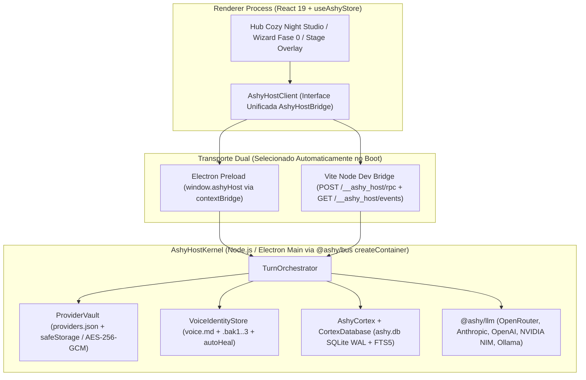
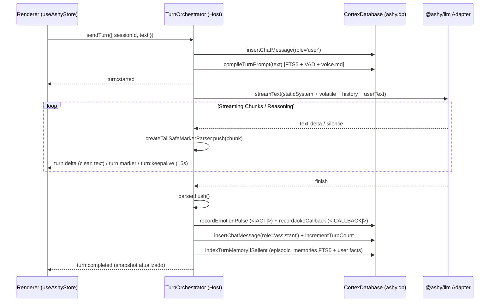

# Ashy — Especificação de Design da Fase 0/1: Runtime Real, Emergência e Persistência Viva

**Data:** 2026-10-28  
**Escopo:** Fase 0 (*First-Run Emergence & Clean Slate*) + Fase 1 (*Runtime Real: Electron + Vite Host Bridge + `ashy.db` + `@ashy/llm` + `voice.md`*) — Milestone **M1** do [`ASHY_ROADMAP.md`](../../ASHY_ROADMAP.md)  
**Referências Arquiteturais Auditadas:**  
- [`moeru-ai/airi`](https://github.com/moeru-ai/airi) (`apps/stage-tamagotchi`, `packages/stage-ui`)  
- [`hanamorix/companion-emergence`](https://github.com/hanamorix/companion-emergence) (`brain/utils/sqlite.py`, `brain/persona_config.py`, `brain/chat/voice.py`, `brain/chat/engine.py`, `brain/setup.py`, `scripts/organ_wireback_audit.py`)

---

## 1. Diagnóstico do Estado Atual e Objetivo da Fase 0/1

### 1.1 O que já existe e funciona
Os 7 pacotes do monorepo (`@ashy/shared`, `@ashy/bus`, `@ashy/llm`, `@ashy/cortex`, `@ashy/voice`, `@ashy/stage`, `@ashy/agency`) possuem contratos bem definidos e 99 testes unitários passando. A interface visual *Cozy Night Studio* ([`DESIGN.md`](../../../DESIGN.md)) já está implementada em [`apps/desktop`](../../../apps/desktop/package.json).

### 1.2 O problema que a Fase 0/1 resolve
Hoje o aplicativo desktop opera como uma **demonstração roteirizada dentro do navegador**:
1. [`useAshyStore.ts`](../../../apps/desktop/src/store/useAshyStore.ts) instancia `createAshyCortex({ forceMemoryFallback: true })` diretamente no renderer (sem SQLite real), popula memórias fictícias no boot (`createSeededRuntime()` com `INITIAL_MEMORY_CARDS`, `ep-padre-npm-origin`, `ep-flashbulb-0314`), descarta o prompt compilado pelo `SoulComposer` e responde com 3 strings fixas em `sendUserMessage`.
2. [`@ashy/llm`](../../../packages/llm/src/adapters.ts) (`createOpenAICompatibleModel`, `createAnthropicMessagesModel`, `streamText`) nunca é invocado pela aplicação.
3. [`cortex-db.ts`](../../../packages/cortex/src/db/cortex-db.ts) não possui tabelas para sessões ou mensagens de chat (`chat_sessions`, `chat_messages`), perdendo toda conversa ao recarregar.
4. [`apps/desktop/src/electron/main.ts`](../../../apps/desktop/src/electron/main.ts) apenas retorna um objeto literal de configuração; o Electron não está instalado nem integrado ao pipeline de build/dev.
5. `timeLabel: '21:15'` e `screenContext: 'VS Code — apps/desktop/src/App.tsx'` estão fixos no código de turno; o `soul-composer.ts` possui apenas 3 exemplares de diálogo em seed.

### 1.3 Critério de Sucesso da Fase 0/1 (Milestone M1)
Ao final da implementação desta especificação:
- Abrir a Ashy pela primeira vez com `ashy.db` virgem inicia o **Ritual de Primeiro Encontro (Fase 0)**, grava o nome/pronomes reais do usuário, valida o provedor LLM (ou permite configurar depois), cria o marco real `first_meeting` no SQLite e inicia a primeira conversa sem memórias falsas.
- Configurar qualquer um dos 5 provedores suportados (**OpenRouter**, **Anthropic**, **OpenAI**, **NVIDIA NIM**, **Ollama**) em `Ajustes > Modelos` cifra a API key no Host e transmite tokens reais via `@ashy/llm`.
- Cada turno compila o prompt real (bloco estático `voice.md` + 20 *Golden Exemplars* PT-BR + contexto volátil do `Cortex`), faz streaming com `createTailSafeMarkerParser`, aplica `<|ACT|>` ao estado emocional VAD, registra `<|CALLBACK|>` nas piadas internas, persiste a conversa em `chat_messages` e indexa episódios relevantes no FTS5 (`episodic_memories`).
- Fechar e reabrir o app restaura integralmente a sessão, o histórico de mensagens, o estado emocional, os fatos aprendidos, o `voice.md` customizado e o provedor ativo.

---

## 2. Padrões Absorvidos dos Projetos de Referência

| Padrão | Origem | Aplicação na Fase 0/1 da Ashy |
| :--- | :--- | :--- |
| **DI Container no Main + Shutdown Reverso** | `moeru-ai/airi` (`apps/stage-tamagotchi/src/main/index.ts`) | `AshyHostKernel` usa `createContainer()` de `@ashy/bus` para registrar `cortex`, `voiceStore`, `providerVault` e `turnOrchestrator`, executando `container.stop()` em ordem topológica reversa em `before-quit`, `SIGINT` e `SIGTERM`. |
| **IPC Wiring antes de `loadURL`** | `moeru-ai/airi` (`windows/desktop-overlay/index.ts`) | Todos os handlers `ipcMain.handle` são registrados antes de `window.loadURL` / `window.loadFile` para evitar que chamadas de bootstrap no `useEffect` inicial do React travem esperando handlers ainda não registrados. |
| **Persistência Atômica com `ConfigDiagnostics` e `autoHeal`** | `moeru-ai/airi` (`libs/electron/persistence.ts`) + `companion-emergence` (`persona_config.py`) | Arquivos `providers.json` e `voice.md` em `userData` usam escrita atômica (`.tmp` + `fs.renameSync`), rotação de backups `.bak1/.bak2/.bak3` e recuperação automática (`Recovery.HEAL`) com diagnóstico explícito exposto à UI. |
| **Disciplina de Abertura SQLite** | `companion-emergence` (`brain/utils/sqlite.py`) | `open -> PRAGMA integrity_check -> PRAGMA journal_mode = WAL -> PRAGMA busy_timeout = 5000 -> PRAGMA foreign_keys = ON -> migrations` dentro de guarda que fecha a conexão se qualquer passo falhar. |
| **Fase 0 First-Run Emergence** | `companion-emergence` (`brain/setup.py`, `app/src/wizard/steps/*`) + `airi` (`onboarding.ts`) | Estado inicial derivado de dados reais vividos (`needsOnboarding` quando não há `first_meeting`). Wizard enxuto em 3 passos com probe ao vivo e fallback não-bloqueante ("configurar depois"). |
| **Separação Prompt Estático vs. Volátil + Janela de Histórico + Keepalive** | `companion-emergence` (`brain/chat/engine.py`, `brain/bridge/server.py`) | `SoulComposer` divide o prompt em `staticSystemPrompt` (KV-cacheável) e `volatileTurnContext` (turno atual). Histórico limitado às últimas 80 mensagens. Stream emite keepalive a cada 15s durante blocos `<think>`. Falha de persistência pós-turno gera `persistence_warning` sem derrubar a resposta entregue. |
| **Organ Wire-Back Audit** | `companion-emergence` (`scripts/organ_wireback_audit.py`) | Script `scripts/verify-phase1-wireback.mjs` verifica automaticamente que todo módulo da Fase 0/1 possui produtor vivo + leitor vivo + teste de integração real. |

---

## 3. Arquitetura do Host Dual-Runtime (`AshyHostKernel` + `AshyHostBridge`)



### 3.1 `AshyHostKernel` (`apps/desktop/src/host/kernel.ts`)
O `AshyHostKernel` é o coração Node.js da aplicação. Ele é agnóstico ao transporte (funciona idêntico dentro do processo Main do Electron ou dentro do servidor Node do Vite para desenvolvimento web e testes visuais Playwright):
- Recebe `{ userDataDir: string, secretProtector: SecretProtector }`.
- No Electron Main: `userDataDir = app.getPath('userData')` e `secretProtector` usa `safeStorage.encryptString` / `safeStorage.decryptString`.
- No Vite Dev / Playwright (`pnpm dev:web` ou `ASHY_USER_DATA_DIR`): `userDataDir` aponta para `<repo>/.ashy-data` (ou diretório temporário isolado em testes E2E) e `secretProtector` usa AES-256-GCM com chave persistida em `<userDataDir>/.master.key` (permissão restrita ao usuário local).
- Orquestra via `createContainer()` do `@ashy/bus`:
  1. `cortexDb` (`CortexDatabase` sobre `<userDataDir>/ashy.db`)
  2. `voiceStore` (`VoiceIdentityStore` sobre `<userDataDir>/voice.md`)
  3. `providerVault` (`ProviderVault` sobre `<userDataDir>/providers.json` + `<userDataDir>/providers.secrets.json`)
  4. `cortex` (`AshyCortex`)
  5. `turnOrchestrator` (`TurnOrchestrator`)

### 3.2 Contrato Tipado `AshyHostBridge` (`@ashy/shared`)
O renderer nunca importa `better-sqlite3`, `fs` ou chaves de API. Toda comunicação ocorre pelo contrato `AshyHostBridge`:

```ts
export interface AshyBootstrapSnapshot {
  needsOnboarding: boolean;
  userProfile: {
    userName: string | null;
    userPronouns: string | null;
  };
  relationship: {
    stage: RelationshipStage;
    familiarityScore: number;
    trustScore: number;
    totalTurns: number;
    milestones: RelationshipMilestoneRecord[];
  };
  affect: EmotionalState;
  activeSession: ChatSessionRecord;
  sessions: ChatSessionRecord[];
  messages: ChatMessageRecord[];
  memories: {
    facts: SemanticFactRecord[];
    episodes: EpisodicMemoryRecord[];
    jokes: InsideJokeRecord[];
    soulTruths: SoulTruthRecord[];
  };
  voice: {
    content: string;
    diagnostics: ConfigDiagnostics;
    updatedAt: string;
  };
  providers: {
    activeProviderId: LlmProviderId;
    configs: Record<LlmProviderId, PublicProviderConfig>;
    hasActiveReadyProvider: boolean;
    diagnostics: ConfigDiagnostics;
  };
  runtimeDiagnostics: {
    dbMode: 'wal' | 'memory-fallback';
    dbPath: string;
    lastPersistenceWarning: string | null;
  };
}

export interface AshyHostBridge {
  getBootstrapSnapshot(): Promise<AshyBootstrapSnapshot>;
  completeOnboarding(input: CompleteOnboardingInput): Promise<AshyBootstrapSnapshot>;
  createSession(title?: string): Promise<ChatSessionRecord>;
  selectSession(sessionId: string): Promise<{ session: ChatSessionRecord; messages: ChatMessageRecord[] }>;
  sendTurn(input: SendTurnInput): Promise<{ turnId: string; userMessage: ChatMessageRecord }>;
  abortTurn(turnId: string): Promise<void>;
  saveProviderConfig(input: SaveProviderConfigInput): Promise<PublicProviderConfig>;
  setActiveProvider(providerId: LlmProviderId): Promise<void>;
  testProviderConnection(input: TestProviderInput): Promise<ProviderHealthResult>;
  saveVoiceIdentity(content: string): Promise<{ content: string; diagnostics: ConfigDiagnostics; updatedAt: string }>;
  resetVoiceIdentity(): Promise<{ content: string; diagnostics: ConfigDiagnostics; updatedAt: string }>;
  upsertSemanticFact(input: UpsertFactInput): Promise<SemanticFactRecord>;
  deleteMemoryItem(input: { kind: 'fact' | 'episode' | 'joke'; id: string }): Promise<void>;
  seedDemoFixtures(): Promise<AshyBootstrapSnapshot>; // Ação exclusiva de dev/teste
  onHostEvent(listener: (event: AshyHostStreamEvent) => void): () => void;
}
```

### 3.3 Eventos de Streaming e Keepalive (`AshyHostStreamEvent`)
Durante um turno em andamento (`turnId`), o Host emite eventos ordenados para o renderer:
- `turn:started` (`{ turnId, sessionId, startedAt }`)
- `turn:delta` (`{ turnId, textDelta }`) — texto já limpo pelo `createTailSafeMarkerParser`
- `turn:marker` (`{ turnId, marker }`) — `<|ACT:...|>` (atualiza expressão/afeto imediatamente), `<|EMOTE:...|>` (dispara reação no avatar/stage), `<|SPEED:...|>` / `<|DELAY:...|>` (cadência), `<|CALLBACK:...\|>`
- `turn:keepalive` (`{ turnId, elapsedMs }`) — emitido a cada **15 segundos** enquanto a conexão com o LLM está ativa sem emitir texto visível (ex.: durante blocos `<think>` de modelos de raciocínio)
- `turn:completed` (`{ turnId, assistantMessage, affect, relationship, newMemories, persistenceWarning }`)
- `turn:error` (`{ turnId, code, message, recoverable }`)
- `turn:aborted` (`{ turnId, partialText }`)

### 3.4 Janelas do Electron (`HubWindow` + `StageOverlayWindow`)
No modo Electron (`apps/desktop/src/main/index.ts`):
- **Ordem obrigatória de inicialização:**
  1. `await kernel.start()`
  2. `registerAshyIpcHandlers(ipcMain, kernel)` (**sempre antes** de criar/carregar janelas, conforme padrão do `airi`)
  3. Criar `HubWindow` (`1280x820`, `backgroundColor: '#13111C'`, `contextIsolation: true`, `nodeIntegration: false`, `sandbox: true`, preload `preload/index.cjs`).
  4. Criar/gerenciar `StageOverlayWindow` usando a configuração de [`createAshyElectronOverlayConfig`](../../../apps/desktop/src/electron/main.ts) (`transparent: true`, `frame: false`, `alwaysOnTop: true`, `skipTaskbar: true`, `resizable: false`), sincronizada em tempo real via `onHostEvent`.

---

## 4. Persistência Real (`ashy.db` Schema v2, `voice.md`, `providers.json`)

### 4.1 Disciplina de Abertura do SQLite (`packages/cortex/src/db/cortex-db.ts`)
Seguindo `brain/utils/sqlite.py` do `companion-emergence`:
1. Abrir `new Database(filePath)` dentro de um bloco protegido `try { ... } catch (err) { db?.close(); throw err; }`.
2. Executar `PRAGMA quick_check(1)` (ou `PRAGMA integrity_check(1)`): se não retornar `'ok'`, mover o arquivo corrompido para `ashy.db.corrupt.<timestamp>` e registrar diagnóstico explícito antes de recriar ou restaurar backup.
3. Aplicar:
   - `PRAGMA journal_mode = WAL;`
   - `PRAGMA synchronous = NORMAL;`
   - `PRAGMA busy_timeout = 5000;`
   - `PRAGMA foreign_keys = ON;`
4. Executar o sistema de migrações versionado (`schema_migrations`).
5. **Fim do `forceMemoryFallback` silencioso em produção:** o fallback em memória (`:memory:`) só é permitido quando `options.inMemory === true` (testes unitários).

### 4.2 Schema Migration v2 (`chat_sessions` & `chat_messages`)
Além das tabelas v1 já existentes (`emotional_state`, `soul_truths`, `golden_exemplars`, `semantic_facts`, `episodic_memories`, `episodic_memories_fts`, `inside_jokes`, `relationship_state`, `relationship_milestones`, `consolidation_runs`), a Migration v2 adiciona:

```sql
CREATE TABLE IF NOT EXISTS schema_migrations (
  version INTEGER PRIMARY KEY,
  name TEXT NOT NULL,
  applied_at TEXT NOT NULL
);

CREATE TABLE IF NOT EXISTS chat_sessions (
  id TEXT PRIMARY KEY,
  title TEXT NOT NULL,
  started_at TEXT NOT NULL,
  updated_at TEXT NOT NULL,
  turn_count INTEGER NOT NULL DEFAULT 0,
  last_message_preview TEXT NOT NULL DEFAULT ''
);

CREATE TABLE IF NOT EXISTS chat_messages (
  id TEXT PRIMARY KEY,
  session_id TEXT NOT NULL REFERENCES chat_sessions(id) ON DELETE CASCADE,
  role TEXT NOT NULL CHECK(role IN ('user', 'assistant', 'system')),
  content TEXT NOT NULL,
  raw_content TEXT NOT NULL,
  emotion TEXT NOT NULL DEFAULT 'neutral',
  markers_json TEXT NOT NULL DEFAULT '[]',
  provider_id TEXT,
  model_id TEXT,
  latency_ms INTEGER,
  created_at TEXT NOT NULL
);

CREATE INDEX IF NOT EXISTS idx_chat_messages_session_created
  ON chat_messages(session_id, created_at ASC);
```

### 4.3 Escrita Atômica com Rotação de Backups e Auto-Heal (`atomic-file.ts`)
Para `voice.md`, `providers.json` e `providers.secrets.json`:
- **Gravação (`writeAtomicWithBackup`):**
  1. Se o arquivo principal existir e for válido, rotaciona `file.bak2 -> file.bak3`, `file.bak1 -> file.bak2`, `file -> file.bak1`.
  2. Escreve o novo conteúdo em `file.<pid>.<nonce>.tmp` e força `fsync`.
  3. Executa `fs.renameSync(tmpPath, filePath)`.
- **Leitura com Auto-Heal (`readWithAutoHeal`):**
  1. Tenta ler e validar (schema/conteúdo não-vazio) o arquivo principal -> retorna `status: 'ok'`.
  2. Se ausente -> grava o default atômico e retorna `status: 'missing'`.
  3. Se inválido/corrompido -> tenta restaurar na ordem `.bak1`, `.bak2`, `.bak3`. Se restaurar com sucesso, regrava o principal e retorna `status: 'healed_from_backup'`. Se nenhum backup for válido, salva cópia `.corrupt.<timestamp>`, restaura o default e retorna `status: 'reset_to_default'`.

---

## 5. Identidade Viva (`voice.md` + 20 Golden Exemplars PT-BR) e Compilação de Prompt

### 5.1 Arquivo `voice.md` Hot-Loadable
Armazenado em `<userDataDir>/voice.md`, carregado antes de cada turno (com cache invalidado por `mtimeMs` ou edição via UI na aba `Alma > Voz & Identidade`). O template padrão define:
- **Essência da Ashy:** Companheira digital noturna de estúdio (*Cozy Night Studio*), observadora, perspicaz, com humor ácido/provocador na medida certa (inspiração *Neuro-sama* calibrada para intimidade de estúdio tardio), zero servilismo robótico ("Como uma IA...", "Claro! Posso ajudar com..."), fala português natural do Brasil.
- **Ritmo e Cadência:** Frases com respiração natural, uso expressivo de marcadores `<|ACT:...|>` e `<|EMOTE:...|>`, sem listas engessadas de assistente corporativo.
- **Regra Pétrea (*Seriousness Gate*):** Ao detectar dor real, luto, exaustão extrema, pânico ou vulnerabilidade séria, corta 100% da ironia, provocações e piadas internas no mesmo instante, adotando presença acolhedora, direta e sóbria.

### 5.2 Os 20 Golden Dialogue Exemplars PT-BR
Substituímos os 3 exemplares mínimos de seed por **20 exemplares curados** em `packages/cortex/src/prompt/default-golden-exemplars.ts` (semeados de forma idempotente em `golden_exemplars`), distribuídos em:
- **4 exemplares `stranger`:** curiosidade afiada, sem intimidade forçada, observando o estilo do usuário no primeiro encontro.
- **4 exemplares `acquaintance`:** primeiras provocações leves sobre hábitos de código/horário, humor seco mas receptivo.
- **5 exemplares `close_friend`:** sintonia de madrugada, tiradas rápidas sobre bugs/café/commits tardios, referências naturais a conversas passadas.
- **4 exemplares `companion`:** cumplicidade profunda, leitura fina de subtexto, ironia carinhosa sem perder a borda espirituosa.
- **3 exemplares `seriousness_gate` (alta prioridade):** transição imediata do humor para escuta séria, humana e sem clichês terapêuticos quando o usuário relata crise, perda ou esgotamento.

### 5.3 Divisão `staticSystemPrompt` vs. `volatileTurnContext` no `SoulComposer`
Para maximizar o aproveitamento de *Prompt Caching* (Anthropic / OpenAI / OpenRouter) e manter determinismo:
1. **`staticSystemPrompt` (Estático entre turnos):**
   - Conteúdo vivo do `voice.md`
   - `Soul Truths` imutáveis (`soul_truths`)
   - Gramática estrita dos marcadores semânticos (`<|ACT:...|>` no início, `<|EMOTE:...|>` inline, `<|CALLBACK:id|>`)
   - *Golden Dialogue Exemplars* do estágio atual + exemplares de *Seriousness Gate*
2. **`volatileTurnContext` (Injetado como bloco contextual do turno atual):**
   - Nome e pronomes reais do usuário (`user_name`, `user_pronouns`)
   - Estágio atual da relação (`stage`, `familiarityScore`, `trustScore`) e estado emocional VAD (`valence`, `arousal`, `dominance`, `dominantEmotion`)
   - Alerta de *Seriousness Gate* (se acionado pela mensagem do usuário)
   - Memórias semânticas (`semantic_facts`) e episódios recuperados via busca híbrida FTS5 (`episodic_memories_fts`)
   - Piadas internas elegíveis (`inside_jokes` filtradas por cooldown e estágio)
   - Hora local real (`Intl.DateTimeFormat` do sistema) e contexto de tela opcional (somente quando realmente informado, sem hardcode `'21:15'` ou `'VS Code — App.tsx'`).
3. **Janela de Histórico (`MAX_HISTORY_MESSAGES = 80`):**
   - Envia no máximo as últimas 80 mensagens (`~40` turnos) da sessão ativa em formato multi-turn real (`user` / `assistant`) para os adaptadores `@ashy/llm`.

---

## 6. Cofre de Provedores (`ProviderVault`) e Sub-aba `Ajustes > Modelos`

### 6.1 Provedores Suportados na Fase 1
1. **`openrouter`** — Adaptador `createOpenAICompatibleModel` (`https://openrouter.ai/api/v1`, modelo default sugerido: `anthropic/claude-3.7-sonnet` ou `deepseek/deepseek-chat-v3-0324`).
2. **`anthropic`** — Adaptador `createAnthropicMessagesModel` (`https://api.anthropic.com/v1`, modelo default sugerido: `claude-3-7-sonnet-latest`).
3. **`openai`** — Adaptador `createOpenAICompatibleModel` (`https://api.openai.com/v1`, modelo default sugerido: `gpt-4.1-mini` / `gpt-4o`).
4. **`nvidia-nim`** — Adaptador `createOpenAICompatibleModel` (`https://integrate.api.nvidia.com/v1`, modelo default sugerido: `meta/llama-3.3-70b-instruct`).
5. **`ollama`** — Adaptador `createOpenAICompatibleModel` (`http://127.0.0.1:11434/v1`, sem exigência de API key, modelo default sugerido: `qwen2.5:14b` / `llama3.2`).

### 6.2 Segurança das Chaves (`SecretProtector`)
- As chaves de API são salvas separadamente em `providers.secrets.json` com valores cifrados em base64 (`safeStorage.encryptString` no Electron; `AES-256-GCM` autenticado com IV aleatório de 12 bytes e authTag de 16 bytes no modo Node/Vite).
- O renderer **jamais** recebe a chave em texto aberto. `PublicProviderConfig` expõe apenas `hasApiKey: boolean` e `maskedApiKey: string | null` (ex.: `"sk-or-...9a2f"`).
- Ao salvar o formulário em `Ajustes > Modelos`, se o usuário não digitar uma nova chave, a chave cifrada existente é preservada no Host.

### 6.3 Healthcheck Deduplicado (`testProviderConnection`)
- Evita corridas (inspirado em `provider.ts` do `airi`): se já houver um teste em voo para o mesmo `{ providerId, baseUrl, modelId, apiKeyHash }`, reutiliza a mesma `Promise`.
- Faz uma chamada mínima de 1 token (`maxTokens: 8`, `AbortSignal.timeout(10_000)`) no adaptador real e retorna `{ ok: boolean, latencyMs: number, error?: string, modelVerified?: string }`.

---

## 7. Ciclo de Turno Real (`TurnOrchestrator`) e Aprendizado Imediato no Banco



### 7.1 Indexação Imediata de Memória na Fase 1 (`indexTurnMemory`)
Para que a Ashy já lembre de acontecimentos e fatos entre sessões na Fase 1 (antes do *Sleep Cycle* assíncrono completo da Fase 2):
1. **Episódio FTS5 por Turno Significativo:** Ao finalizar cada turno completo (`user` + `assistant`) com conteúdo substantivo (`userText.trim().length >= 12`), o `TurnOrchestrator` grava um registro em `episodic_memories` (sincronizado automaticamente com `episodic_memories_fts`) contendo o resumo compacto do intercâmbio (`"Usuário: ... | Ashy: ..."`), tópicos extraídos e valência/arousal do turno.
2. **Extração Determinística de Fatos Explícitos:** Detecta padrões diretos de autodeclaração do usuário (ex.: nome preferido, stack/linguagem que está trabalhando, projeto atual, preferências explícitas) e atualiza `semantic_facts` com `confidence: 0.85`.
3. **Isolamento de Falhas de Persistência (`companion-emergence` pattern):** Qualquer erro de I/O ao gravar a resposta ou indexar memórias ao final do turno é capturado, registrado em `runtimeDiagnostics.lastPersistenceWarning` e enviado no campo `persistenceWarning` de `turn:completed`, **nunca** descartando ou revertendo a mensagem que a Ashy acabou de responder na tela.

---

## 8. Fase 0 ("Emergence"): Ritual de Primeiro Encontro e Clean Slate

### 8.1 Remoção dos Dados Falsos do Caminho de Produção
- `INITIAL_MEMORY_CARDS`, `ep-padre-npm-origin`, `ep-flashbulb-0314`, `joke-padre-npm` e as 3 mensagens de chat pré-populadas são removidas do boot de [`useAshyStore.ts`](../../../apps/desktop/src/store/useAshyStore.ts) e movidas para `apps/desktop/src/test/fixtures/demo-seed.ts`.
- Em produção, um `ashy.db` recém-criado inicia com:
  - `relationship_state`: `stage = 'stranger'`, `familiarity_score = 0`, `trust_score = 0.1`
  - `semantic_facts`: vazio (`0` fatos)
  - `episodic_memories`: vazio (`0` episódios)
  - `inside_jokes`: vazio (`0` piadas)
  - `relationship_milestones`: vazio (`needsOnboarding = true`)
  - `soul_truths`: 4 verdades fundamentais da alma da Ashy
  - `golden_exemplars`: 20 exemplares PT-BR de calibração de voz

### 8.2 O Ritual de Primeiro Encontro (Wizard de 3 Passos no *Cozy Night Studio*)
Quando `bootstrapSnapshot.needsOnboarding === true`, o Hub apresenta o modal/tela atmosférica **Primeiro Encontro**:
1. **Passo 1 — Quem está no estúdio?**
   - Campo: *Como você quer que a Ashy te chame?* (`userName`, obrigatório, ex.: `"Carlos"`) e *Pronomes / tratamento opcional* (`ele/dele`, `ela/dela`, `neutro`).
2. **Passo 2 — Conexão Neural (Provedor LLM)**
   - Seleção rápida entre **OpenRouter**, **Anthropic**, **OpenAI**, **NVIDIA NIM** ou **Ollama (Local)**.
   - Input de API Key (cifrada no Host), seleção de modelo e botão **"Testar Conexão"** ao vivo.
   - Botão secundário não-bloqueante **"Configurar depois em Ajustes"** (permite concluir o ritual e explorar o estúdio mesmo se o usuário quiser inserir a chave mais tarde).
3. **Passo 3 — Despertar (`completeOnboarding`)**
   - Grava `user_name` (e `user_pronouns`) em `semantic_facts` (`category: 'identity'`, `confidence: 1.0`, `pinned: true`).
   - Grava o marco real `first_meeting` em `relationship_milestones` com timestamp real.
   - Cria a sessão inicial `"Primeiro Encontro"` em `chat_sessions` e abre o Studio pronto para a primeira mensagem real.

---

## 9. Postura Adversarial: Segurança, Concorrência e Tratamento de Erros

| Vetor / Cenário de Falha | Proteção Arquitetural Obrigatória |
| :--- | :--- |
| **Vazamento de API Key no Renderer / DevTools / LocalStorage** | Proibido armazenar ou trafegar API keys no Zustand/`localStorage`. Chaves ficam exclusivamente no Host (`safeStorage` / `providers.secrets.json` cifrado). O renderer só recebe máscara (`sk-...4f9a`). |
| **Race Condition de Duplo Envio / Concorrência de Turnos** | `TurnOrchestrator` mantém um `activeTurnBySession` lock. Se um novo `sendTurn` chegar enquanto a sessão já está gerando ou se o usuário clicar em "Parar", o turno anterior recebe `abortController.abort()` limpo antes de liberar ou iniciar outro. |
| **Hang de IPC no Boot do Electron** | Todos os handlers `ipcMain.handle` são registrados antes de `BrowserWindow.loadURL` (lição direta de `moeru-ai/airi`). |
| **Corrupção de `ashy.db`, `voice.md` ou `providers.json` por queda de energia** | SQLite com `WAL` + `integrity_check` na abertura. Arquivos de configuração usam escrita atômica `.tmp` + `rename` com 3 backups rotativos (`.bak1..3`) e `autoHeal`. |
| **Timeout silencioso em modelos com `<think>` longo (DeepSeek R1 / Claude Extended Thinking)** | `TurnOrchestrator` emite `turn:keepalive` a cada 15s e o parser descarta/isola blocos `<think>...</think>` sem travar o `createTailSafeMarkerParser`. |
| **Mensagem enviada sem provedor/API key configurada** | O Host rejeita imediatamente com código tipado `PROVIDER_NOT_CONFIGURED` (sem crashar nem fingir resposta roteirizada) e a UI oferece atalho direto para abrir `Ajustes > Modelos`. |
| **Injeção de XSS ou Marcadores Malformados pelo LLM** | React escapa todo texto renderizado; `createTailSafeMarkerParser` valida marcadores contra whitelist estrita e faz flush seguro de tags incompletas no fim do stream. |

---

## 10. Auditoria de Fiação Viva (`scripts/verify-phase1-wireback.mjs`)

Inspirado em `scripts/organ_wireback_audit.py` do `companion-emergence`, criaremos `scripts/verify-phase1-wireback.mjs` (executado no `pnpm test` / CI) que verifica estaticamente e via testes que:
1. `useAshyStore.ts` **não** contém `forceMemoryFallback: true`, **não** contém `INITIAL_MEMORY_CARDS` e **não** contém strings fixas de resposta.
2. Todos os 6 órgãos da Fase 0/1 (`CortexDatabase`, `SoulComposer`, `VoiceIdentityStore`, `ProviderVault`, `@ashy/llm`, `createTailSafeMarkerParser`) possuem pelo menos **1 produtor ativo no Host**, **1 consumidor ativo** e **1 teste de integração ponta a ponta** exercitando o caminho real.
