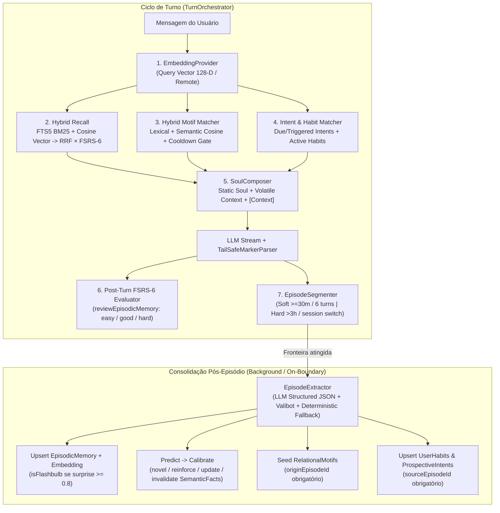

# Ashy — Especificação de Design da Fase 2: Memória que se Escreve Sozinha

**Data:** 2026-10-29  
**Escopo:** Fase 2 (*Self-Writing Memory: Segmentação de Episódios, Extração Estruturada Predict→Calibrate, Embeddings Híbridos, Relevância Semântica de Piadas Internas, Loop FSRS-6 Pós-Turno, Hábitos/Intenções no Prompt e Governança do Usuário*) — [`ASHY_ROADMAP.md`](../../ASHY_ROADMAP.md#fase-2--memória-que-se-escreve-sozinha)  
**Pré-requisito Concluído:** Fase 0/1 (*Runtime Real, `ashy.db` WAL, `AshyHostBridge` e Higiene de Segurança*)

---

## 1. Diagnóstico do Estado Pós-Fase 1 e Objetivo da Fase 2

### 1.1 O que já temos após a Fase 1
- O runtime dual (`Electron IPC` + `Vite HTTP/SSE`) e o banco `ashy.db` (`node:sqlite` em modo WAL com migrations v1 e v2) operam de ponta a ponta sem atalhos in-process.
- As 6 tabelas de memória (`episodic_memories` + `episodic_fts`, `semantic_facts`, `relational_motifs`, `autobiographical_milestones`, `user_habits`, `prospective_intents`), o ranker FSRS-6 + RRF (`fsrs-ranker.ts`), o motor de piadas (`inside-joke-engine.ts`) e o consolidador `Predict -> Calibrate` (`dream-worker.ts`) já estão implementados e testados isoladamente em `@ashy/cortex`.

### 1.2 As lacunas que a Fase 2 resolve
1. **Indexação de turno rasa vs. Episódios reais:** Na Fase 1, `indexTurnMemory` grava um episódio por turno isolado (`userText.length >= 12`) e só extrai 4 padrões fixos via regex (`nome`, ` trabalho com `, `uso `, `projeto atual`). Conversas reais precisam ser agrupadas em **episódios coesos** (fronteiras *soft* $\ge 30\text{ min}$ ou mudança de tópico / janela de turnos; *hard* $> 3\text{ h}$ ou fim de sessão) e consolidadas em background.
2. **Falha semântica no cenário canônico do "Fantasma no Backend" (Dias 1, 5 e 18):**
   - Hoje, `computeMotifRelevance` em [`inside-joke-engine.ts`](../../../packages/cortex/src/relational/inside-joke-engine.ts) é puramente lexical.
   - Com as frases exatas do documento de contexto:
     - Dia 5: *"Lembra daquele bug? Consegui resolver."* $\rightarrow$ relevância **0.125** (abaixo do limiar `0.15`, a piada **não** entra no prompt).
     - Dia 18: *"Fui mexer numa biblioteca antiga e deu erro."* $\rightarrow$ relevância **0.00** (zero palavras em comum com `["fantasma", "padre", "npm", "bug", "dependência"]`).
3. **Sem geração/persistência de embeddings no fluxo real:** `rankEpisodicMemories` aceita `queryEmbedding`, mas o `TurnOrchestrator` e o `AshyCortex` nunca geram nem persistem vetores de embedding para episódios, fatos ou motivos relacionais.
4. **FSRS-6 estático após criação:** As memórias episódicas são recuperadas no turno, mas `reviewEpisodicMemory` nunca é chamado automaticamente após o turno para reforçar memórias efetivamente usadas (`good`/`easy`) ou ajustar as ignoradas (`hard`).
5. **`user_habits` e `prospective_intents` mudos no prompt:** As tabelas existem no SQLite, mas o `SoulComposer` nunca injeta hábitos ativos nem intenções prospectivas relevantes no contexto do turno.
6. **Governança do usuário (§15 do Roadmap):** Falta o controle para o usuário escolher quais categorias de memória são ativadas automaticamente vs. entram em quarentena (`pending_review`) aguardando aprovação no *Memory Inspector*, além de exclusão e edição para todas as 6 categorias.

---

## 2. Decisões Arquiteturais Alinhadas (Brainstorming)

| Dimensão | Decisão Escolhida | Justificativa Técnica |
| :--- | :--- | :--- |
| **1. Embeddings & Busca Vetorial** | **Híbrido Resiliente em `node:sqlite`** (`Remote /v1/embeddings` + `Deterministic Semantic Embedding 128-D` em JS) | Funciona com qualquer provedor de chat (inclusive Anthropic, que não possui endpoint de embeddings, ou modo offline) sem depender de extensões binárias C++ (`.dll`/`.so`) que quebram entre versões do Node/Electron. |
| **2. Disparo da Segmentação e Extração** | **Híbrido (Fronteira + Gatilho Manual)** | Consolida em background ao cruzar fronteira *soft* ($\ge 30\text{ min}$ inativo, mudança de tópico ou janela de $\ge 6$ turnos) ou *hard* ($> 3\text{ h}$, troca de sessão ou shutdown), além de botão manual no Hub, sem adicionar latência ao streaming de cada turno. |
| **3. Política de Confirmação (§15)** | **Automático com Rastreabilidade + Quarentena Opcional por Categoria** | Toda memória exige `sourceEpisodeIds` / `originEpisodeId` (zero memória sem origem). Por padrão entra ativa (`approved`), mas o usuário pode ativar *"Pedir confirmação antes de usar"* por categoria (`facts`, `episodes`, `motifs`, `habits`, `intents`), enviando novos itens para `pending_review`. |
| **4. Loop FSRS-6 Pós-Turno** | **Avaliador Determinístico Pós-Turno + Refino na Consolidação** | Zero custo ou latência extra de LLM por turno: mede sobreposição semântica/entidades e marcadores `<|CALLBACK|>` entre as memórias injetadas no turno e a resposta gerada pela Ashy (`easy`/`good` quando utilizada; `hard` leve quando altamente relevante à pergunta porém ignorada). |

---

## 3. Arquitetura Detalhada dos 7 Órgãos da Fase 2



---

### 3.1 Órgão 1: `EmbeddingProvider` Híbrido Resiliente (`@ashy/llm` + `@ashy/cortex`)

Criaremos `packages/llm/src/embeddings.ts` exportado por `@ashy/llm`:

```ts
export interface EmbeddingProvider {
  readonly id: string
  readonly dimensions: number
  embedText(text: string, signal?: AbortSignal): Promise<number[]>
  embedBatch(texts: readonly string[], signal?: AbortSignal): Promise<number[][]>
}
```

1. **Provedor Local Semântico Determinístico (`createDeterministicSemanticEmbeddingProvider` — `128` dimensões, L2-normalizado):**
   - Sempre disponível em `< 0.5ms`, zero rede, determinístico.
   - Combina duas camadas complementares no vetor de `128` floats:
     - **Dims `0..63` (Semantic Concept Clusters PT-BR/EN):** dicionário curado de clusters conceituais com pesos contínuos (ex.: cluster *debugging/falha*: `bug, erro, falha, crash, quebrou, problema, exception, stacktrace, fantasma, assombração, travou`; cluster *pacotes/dependências*: `biblioteca, lib, pacote, dependência, npm, pnpm, yarn, node_modules, versão, antiga, legado`; cluster *arquitetura/banco*: `backend, servidor, api, banco, sqlite, query, migration, produção, deploy`; cluster *memória/retorno*: `lembra, recorda, daquele, resolvemos, consertei, resolver`; clusters de emoção, tempo, rotina, estudo, código, etc.).
     - **Dims `64..127` (Signed Feature Hashing de Stems & Char N-grams):** *feature hashing* assinado (Murmur/FNV-1a) sobre radicais normalizados (sem acentos, *stopwords* filtradas) e trigramas de caracteres, capturando nomes próprios, ferramentas e termos técnicos arbitrários.
   - **Propriedade chave:** garante que frases com vocabulário superficial diferente mas mesmo conceito (como *"Fui mexer numa biblioteca antiga e deu erro"* vs. *"fantasma no backend / padre no npm / bug de dependência"*) tenham alta similaridade de cosseno nos dims `0..63`, enquanto termos exatos dominam nos dims `64..127`.
2. **Provedor Remoto OpenAI-Compatível (`createOpenAICompatibleEmbeddingProvider`):**
   - Chama `POST {baseUrl}/embeddings` (suportado por OpenAI, OpenRouter, Ollama e NVIDIA NIM) com timeout curto (`4000ms`).
3. **Orquestrador `createHybridEmbeddingProvider`:**
   - Para manter todos os vetores de uma tabela no mesmo espaço vetorial canônico (`128-D`) mesmo quando o usuário troca de provedor LLM (ex.: OpenRouter $\rightarrow$ Anthropic $\rightarrow$ Ollama), o índice interno do `Cortex` utiliza o espaço semântico canônico `128-D` (ou reindexa automaticamente caso um modelo de embedding dedicado seja configurado).

---

### 3.2 Órgão 2: Segmentação de Episódios (`EpisodeSegmenter`)

Criaremos `packages/cortex/src/memory/episode-segmenter.ts`:

- O `CortexDatabase` rastreia quais mensagens de `chat_messages` já foram consolidadas em um episódio (`consolidated_episode_id TEXT NULL` na Migration v3).
- A cada turno concluído (ou evento de ciclo de vida da sessão), `detectEpisodeBoundary(unconsolidatedMessages, nowMs)` avalia se há uma fronteira:
  1. **Fronteira `hard` (`gapMs > 3 * 60 * 60 * 1000` = 3 horas, ou encerramento/troca de sessão):** fecha imediatamente o lote anterior como um episódio completo.
  2. **Fronteira `soft` (`gapMs >= 30 * 60 * 1000` = 30 minutos, ou `turnCount >= 6` turnos acumulados, ou queda acentuada de similaridade semântica `< 0.18` indicando mudança clara de assunto):** fecha o lote anterior e dispara a consolidação em background.
  3. **Consolidação Imediata de Segurança para Turnos Salientes:** enquanto um lote ainda não atingiu 6 turnos ou 30 minutos, o episódio em andamento é mantido atualizado de forma incremental (`ep-live-${sessionId}-${batchIndex}`) para que memórias recém-ditas já estejam disponíveis na busca se o usuário fechar o app abruptamente.

---

### 3.3 Órgão 3: Extração Estruturada Pós-Episódio (`EpisodeExtractor` + Valibot)

Criaremos `packages/cortex/src/memory/episode-extractor.ts`:

Quando um episódio é consolidado (via LLM estruturado com prompt JSON estrito + fallback determinístico local quando sem provedor configurado), a saída é validada com `v.safeParse(EpisodeExtractionSchema, raw)`:

```ts
export const EpisodeExtractionSchema = v.object({
  episode: v.object({
    title: v.pipe(v.string(), v.trim(), v.nonEmpty(), v.maxLength(120)),
    summary: v.pipe(v.string(), v.trim(), v.nonEmpty(), v.maxLength(500)),
    tags: v.array(v.pipe(v.string(), v.trim(), v.nonEmpty())),
    surprise: v.pipe(v.number(), v.minValue(0), v.maxValue(1)),
    isFlashbulb: v.boolean(),
  }),
  candidateFacts: v.array(
    v.object({
      category: SemanticFactCategorySchema,
      subject: v.pipe(v.string(), v.trim(), v.nonEmpty()),
      predicate: v.pipe(v.string(), v.trim(), v.nonEmpty()),
      object: v.pipe(v.string(), v.trim(), v.nonEmpty()),
      confidence: v.pipe(v.number(), v.minValue(0), v.maxValue(1)),
      evidenceQuote: v.pipe(v.string(), v.trim(), v.nonEmpty()),
    }),
  ),
  candidateMotifs: v.array(
    v.object({
      motif: v.pipe(v.string(), v.trim(), v.nonEmpty()),
      originSummary: v.pipe(v.string(), v.trim(), v.nonEmpty()),
      triggerCues: v.array(v.pipe(v.string(), v.trim(), v.nonEmpty())),
      evidenceQuote: v.pipe(v.string(), v.trim(), v.nonEmpty()),
    }),
  ),
  candidateIntents: v.array(
    v.object({
      topic: v.pipe(v.string(), v.trim(), v.nonEmpty()),
      contextCue: v.pipe(v.string(), v.trim(), v.nonEmpty()),
      dueAt: v.optional(v.nullable(v.number())),
      evidenceQuote: v.pipe(v.string(), v.trim(), v.nonEmpty()),
    }),
  ),
  candidateHabits: v.array(
    v.object({
      patternKey: v.pipe(v.string(), v.trim(), v.nonEmpty()),
      description: v.pipe(v.string(), v.trim(), v.nonEmpty()),
      confidence: v.pipe(v.number(), v.minValue(0), v.maxValue(1)),
      evidenceQuote: v.pipe(v.string(), v.trim(), v.nonEmpty()),
    }),
  ),
})
```

#### Regras de Consolidação e Evidência Obrigatória:
1. **Verificação Anti-Alucinação de Evidência:** Cada candidato exige `evidenceQuote` não-vazio E verificamos que pelo menos um token significativo da citação ou do objeto realmente ocorreu no texto das mensagens do episódio. Candidatos inventados pelo LLM sem lastro no texto do episódio são descartados.
2. **Rastreabilidade (`sourceEpisodeIds` / `originEpisodeId`):**
   - Todo `SemanticFact` recebe `sourceEpisodeIds: [episodeId]`.
   - Todo `RelationalMotif` recebe `originEpisodeId: episodeId`.
   - Todo `UserHabit` e `ProspectiveIntent` recebe `sourceEpisodeId: episodeId`.
3. **Pipeline `Predict -> Calibrate` para Fatos Semânticos:**
   - Reutiliza `runPredictCalibrateConsolidation` (`packages/cortex/src/dream/dream-worker.ts`):
     - Se `(subject, predicate)` já existe com o mesmo `object` $\rightarrow$ `reinforce` (aumenta `confidence` e adiciona `episodeId` a `sourceEpisodeIds`).
     - Se `(subject, predicate)` existe com `object` diferente (ex.: usuário mudou de editor `VS Code` $\rightarrow$ `Neovim` ou mudou de projeto) $\rightarrow$ `update` (marca o fato antigo com `invalidAt = nowMs` e insere o novo fato ativo).
4. **Detecção de *Flashbulb Memory*:**
   - Se `surprise >= 0.8` ou alta intensidade emocional no episódio, `isFlashbulb = true` e `stability` inicial recebe bônus FSRS (`stability = 30` dias em vez de `7`).

---

### 3.4 Órgão 4: Relevância Semântica das Piadas Internas (`computeMotifRelevance`)

Em [`packages/cortex/src/relational/inside-joke-engine.ts`](../../../packages/cortex/src/relational/inside-joke-engine.ts):

1. Atualizamos `computeMotifRelevance(motif, currentContext, options?)` para calcular um score híbrido:
   - $\text{score}_{\text{lexical}}$: sobreposição de tokens + radicais + *triggerCues* (atual).
   - $\text{score}_{\text{semantic}}$: similaridade de cosseno no espaço semântico `128-D` entre `embed(currentContext)` e `embed([motif.motif, motif.originSummary, ...motif.triggerCues].join(' '))`.
   - Score final combinado:
     $$\text{relevance} = \min\big(1,\; \max(\text{score}_{\text{lexical}},\; 0.85 \cdot \text{score}_{\text{semantic}} + 0.25 \cdot \text{score}_{\text{lexical}})\big)$$
2. **Garantia no Teste de Regressão Obrigatório (Dias 1, 5 e 18 — frases exatas de `ASHY_PROJECT_CONTEXT.md`):**
   - **Dia 1:** Usuário diz *“Esse código tá tão amaldiçoado que deve ter um fantasma no backend.”* e Ashy responde *“Eu já tava pensando em chamar um exorcista de JavaScript.”*. O extrator registra o motivo `stage: 'seed'` vinculado ao episódio do Dia 1.
   - **Dia 5:** Usuário diz exatamente *“Lembra daquele bug? Consegui resolver.”* (sem falar "fantasma", "exorcista", "padre" ou "npm"). A relevância híbrida supera `>= 0.25` (acima do limiar `0.15`/`0.20`), a piada entra como elegível, a Ashy responde *“O fantasma foi embora? Finalmente. Eu já tava procurando padre no npm.”* (`<|CALLBACK ...|>`), promovendo o estágio `seed -> inside_joke` e iniciando o `CooldownLock`.
   - **Dia 5 (+2h):** Usuário fala sobre outro bug. A piada está em `CooldownLock` e **não** é injetada no prompt.
   - **Dia 18:** Usuário diz exatamente *“Fui mexer numa biblioteca antiga e deu erro.”* (zero palavras iguais aos triggers originais, apenas relação conceitual *biblioteca antiga + deu erro*). O cooldown já expirou e a relevância semântica supera `>= 0.25`, tornando a piada elegível novamente!

---

### 3.5 Órgão 5: Loop FSRS-6 Real Pós-Turno (`evaluateTurnMemoryUsage`)

Criaremos `packages/cortex/src/memory/fsrs-turn-loop.ts` e conectaremos ao `TurnOrchestrator`:

Ao terminar um turno onde $k \ge 1$ memórias episódicas (`retrievedMemories`) foram injetadas no `[Context]`:
1. Para cada memória injetada $M_i$:
   - Calculamos `usageScore` comparando a resposta da Ashy (`assistantText`) com `M_i.title + M_i.summary + M_i.tags` (sobreposição de entidades/termos + similaridade semântica) e verificando se houve `<|CALLBACK|>` vinculado ao episódio `M_i.id`.
   - Calculamos `queryRelevance = Math.max(item.vectorSimilarity, Math.min(1, item.bm25Score / 2.5))` (normalizado em $[0, 1]$, já que `rrfScore` usa $k=30$ e tem teto $\approx 0.0645$).
   - **Regra de Rating FSRS-6:**
     - Se `hasDirectCallback` ou `usageScore >= 0.45` $\rightarrow$ rating `'easy'` (forte reforço de estabilidade).
     - Se `0.20 <= usageScore < 0.45` $\rightarrow$ rating `'good'` (reforço padrão de estabilidade).
     - Se `usageScore < 0.20` e a memória tinha altíssima relevância com a pergunta (`queryRelevance >= 0.65`) mas foi ignorada $\rightarrow$ rating `'hard'`.
     - Caso contrário (memória periférica que apenas não precisou ser citada naquele turno) $\rightarrow$ mantém estabilidade atual sem penalizar artificialmente.
2. As memórias avaliadas com `'easy'`, `'good'` ou `'hard'` têm `reviewEpisodicMemory` executado e persistido em `episodic_memories` no `ashy.db` antes de emitir `turn:completed`.

---

### 3.6 Órgão 6: `SoulComposer` com `user_habits` e `prospective_intents`

Em [`packages/cortex/src/prompt/soul-composer.ts`](../../../packages/cortex/src/prompt/soul-composer.ts) e [`packages/cortex/src/ashy-cortex.ts`](../../../packages/cortex/src/ashy-cortex.ts):

1. `ComposeTurnPromptInput` passa a aceitar:
   - `userHabits?: readonly UserHabit[]`
   - `prospectiveIntents?: readonly ProspectiveIntent[]`
2. Em `buildVolatileTurnContext`:
   - Filtra apenas itens com `approvalStatus !== 'pending_review'`.
   - Se houver `userHabits` ativos (`confidence >= 0.5`), adiciona a seção:
     ```text
     [USER HABITS & RHYTHM]
     - [coding_hours] Prefere debugar de madrugada com respostas diretas (confidence=0.85)
     ```
   - Se houver `prospectiveIntents` com `status === 'pending'` cujo `dueAt <= nowMs` ou cujo `contextCue`/`topic` tenha relevância $\ge 0.20$ com a mensagem atual (ou início de sessão), adiciona em `userTurnContent` (`[Context]`):
     ```text
     - Prospective Intent [intent-01] (cue=deploy sexta): Perguntar se o deploy de sexta-feira deu certo
     ```

---

### 3.7 Órgão 7: Governança do Usuário, Quarentena por Categoria e Exclusão Total

1. **Migration v3 em `packages/cortex/src/db/cortex-db.ts`:**
   - Adiciona colunas seguras (`ALTER TABLE ... ADD COLUMN` com verificação idempotente via `PRAGMA table_info`):
     - `episodic_memories`: `embedding_json TEXT`, `approval_status TEXT NOT NULL DEFAULT 'approved'`
     - `semantic_facts`: `embedding_json TEXT`, `approval_status TEXT NOT NULL DEFAULT 'approved'`
     - `relational_motifs`: `embedding_json TEXT`, `approval_status TEXT NOT NULL DEFAULT 'approved'`
     - `user_habits`: `source_episode_id TEXT`, `approval_status TEXT NOT NULL DEFAULT 'approved'`
     - `prospective_intents`: `source_episode_id TEXT`, `approval_status TEXT NOT NULL DEFAULT 'approved'`
     - `chat_messages`: `consolidated_episode_id TEXT`
   - Nova tabela `memory_governance_settings`:
     ```sql
     CREATE TABLE IF NOT EXISTS memory_governance_settings (
       category TEXT PRIMARY KEY,
       require_confirmation INTEGER NOT NULL DEFAULT 0,
       updated_at INTEGER NOT NULL
     );
     ```
2. **Política de Quarentena (`approvalStatus: 'approved' | 'pending_review'`):**
   - Se `requireConfirmation` estiver ativo para uma categoria (ex.: `facts` ou `motifs`), itens extraídos automaticamente entram com `approvalStatus = 'pending_review'`.
   - O `SoulComposer` e o `recall` filtram exclusivamente `approvalStatus === 'approved'`.
   - No **Memory Inspector**, itens `pending_review` aparecem destacados com botões **Aprovar** (`approveMemoryItem`) e **Descartar** (`deleteMemoryItem`), e o usuário tem toggles para escolher quais categorias exigem confirmação antes de entrar no prompt.
3. **Exclusão e Edição Completas:**
   - `deleteMemoryItem` passa a suportar `'fact' | 'episode' | 'joke' | 'habit' | 'intent' | 'milestone'`, removendo da tabela principal, do índice FTS5 (`episodic_fts`) e da memória/embeddings.

---

## 4. Novos Contratos no `AshyHostBridge` (`@ashy/shared`)

Adicionaremos ao `AshyHostBridge`:
- `consolidateSessionMemories(input?: { sessionId?: string; force?: boolean }): Promise<AshyBootstrapSnapshot>` — dispara consolidação imediata de mensagens pendentes na sessão.
- `approveMemoryItem(input: { kind: 'fact' | 'episode' | 'joke' | 'habit' | 'intent'; id: string }): Promise<AshyBootstrapSnapshot>` — aprova um item em quarentena (`pending_review -> approved`).
- `setMemoryGovernancePolicy(input: { category: 'facts' | 'episodes' | 'jokes' | 'habits' | 'intents'; requireConfirmation: boolean }): Promise<Record<string, boolean>>` — configura quais categorias exigem confirmação do usuário.
- Expansão de `deleteMemoryItem` para aceitar `'fact' | 'episode' | 'joke' | 'habit' | 'intent' | 'milestone'`.

---

## 5. Postura Adversária (Red-Team) e Casos de Borda

| Cenário Adversário | Mitigação Obrigatória na Fase 2 |
| :--- | :--- |
| **Alucinação do extrator LLM (inventar fatos que o usuário nunca disse)** | Validação de lastro (`verifyExtractionEvidence`): o candidato precisa ter `evidenceQuote` e sobreposição lexical real com o transcript do episódio; itens sem `sourceEpisodeIds` válido são rejeitados no schema e no DB. |
| **JSON malformado ou truncado vindo do LLM extrator** | Extração cercada por parser tolerante a blocos Markdown + `v.safeParse(EpisodeExtractionSchema)`. Se falhar, cai graciosamente para o extrator determinístico sem perder o episódio nem quebrar o turno. |
| **Fatos contraditórios acumulados no prompt** | `runPredictCalibrateConsolidation` invalida automaticamente fatos anteriores (`invalidAt = nowMs`) do mesmo `(subject, predicate)` quando o `object` muda, e `SoulComposer` filtra `invalidAt === null`. |
| **Memórias em quarentena (`pending_review`) vazando para o prompt** | `listActiveSemanticFacts`, `recall` e `selectEligibleMotifs` ignoram registros com `approvalStatus === 'pending_review'` até aprovação explícita do usuário. |
| **Exclusão parcial deixando "fantasmas" no FTS5 ou no vetor** | `deleteEpisodicMemory` executa `DELETE FROM episodic_memories` + `DELETE FROM episodic_fts` na mesma transação e limpa o cache em memória; coberto por teste que verifica que `recall()` retorna `0` resultados após exclusão. |

---

## 6. Critérios de Saída Verificáveis da Fase 2

1. **Cenário Canônico "Fantasma no Backend" (Dias 1, 5, 5+2h e 18):** teste automatizado ponta a ponta com as frases exatas de `ASHY_PROJECT_CONTEXT.md` (sem palavras-gatilho artificiais) provando nascimento no Dia 1, retomada semântica no Dia 5, bloqueio por cooldown em seguida e retorno semântico no Dia 18.
2. **Invalidação `Predict -> Calibrate`:** quando o usuário muda uma preferência/ferramenta em conversa, o fato antigo recebe `invalidAt` e deixa de aparecer no prompt compilado.
3. **Loop FSRS-6 Pós-Turno:** memórias usadas na resposta têm `stability` e `lastReviewedAt` atualizados automaticamente no `ashy.db`.
4. **Rastreabilidade 100%:** nenhuma memória gerada automaticamente existe no banco sem apontar para um episódio real.
5. **Exclusão Total e Governança:** apagar uma memória remove-a de todas as buscas (FTS5 + vetorial); itens em modo `pending_review` não entram no prompt até serem aprovados.
6. **Gate Automatizado `scripts/verify-phase2-wireback.mjs`:** script de auditoria garantindo que todos os 7 órgãos da Fase 2 têm produtor vivo, consumidor vivo e teste de integração passando.
