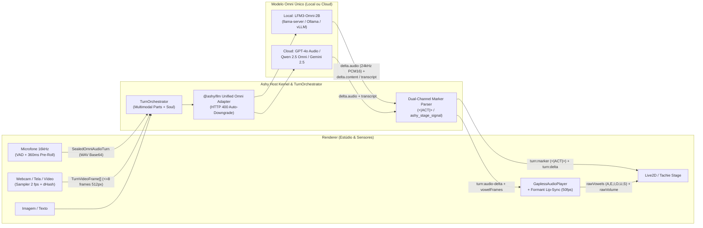

# Fase 8.7 — Arquitetura de Modelo Omni Unificado (Voz, Texto, Imagem e Vídeo Local & Cloud com Foco no `LFM3-Omni-2B`) — Design Specification

**Data:** 2026-10-30  
**Status:** Aguardando aprovação do Carlos  
**Escopo:** `@ashy/shared`, `@ashy/llm`, `@ashy/cortex`, `@ashy/voice`, `@ashy/agency`, `@ashy/desktop`  
**Subagentes Especialistas Consultados:**
- **Especialista 1 (`5a0f5fd6-a28a-424c-a71b-ecc4eb03cfd0`):** Especificações técnicas do `LFM3-Omni-2B` (Liquid AI) e contratos de inferência Omni Local (`llama-server`, `vLLM`, `SGLang`, `Ollama`) & Cloud (`GPT-4o Audio`, `Gemini 2.5 Flash`, `Qwen 2.5 Omni`).
- **Especialista 2 (`3d5de6aa-8ec5-48df-8fad-7cfcf60b5fd8`):** Protocolo `@ashy/shared`, Streaming Multimodal `@ashy/llm`, extração de marcadores `<|ACT|>`/`<|CALLBACK|>` sem vazamento na voz nativa e `TurnOrchestrator` (`kernel.ts`, `provider-vault.ts`).
- **Especialista 3 (`405619ce-ac73-48e1-bda5-4d01a4c015b2`):** Captura de Áudio Direto (`directOmniAudio`), Streaming de Áudio Nativo (`turn:audio-delta`) $\to$ `GaplessAudioPlayer` $\to$ Lip-Sync Acústico no Live2D, Amostrador de Vídeo (`2 fps` + `dHash`) e UI no Estúdio/Ajustes.

---

## 1. Objetivo e Visão Geral

Antes de iniciar a **Fase 9 (Empacotamento Nativo, Auto-Update e Onboarding de Produção)**, a Ashy passará a suportar um **Modo Omni Unificado (`unifiedOmniMode`)**, no qual **um único modelo** processa nativamente **Voz (Audio In + Audio Out), Texto, Imagem e Vídeo**, tanto **localmente** (com foco de primeira classe no **`LFM3-Omni-2B`** da Liquid AI) quanto em **provedores Cloud** (`OpenAI gpt-4o-audio-preview`, `Qwen 2.5 Omni 7B` via OpenRouter/Local, `Google Gemini 2.5 Flash`).

O sistema preserva 100% de compatibilidade com o pipeline modular clássico (`STT -> LLM -> TTS` da Fase 8.6) e permite alternar em 1 clique entre três modos de operação (`OmniExecutionMode`):

1. **`native-omni` (Full Unified Omni — Padrão para `LFM3-Omni-2B`, `gpt-4o-audio-preview`, `qwen2.5-omni-7b`)**:
   - **Entrada:** Áudio de microfone capturado pelo VAD (`16 kHz mono PCM16 WAV` com pré-rolagem de `360ms`) + Texto + Imagens + Vídeo (`2 fps` keyframes deduplicados por `dHash` + trilha de áudio opcional) vão **direto** para o modelo Omni em uma única requisição, **eliminando a latência de um STT intermediário**.
   - **Saída:** O modelo transmite simultaneamente **texto + sinais de palco (`<|ACT|>`)** e **chunks de áudio nativo (`turn:audio-delta` em `24 kHz PCM16/WAV`)** gerados pelo `LiquidCodec` (ou equivalente cloud), que alimentam diretamente o `GaplessAudioPlayer` e o analisador de formantes (`analyzePcmFrameToVowels`) para animar o lip-sync do Live2D em tempo real, **sem precisar de TTS externo**.
2. **`hybrid-omni-in` (Percepção Omni + TTS Externo — Padrão para `gemini-2.5-flash` ou servidores que retornam apenas texto via REST)**:
   - **Entrada:** O modelo único recebe nativamente **Áudio (`input_audio`) + Imagem + Vídeo (`2 fps`) + Texto**.
   - **Saída:** O modelo transmite texto + `<|ACT|>` em streaming e o `RealtimeSpeechPipeline` sintetiza a voz via provedor TTS configurado (Kokoro Local, ElevenLabs, OpenAI TTS).
   - *Resiliência automática:* Se um endpoint configurado como `native-omni` rejeitar `modalities: ["text", "audio"]` com HTTP 400 ou responder apenas com texto, o `TurnOrchestrator` faz **auto-downgrade transparente** para `hybrid-omni-in` no mesmo turno sem falhar.
3. **`modular` (Pipeline Clássico — Fase 8.6)**:
   - Mantém o fluxo separado `STT -> LLM -> TTS` para modelos puramente textuais/visuais tradicionais.

---

## 2. Perfil Técnico do Modelo Local Foco: `LFM3-Omni-2B` (Liquid AI)

- **Arquitetura (2.17B parâmetros totais):**
  - Backbone tri-híbrido LFM3 de `1.73B` (`24` camadas: `13` convoluções curtas *gated* `kernel=7`, `5` camadas de atenção *sliding-window* `window=256`, `6` camadas de atenção global com *partial RoPE*), janela de contexto de **32.768 tokens** e KV cache ~65% menor que um Transformer 2B convencional.
  - Encoder visual LFM3 (imagens + vídeo nativo a **2 fps**) + encoder de áudio causal (**16 kHz** PCM16/WAV) + tokenizador acústico **LiquidCodec** (**24 kHz** speech output, ~80ms por 12 tokens discretos, suporte nativo a `pt-BR` e `en-US` com perfis `female` e `male`) + suporte a **Tool Calling multimodal**.
- **Particularidade Crítica de Inferência (`Non-Reasoning`):**
  - O `LFM3-Omni-2B` não é um modelo de raciocínio em cadeia longa; seu chat template inicializa um bloco `<think></think>` vazio quando o modo thinking não é desabilitado.
  - Portanto, o adaptador `@ashy/llm` deve injetar automaticamente `think: false` e `chat_template_kwargs: { enable_thinking: false }` (e parâmetros de áudio `temperature: 0.1`, `audio_temperature: 0.4`, `audio_repetition_penalty: 1.2`) sempre que detectar a família `lfm3-omni` / `lfm3-audio`.
- **Pegada de Memória & Quantizações Recomendadas:**
  - `Q4_K_M` + `mmproj-Q8_0.gguf`: **~1.77 GB** de VRAM/RAM (roda com folga em GPUs de 4 GB, Apple Silicon M1–M4 ou iGPUs modernas).
  - `Q8_0` + `mmproj-F16.gguf`: **~3.05 GB** de VRAM (alta fidelidade de prosódia em `pt-BR`).

---

## 3. Arquitetura Detalhada por Subsistema

### 3.1 Protocolo e Contratos (`packages/shared/src/host-protocol.ts`)
1. **Modos e Metadados Omni no Catálogo de Modelos:**
   - Adicionar `OMNI_EXECUTION_MODES = ['modular', 'hybrid-omni-in', 'native-omni'] as const` e `OMNI_MODALITY_KINDS = ['text', 'audio', 'image', 'video'] as const`.
   - Estender `ProviderModelCatalogItemSchema` e `PublicProviderConfigSchema` com:
     - `isOmniModel?: boolean`
     - `inputModalities?: OmniModalityKind[]`
     - `outputModalities?: OmniModalityKind[]`
     - `supportsOmniAudioIn?: boolean`
     - `supportsOmniAudioOut?: boolean`
     - `supportsOmniVideoIn?: boolean`
     - `omniExecutionMode?: OmniExecutionMode`
     - `omniVoiceId?: string` (ex.: `'female'` para `LFM3-Omni-2B`, `'coral'` / `'nova'` para OpenAI, `'Cherry'` para Qwen-Omni).
   - Registrar presets de primeira classe em `FALLBACK_PROVIDER_MODELS`:
     - `ollama`: `lfm3-omni:2b`, `LiquidAI/LFM3-Omni-2B-GGUF`, `qwen2.5-omni:7b`.
     - `openai`: `gpt-4o-audio-preview`, `gpt-4o-mini-audio-preview`.
     - `openrouter`: `qwen/qwen2.5-omni-7b`, `openai/gpt-4o-audio-preview`, `google/gemini-2.5-flash`.
   - Exportar helper `inferModelOmniCapabilities(providerId, modelId)` para detecção automática em catálogos dinâmicos.
2. **Input Multimodal no Turno (`SendTurnInputSchema`):**
   - `TurnInputAudioSchema`: `{ dataBase64 (max 8MB), format: 'wav' | 'pcm16', sampleRate?: number, durationMs?: number, transcriptHint?: string }`.
   - `TurnVideoFrameSchema`: `{ dataUrl (JPEG/PNG/WebP base64 max 1.5MB), timestampMs: number, width?: number, height?: number, source?: 'screen' | 'camera' | 'clip', dHashHex?: string }`.
   - `TurnAttachmentSchema`: `{ id?: string, kind: 'image' | 'audio' | 'video', mimeType: string, dataUrlOrBase64: string, name?: string, width?: number, height?: number, durationMs?: number }`.
   - Tornar `text` opcional (`default: ''`) em `SendTurnInputSchema`, validando via `v.check(...)` que pelo menos um entre `text`, `inputAudio`, `videoFrames` (máx. 16) ou `attachments` (máx. 8) esteja presente.
3. **Eventos de Streaming Nativo (`AshyHostStreamEvent`):**
   - `turn:input-transcript`: `{ type: 'turn:input-transcript', turnId, sessionId, userMessageId, transcript, isFinal, source: 'omni-native' | 'stt-preflight' | 'wav-metadata' }`.
   - `turn:audio-delta`: `{ type: 'turn:audio-delta', turnId, sessionId, seq, audioBase64, format: 'pcm16' | 'wav', sampleRate, durationMs, transcriptDelta?, vowelFrames? }`.

### 3.2 Adaptador Multimodal Unificado (`packages/llm/src/stream-text.ts` & `adapters.ts`)
1. **Partes Multimodais (`ChatMessageContentPart`):**
   - Manter `content: string` obrigatório em `ChatMessage` (zero quebra em consumidores existentes) e adicionar `parts?: ReadonlyArray<ChatMessageContentPart>` suportando `text`, `image_url`, `input_audio` e `video_frame`.
   - Em `serializeOpenAIMessages`:
     - Serializar `input_audio` como `{ type: 'input_audio', input_audio: { data, format } }`.
     - Serializar `image_url` como `{ type: 'image_url', image_url: { url, detail: 'auto' } }`.
     - Serializar `video_frame` como sequência ordenada de `{ type: 'text', text: '[Video Frame @ Xms]' }` + `{ type: 'image_url', image_url: { url, detail: 'low' } }` (compatível universalmente com `LFM3-Omni-2B` a 2fps no `llama-server`/`Ollama`/`vLLM`, `OpenAI`, `Qwen-Omni` e `Gemini`).
2. **Parâmetros de Saída de Áudio & Quirks do `LFM3-Omni-2B`:**
   - Quando `request.modalities?.includes('audio')`:
     - Enviar `modalities: ['text', 'audio']` e `audio: { voice, format: 'pcm16' }`.
     - Se o modelo for `LFM3-Omni-2B` / `LFM3-Audio-2B`, injetar `think: false`, `chat_template_kwargs: { enable_thinking: false }`, `audio_temperature: 0.4`, `audio_repetition_penalty: 1.2`.
     - **Auto-Downgrade em HTTP 400/422:** Se o servidor rejeitar `modalities` ou `audio`, remover esses campos automaticamente e repetir a chamada uma única vez (caindo graciosamente para `hybrid-omni-in` com TTS fallback).
3. **Parser SSE de `delta.audio` e `input_transcript`:**
   - Extrair `choice.delta.audio.{ data, transcript, format, sample_rate }` e `message.audio`, emitindo eventos `{ type: 'audio-delta', ... }` e `{ type: 'text-delta', text: transcript }` (quando `delta.content` não vier duplicado no mesmo chunk).

### 3.3 Preservação da Alma e Sinais `<|ACT|>` sem Vazamento na Voz Nativa (`@ashy/cortex` & `TurnOrchestrator`)
Para impedir que um modelo Omni em modo `native-omni` pronuncie literalmente `"less than pipe ACT..."` no áudio sintetizado:
1. **Diretiva de Prompt (`soul-composer.ts`):** Quando `omniOutputMode === 'native-audio'`, adicionar diretiva explícita para emitir marcadores `<|ACT|>`/`<|CALLBACK|>` apenas no canal textual silencioso ou via tool call `ashy_stage_signal`, nunca verbalizando as tags no fluxo de áudio.
2. **Parser Dual-Channel (`turn-orchestrator.ts`):** Passar tanto `text-delta` quanto `audio-delta.transcriptDelta` pelo `createTailSafeMarkerParser` para capturar qualquer `<|ACT|>`, `<|DELAY|>` ou `<|CALLBACK|>` e emitir `turn:marker` + `turn:delta` limpo para a UI, além de registrar a tool interna `ashy_stage_signal`.
3. **Extração de `vowelFrames` no Host:** Ao receber cada `audio-delta` (`PCM16` ou `WAV`), decodificar as amostras float32 e calcular os envelopes de formantes (`extractPcmFrameVowelWeights`) anexando `vowelFrames` ao evento `turn:audio-delta`.

### 3.4 Áudio Direto (`directOmniAudio`), Vídeo `2 fps` & Lip-Sync no Live2D (`@ashy/voice`, `omni-media-sampler.ts`, `useAshyStore.ts`, `App.tsx`)
1. **`VoiceSessionRuntime` (`packages/voice/src/voice-session-runtime.ts`):**
   - Adicionar `directOmniAudio?: boolean` e `onOmniAudioTurnReady?: (turn: SealedOmniAudioTurn) => void`.
   - Quando `directOmniAudio === true`, o `ingestPcmBlock` mantém a pré-rolagem de `360ms` (`HistoryLease`), o filtro de cliques curtos (`< 300ms`), o Barge-In automático e a proteção CAS entre pausas curtas, mas ao selar o turno codifica os blocos acumulados diretamente em `16 kHz mono PCM16 WAV` (`wavBase64`) e dispara `onOmniAudioTurnReady` sem passar por STT externo.
   - Adicionar `ingestOmniAudioDelta(...)` e `computeOmniPlaybackReceipt(...)` para agendar chunks `turn:audio-delta` no `GaplessAudioPlayer` e calcular `heardText`/`unheardText` exatos em caso de Barge-In.
2. **Amostrador de Vídeo e Imagem (`apps/desktop/src/services/omni-media-sampler.ts`):**
   - **Webcam ao Vivo (`createLiveWebcamSampler`) e Tela (`captureAuthorizedScreen`):** Amostragem na taxa nativa do `LFM3-Omni-2B` (**2 fps**, janela deslizante de até `8` quadros = 4s), redimensionados para `<= 512x512` JPEG (`quality: 0.75`) e deduplicados por **64-bit dHash** (descartando quadros estáticos com distância de Hamming `<= 4`).
   - **Upload de Vídeo (`.mp4`/`.webm`) e Imagem:** Extrai de `2` a `8` keyframes uniformemente espaçados (`<= 768px` JPEG).
   - **Integração com `PrivacyController`:** `activateFullPrivacyShield()` (`Alt+E` / `Pausar sensores`) encerra imediatamente as tracks da webcam (`track.stop()`), limpa os buffers visuais e registra auditoria no `ActionGatekeeper`.
3. **UI no Estúdio e Ajustes (`App.tsx` & `ModelsSettingsPanel.tsx`):**
   - **Estúdio (`Companhia`):**
     - Pill `⚡ Omni Unificado (LFM3-Omni-2B)` (`data-testid="pill-toggle-omni-mode"`) na barra superior do palco.
     - Botão de Webcam ao vivo (`data-testid="btn-toggle-webcam"`) com miniatura PiP (`data-testid="studio-webcam-pip"`) no dock de voz.
     - Botões de anexar **Imagem** (`data-testid="btn-attach-image"`), **Vídeo** (`data-testid="btn-attach-video"`) e **Webcam** (`data-testid="btn-composer-webcam"`) com faixa de pré-visualização (`data-testid="composer-media-attachments"`) no composer do chat.
   - **Ajustes (`Modelos` & `Voz`):**
     - Card **Modo Omni Unificado (1 Único Modelo: Voz + Texto + Imagem + Vídeo)** (`data-testid="unified-omni-settings-card"`) com toggle mestre (`data-testid="toggle-unified-omni-mode"`) e 4 presets de 1 clique:
       - `LFM3-Omni-2B (Local · Recomendado)` (`data-testid="preset-omni-lfm3-local"`)
       - `GPT-4o Audio (OpenAI Cloud)` (`data-testid="preset-omni-gpt4o"`)
       - `Qwen 2.5 Omni 7B (Local / Cloud)` (`data-testid="preset-omni-qwen"`)
       - `Gemini 2.5 Flash (Cloud Omni)` (`data-testid="preset-omni-gemini"`)
     - Toggle **"Áudio Direto para o Modelo Omni (Pular STT/TTS Externo)"** (`data-testid="toggle-direct-omni-audio"`) em `Ajustes > Voz`.

---

## 4. Segurança, Tratamento de Erros e Limites Adversariais

1. **Limites de Payload Anti-DoS:**
   - Elevar `MAX_RPC_BODY_BYTES` em `vite-host-plugin.ts` para `20 * 1024 * 1024` (20 MB) para acomodar turnos combinados de áudio + quadros de vídeo, mantendo limites estritos por campo no Valibot (`inputAudio.dataBase64` máx. `8_000_000` chars; `videoFrames` máx. `16` quadros de `1_500_000` chars cada; validação estrita de prefixo `data:image/(jpeg|png|webp);base64,`).
2. **Degradação Graciosa Tripla:**
   - Se o modelo Omni responder sem `audio-delta` (somente texto), a store aciona automaticamente o TTS configurado (`autoSpeakReplies`) para que a Ashy nunca fique muda.
   - Se o endpoint rejeitar `modalities: ["text", "audio"]` com HTTP 400, o `@ashy/llm` refaz a chamada apenas com `text` transparentemente.
   - Se `getUserMedia({ video: true })` for negado ou indisponível, a UI informa o erro em `voiceRuntimeError` sem afetar o turno de voz/texto.
3. **Privacidade:**
   - Captura de tela e webcam respeitam `privacyState.eyesMode` e são imediatamente cortadas pelo `activateFullPrivacyShield()`.

---

## 5. Estratégia de Testes (TDD & Adversarial)

1. **`@ashy/shared` (`host-protocol.test.ts`):** Validação de `SendTurnInputSchema` (texto vazio permitido com `inputAudio` ou `videoFrames`, rejeitado quando tudo está vazio; bloqueio de `videoFrames` com MIME inválido ou excesso de quadros), `inferModelOmniCapabilities` para `lfm3-omni-2b` e eventos `turn:audio-delta` / `turn:input-transcript`.
2. **`@ashy/llm` (`llm-omni.test.ts`):** Serialização de `input_audio`, `image_url` e `video_frame` em `serializeOpenAIMessages`; injeção de `think: false` e hiperparâmetros de áudio para `LFM3-Omni-2B`; parser SSE de `delta.audio` + `input_transcript`; auto-retry em HTTP 400 quando `modalities: ["text", "audio"]` não é suportado.
3. **`@ashy/voice` (`voice-omni.test.ts`):** Modo `directOmniAudio: true` preservando pré-rolagem de `360ms` e proteção CAS entre pausas antes de emitir `onOmniAudioTurnReady`; decodificação de `turn:audio-delta` (`24kHz PCM16` e `WAV`) no `GaplessAudioPlayer` com extração de vogais e recibo de Barge-In (`computeOmniPlaybackReceipt`).
4. **`@ashy/desktop` (`phase-8-7-unified-omni-model.test.tsx`):** Fluxo ponta a ponta com `LFM3-Omni-2B` (envio de turno com `inputAudio` + `videoFrames` -> recebimento de `turn:input-transcript`, `turn:marker` `<|ACT|>` e `turn:audio-delta` -> animação de `simulatedVowels` / `activeViseme` no Live2D -> Barge-In no meio do áudio nativo -> UI de presets Omni e amostrador de vídeo/webcam).
